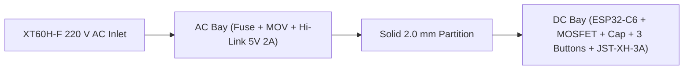

# 3D Modeling & CAD Guidelines

This directory contains the CAD models (OpenSCAD sources, STL, and Bambu Studio 3MF projects) for the `csiGarland` holiday figurines and mounting hardware.

---

## 1. Dimensional Specifications

### 1.1 LED Breakout Board Pocket
* **Measured Board Dimensions:** 
  * Circular arc diameter: **Ø9.50 mm**.
  * Distance between parallel flat chords: **9.05 mm**.
  * PCB substrate thickness: **1.25 mm** (total height with 5050 LED + capacitor: ~2.85 mm).
  * Solder pads: 6 oblong pads on the **underside / back** (Input: 5V, Din, GND; Output: 5V, Vout, GND).
* **Keyed Bore & Lip** (`base_mount.scad`):
  * The board goes up into the cup from below, pads down, through a keyed bore: **Ø9.80 mm** (+0.30 mm for PETG shrinkage) with flats **9.35 mm** apart that stop it turning.
  * It stops under a **0.60 mm** lip at the neck top, whose opening of **Ø8.30 mm** clears the 5050 chip ($r = 3.54\text{ mm}$) and capacitor ($r = 3.70\text{ mm}$) by 0.45 mm. The board's top is 0.60 mm under the neck top, 0.45 mm lower than in the one-piece base of 1.4.0. As the garland hangs, the neck points down and the board rests on the lip.
  * **Wire wells:** beside the bore at ±X, as wide as the cable channel (6.00 mm) and reaching $r = 6.10\text{ mm}$, from the plug up to the board's back. Each takes the three wires of one side of the board on their way down from the pads, up to 2.0 mm each; the neck wall outside them is 0.80 mm.

### 1.2 Cable Channel & Potting
* **Wire Specification:** 3-conductor flat ribbon (1.27 mm pitch) or flexible silicone wire. The channel takes three wires side by side of up to 2.0 mm outside, which is meant for 20 AWG silicone wire; check the outer diameter of yours. How to choose: [Garland cable](../docs/guides/hardware.md#garland-cable).
* **Side Channel Dimensions:** **6.00 mm (W) × 2.00 mm (H)** along X through the flange, as in the one-piece base. In the cup it is open below; the cable lies on the plug, which closes it.
* **Assembly Method:** the garland is soldered and tested on the bench first. Each board's wires are bent down at its edge, the cup is lowered over the board from above until the board meets the lip, and the wires lie in the wells and the channel. With the cup upside down, potting compound or hot glue poured onto the board's back holds it and its joints, so that a pull on the cable never reaches the pads; the plug snaps in last. Nothing is threaded, and nothing is soldered inside a part. Press the board onto the lip before the compound goes in, so that none runs past its rim onto the LED, and keep the compound under the channel.

### 1.3 Base Mount & Snap Socket
* **Two Parts:** the base mount is [`base_mount.scad`](base_mount.scad): the **cup** ([`base_cup.stl`](base_cup.stl)), which is the flange and the neck, open from below; and the **plug** ([`base_plug.stl`](base_plug.stl)), the floor. Together they are the shape of the one-piece base of 1.4.0: Ø17.60 mm flange (4.40 mm tall) + Ø13.80 mm neck (5.00 mm tall) with a Ø14.40 mm snap ridge; total height 9.40 mm. Every cap printed for 1.4.0 fits it.
* **The Fit, in One Place:** the neck, the ridge, the flange and the socket's gaps are in [`base_interface.scad`](base_interface.scad), which `base_mount.scad` and every `figurine_*.scad` include, so the base and the caps cannot drift apart. Every cap is printed to those numbers: change one, and the caps change with it.
* **Plug Snap:** the plug is the base's 1.20 mm floor with its rounded edge, and the seam runs where that rounding ends. Two lugs at ±Y, clear of the cable, 0.90 × 5.00 × 2.40 mm, go up into pockets in the flange; a **0.30 mm** bead on each clicks into a groove, engaging 0.20 mm past the lug's 0.10 mm clearance. If the click is too stiff or too loose, adjust `lug_bead` or `lug_gap` (±0.05 mm).
* **Cap Socket:** Ø14.00 mm bore with a Ø14.75 mm snap groove; socket depth is **5.30 mm**, i.e. **0.30 mm axial clearance** over the neck top, so the cap seats on the base flange and the ridge engages even if the socket-ceiling bridge sags.
* **LED Clearance:** every cap clears the 5050 LED chip ($r = 3.54\text{ mm}$ half-diagonal) and capacitor ($r = 3.70\text{ mm}$), which stand **1.20 mm** proud of the neck top: the hollows of the bell, tree, icicles, snowman, gingerbread man and lantern are at least **r = 4.2 mm** wide up to that height, the pinecone's chamber starts at **r = 4.2 mm**, and the star has an **Ø8.8 mm (r = 4.4 mm) × 2.2 mm** clearance pocket with a 45° roof. The space above the socket does not let the board go higher for every cap: the star's pocket and the pinecone's chamber are narrower than the board.
* **Calibration:** print one cup, one plug and one cap first; if the cap's snap is too tight or too loose, adjust `snap_ridge_dia` (±0.1 mm) or `neck_socket_gap`.

### 1.4 Figurine Envelopes
* **Overall Height:** 45.7–49.0 mm (50 mm height class).
* **Collar Diameter:** Ø17.60 mm, flush with the base mount flange.
* **Wall Thickness:** the bell, tree, icicles, snowman, gingerbread man and lantern are even shells of 1.50 mm (3 perimeters), their hollow the outline eroded by the wall, built with [`figurine_shell.scad`](figurine_shell.scad): a solid given as a radius round the axis, or as eroded spheres, ellipsoids and frustums gathered along rays from the axis, made into a hollow whose ceilings, as the cap prints, stay 35° from the horizontal or steeper. A flatter ceiling inside a closed hollow takes tree supports that can never be taken out; Bambu Studio put such supports inside the released snowman, gingerbread man and bell. The star is an even 1.20 mm shell normal to its facets (`star_wall` in `figurine_star.scad`), about 3 perimeters in plan. The pinecone keeps its solid overlapping scales.

---

## 2. Figurine Collection

For high-resolution previews, individual visual breakdowns, and Bambu Studio print parameters, see the comprehensive [Optical Diffuser Figurine Catalog](../docs/hardware/diffusers.md), which also gives the order of the figurines along the cable. The table numbers the designs, not that order. Each model's `c_cap` is its filament's colour in the renders, which `deploy/new-model-renders.ps1` makes after a change to a model.

All 8 holiday figurines print collar-down in translucent PETG and hang with the universal snap-fit base mount at the top (cord running overhead). Every figurine but the bell prints with tree supports. They hold the socket ceiling inside the collar, which sags into strings unsupported, and on the snowman (nose, hands), gingerbread (arms), pinecone (scale undersides) and the two lower star points they also carry those overhangs. The bell has no socket ceiling and no surface flatter than 35°, and Bambu Studio slices it with no support at all:

| # | Figurine Name | SCAD Source | STL File | Style & Geometry |
|---|---|---|---|---|
| 1 | **Spiral Pine with Trunk** | `figurine_tree.scad` | `diffuser_cap_tree.stl` | 4-tier spiral tree with a triangular outline: narrow top at the base mount, stepped tiers widening downward, and a slim trunk at the bottom (48.0 mm) |
| 2 | **3D Magen David** | `figurine_star.scad` | `diffuser_cap_star.stl` | 6-pointed faceted Star of David, completely sealed closed shell (49.0 mm) |
| 3 | **Icicle Cluster** | `figurine_icicle.scad` | `diffuser_cap_icicle.stl` | 5-stalactite organic cluster with freezing meltwater ripples (48.0 mm) |
| 4 | **Hanging Pinecone** | `figurine_pinecone.scad` | `diffuser_cap_pinecone.stl` | Inverted pinecone with stem at base, shingled checkerboard scales layering down (45.7 mm) |
| 5 | **Holiday Bell** | `figurine_bell.scad` | `diffuser_cap_bell.stl` | Classic church bell: rounded crown shoulder, straight waist, flare to a thick rolled lip, and a clapper peeking out of the mouth (49.0 mm) |
| 6 | **Cozy Snowman** | `figurine_snowman.scad` | `diffuser_cap_snowman.stl` | Inverted snowman with pom-pom/beanie at base, carrot nose, scarf, and round belly with ball-hands (47.6 mm) |
| 7 | **Gingerbread Man** | `figurine_gingerbread.scad` | `diffuser_cap_gingerbread.stl` | Baker's cap at base, 3D bow tie, welcoming hug arms with icing cuffs, gumdrop buttons, and legs (47.9 mm) |
| 8 | **Vintage Lantern** | `figurine_lantern.scad` | `diffuser_cap_lantern.stl` | Hexagonal pagoda canopy at base, 6 fluted columns, diamond-faceted crystal panes, and acorn finial (47.5 mm) |

---

## 3. Bambu Studio Print Profiles

[`csigarland_full_set.3mf`](csigarland_full_set.3mf) is a ready Bambu Studio project, saved in 02.09, for the whole garland
(32 caps + 32 base mounts) on a **Bambu Lab P2S, 0.4 mm nozzle, Textured PEI Plate**. It holds 9 plates with
exactly one filament per plate, so no filament changes happen during a print and a single 4-slot AMS is enough;
print the plates one by one ("Print plate") and map the plate's filament to the loaded AMS slot.

| Plate | Content | Filament | Plate-specific settings |
|---|---|---|---|
| 1 | Tree ×4 | PETG Translucent Olive | tree supports |
| 2 | Star ×4 | PETG Translucent Light Blue | tree supports |
| 3 | Icicle ×4 | PETG Clear | tree supports |
| 4 | Pinecone ×4 | PETG Translucent Brown | tree supports, 0.16 mm layers |
| 5 | Bell ×4 | PETG Translucent Teal | tree supports (none are made) |
| 6 | Snowman ×4 | PETG Clear | tree supports, 0.16 mm layers |
| 7 | Gingerbread ×4 | PETG Translucent Orange | tree supports, 0.16 mm layers |
| 8 | Lantern ×4 | PETG Translucent Gray | tree supports |
| 9 | Base cup ×32 + base plug ×32 | PETG Basic Green | 4 walls, 100% zig-zag infill, no brim, no support |

**Plate 9** holds four rows of [`base_cup.stl`](base_cup.stl), standing on its open bottom, and four
rows of [`base_plug.stl`](base_plug.stl), floor down, eight to a row at a 25.6 mm pitch. Neither needs
support: the cup's channel, wells and lug pockets end under bridges of 1.2 to 6 mm, and its lip
overhangs 0.75 mm. The plate was rebuilt from the two STLs outside the slicer, and its pictures
were drawn by Bambu Studio 02.09 when it sliced the plate from the command line.

* **Process:** `0.20mm Standard @BBL P2S` with 3 walls, 0% sparse infill (hollow translucent shells),
  6 top layers, 3 mm outer brim (0.15 mm gap), prime tower off, elephant-foot compensation 0.15 mm.
* **Wall generator: Arachne** (`wall_generator = arachne`), where the preset has classic. A 1.5 mm shell is a ring with a wall on each side, the outline's and the hollow's, and the classic generator's four lines need about 1.6 mm: where the shell runs a little under that, as round the gingerbread man's head at 16-19 mm, the snowman's body and the bell's clapper, it broke the inner lines into short pieces with gap fill between them, which print as a ring of beads that shows through the PETG. All six gingerbread men of the first print had two such rings on the head. Arachne draws the lines in variable width and keeps them whole, and the set prints faster with it.
* **Seams:** at the back (`seam_position = back`), the +Y side of each figurine as it stands on the plate,
  which is the side opposite the snowman's and the gingerbread man's faces: turn a cap on its base so
  that side faces the wall. Every wall's seam is a scarf joint (`seam_slope_type = all`, contours and
  holes, inner walls too), which overrides the filament presets' own setting of none
  (`override_filament_scarf_seam_setting`). Aligned seams had wandered across the front of the round
  caps, and translucent PETG shows every seam, the inner ones as well. The scarf joints cost about
  2.8 h over the set.
* **Supports** (plates 1–8): tree (auto), threshold 30°, not limited to the build plate, 0.2 mm top/bottom Z distance.
* **Filament presets:** `Bambu PETG Translucent @BBL P2S 0.4 nozzle`, its nozzle at 250 °C for the
  first layer as the preset has it and 240 °C after it, where the preset has 245 °C: the first caps
  printed at 245 °C left many fine strings, and at 240 °C the supports also come away more easily.
  `Bambu PETG Basic @BBL P2S 0.4 nozzle` as it comes, 245 °C for the first layer and 250 °C after;
  plate 70 °C.
* **Estimate (Bambu Studio 02.09):** ~21.1 h in total, the preparation of each plate included (~20.1 h of printing), ~207 g of translucent PETG + ~38 g of PETG Basic, of which plate 9 takes 2 h 50 min.
* Re-export the project after changing any SCAD source; the plate colours in the file are approximate,
  sync them with the AMS if you want exact swatches.

---

## 4. Control Unit Enclosure Specifications & Printable Models

The main control unit houses the Hi-Link isolated power supply, the ESP32-C6-LCD-1.3 controller, the YZ_CTL_V1 MOSFET power switch, three tactile buttons and the external connectors. Full description: [`docs/hardware/control-unit.md`](../docs/hardware/control-unit.md), sections 7–8.

### 4.1 Enclosure Parts & STL Files

| Part / Model | SCAD Source | STL File | Dimensions (mm) | Purpose & Features |
|---|---|---|---|---|
| **Enclosure Base** | `control_enclosure.scad` (`view_mode="base"`) | [`enclosure_base.stl`](enclosure_base.stl) | 122.0 × 68.0 × 32.0 | Tub with AC/DC partition, Hi-Link bay, XT60H-F sleeve, fuse and MOV cradles, 4 ESP32 posts, 3 button pedestals, MOSFET and capacitor cradles, JST-XH sleeve, 4× M3 bosses, raised wall labels |
| **Enclosure Lid** | `control_enclosure.scad` (`view_mode="lid"`) | [`enclosure_lid.stl`](enclosure_lid.stl) | 122.0 × 68.0 × 3.0 plate (+2.5 lip, +ribs/posts) | Control panel with the 23.6 × 23.6 mm LCD window (bevelled towards the glass) and front stop lip, 3× Ø12.2 mm button holes, recesses for the colour inlays, engraved `220V~ INSIDE`, Hi-Link retaining ribs (2.6 mm), connector hold-down posts (XT60 15.8 mm, JST 16.4 mm), 4× corner posts (Ø8.4 mm) with M3 heat-set inserts in their tips |
| **White Inlay** | `control_enclosure.scad` (`view_mode="inlay_white"`) | [`enclosure_inlay_white.stl`](enclosure_inlay_white.stl) | 0.4 mm thick | Flush inlay: logo `csi`, labels `POWER` and `SPEED` |
| **Sky-Blue Inlay** | `control_enclosure.scad` (`view_mode="inlay_blue"`) | [`enclosure_inlay_blue.stl`](enclosure_inlay_blue.stl) | 0.4 mm thick | Flush inlay: logo `Garland`, label `EFFECT` |
| **Print Project** | — | [`csigarland_control_enclosure.3mf`](csigarland_control_enclosure.3mf) | 256 × 256 plate | Bambu Studio project for P2S Combo: base + lid on one plate, PLA Basic black/white/sky blue, all print settings included |

Test coupons (print before the full parts): `view_mode="test_xt60"`, `"test_jst"`, `"test_lcd"`.
Preview with component mock-ups: `view_mode="assembled"`.

### 4.2 Component Bays & Mounting Architecture
* **Lid posts:** four Ø8.4 mm posts at the corners of the lid, with flared roots (+3 mm over 6 mm) under the plate, reach down to 1.0 mm pads on the base floor; the screws go in from the bottom, so the panel stays clean.
* **AC Bay (left, x 2.5–62 mm):**
  * **Hi-Link HLK-10M05B:** 47.5 × 28.5 mm bay with four 10 mm L-shaped corner guides, resting on 4 × 4 mm shoulders 4.0 mm above the floor (pin plenum). Two 2.6 mm lid ribs end 0.9 mm above the nominal module top.
  * **XT60H-F Power Inlet (220 V AC):** open-top 16.6 × 9.4 mm sleeve, 16 mm deep, 15.8 × 8.8 mm outer bezel stop, backstop rib with wire slot, lid hold-down post. **[The enclosure is designed around it, but do not buy it for this: it has no approval for mains](../docs/hardware/control-unit.md#1-power-inlet-amass-xt60h-f-female-with-sheath-left-wall).**
  * **Fuse & MOV:** cradle for an enclosed 5×20 mm fuse holder (`fuse_holder` parameter) and an edge-on slot for the 10D471K disc.
  * **No openings** in the floor or walls of the AC bay except the inlet itself.
* **DC Bay (right, x 64–119.5 mm):**
  * **ESP32-C6-LCD-1.3:** screwed through its 4 M2 standoffs (pitch 22.55 × 25.50 mm, measured) to four posts (Ø7 mm top, Ø10 mm lower body with gussets along Y), M2 × 10 screws driven from below through Ø4.4 mm bores, with a solid 7 mm top above the bore. LCD glass ends 1.0 mm behind the panel.
  * **Three Button Pedestals:** 15 × 16 mm pillars with a 12.2 × 13.0 mm guide well (legs on the front and back sides). The switch rests on a single 5 mm rib across the middle; the leg/solder wells on both sides are open through the front and back faces for the flying leads. The seat is 2 mm lower than the nominal 12 mm stack needs (Z = 22.75 mm), so real switches with caps let the lid close.
  * **YZ_CTL_V1 MOSFET Cradle:** flat latch cradle next to the partition.
  * **Filter Capacitor:** horizontal snap saddle for an Ø8 × 12 electrolytic (measured 8.2 × 12.3 mm: 100 µF / 50 V in the prototype).
  * **JST-XH-3A Garland Outlet:** flush 10.2 × 6.0 mm window/sleeve with backstop; the header is pushed in from outside after soldering, then fixed with a drop of hot glue.
  * **DC wires** from the Hi-Link pass through a 12 × 6 mm opening at the foot of the partition.
  * **USB-C:** not brought out; firmware updates are OTA.
* **Labels:** flush 0.4 mm (two layers) colour inlays on the panel — logo `csi` (white) + `Garland` (sky blue) in the csiPass 5×7 pixel face (same glyph table and 6-cell pitch as the csiPass wordmark, 0.85 mm cells, 50.2 × 6.0 mm), `POWER` and `SPEED` (white), `EFFECT` (sky blue) — synthetic narrow bold (Liberation Sans Bold 3.4 mm, squeezed to 72 % in X, outline grown 0.12 mm, spacing 1.25): ~0.70 mm strokes and 0.5 mm between letters, so the first layer prints every stroke; `220V~ INSIDE` engraved 0.6 mm without colour at the front of the AC bay; `AC 220V~` and `LED OUT` raised 0.6 mm on the side walls.

### 4.3 Printing Guidelines
* **Ready Project:** [`csigarland_control_enclosure.3mf`](csigarland_control_enclosure.3mf) — Bambu Lab P2S Combo (AMS), 0.4 mm nozzle, Textured PEI, `0.20mm Standard @BBL P2S` with 6 walls, 5 top / 4 bottom layers, 20% gyroid, tree supports from the build plate only, no brim, prime tower on. Filaments: 1 = PLA Basic Black (body), 2 = PLA Basic White, 3 = PLA Basic Sky Blue (inlays). Both parts on one plate: about 3.7 h and 113 g (Bambu Studio 02.09 estimate, ~3.6 h of printing). First-layer safeguards for the inlays: the first layer prints black first, then sky blue, then white (`first_layer_print_sequence` 1-3-2), so the inlays fill finished recesses instead of standing as loose islands the nozzle can catch during the filament changes; avoid crossing walls on; first-layer travel acceleration 3000 mm/s²; elephant-foot compensation off; a single first-layer wall. The first print showed the recesses shifted diagonally by ~1.4 mm against the layer-1 inlays — the CoreXY signature of a skipped motor step after the first-layer colour change (the file itself places the inlays exactly); colour changes happen only in the first two lid layers (4 changes, the prime tower stops at 0.4 mm). The swatch colours are approximate — sync them with the AMS.
* **Material:** PLA Basic is used for this unit. The shell holds mains wiring and PLA is not flame-retardant; a UL94 V-0 filament (e.g. Bambu PC FR) is the safer choice if you reprint it.
* **Orientation:**
  * `enclosure_base.stl`: floor on the plate (Z=0), with the tree supports from the build plate above.
  * `enclosure_lid.stl` + inlays: panel face down on the textured PEI plate, with the same supports; the inlays fill their recesses in the first two layers (0.4 mm).
* **Button Caps:** standard factory round snap-on caps (head Ø11.5 mm, total height with the switch 12.0 mm) — no 3D printing required.
* **Fasteners:**
  * 4× **M3 heat-set inserts**, M3 × 5.7 mm, OD 4.6 mm, melted into the tips of the four lid posts (Ø4.0 × 6.5 mm holes, 0.4 mm lead-in chamfer, Ø3.2 × 2.0 mm relief above). Adjust `insert_d` / `insert_len` for other inserts.
  * 4× **M3 × 6 button-head hex screws** (ISO 7380, head Ø5.4 × 2.0 mm) from the **bottom**: Ø6.0 × 2.0 mm counterbores in the base pads, heads flush with the underside; M3 × 6 engages about 4.4 mm of the insert (M3 × 5: 3.4 mm). The panel has no screw holes.
  * 4× M2 × 10 screws for the ESP32 board, 4× Ø8 mm rubber feet.
