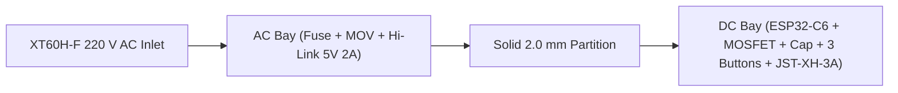

# 3D Modeling & CAD Guidelines

This directory contains the CAD models (STEP, STL, and Bambu Studio 3MF projects) for the `csiGarland` holiday figurines and mounting hardware.

---

## 1. Dimensional Specifications

### 1.1 LED Breakout Board Pocket
* **Measured Board Dimensions:** 
  * Circular arc diameter: **Ø9.50 mm**.
  * Distance between parallel flat chords: **9.05 mm**.
  * PCB substrate thickness: **1.25 mm** (total height with 5050 LED + capacitor: ~2.85 mm).
  * Solder pads: 6 oblong pads on the **underside / back** (Input: 5V, Din, GND; Output: 5V, Vout, GND).
* **CAD Anti-Rotation Pocket & Soldering Well:** 
  * Socket arc diameter: **Ø9.80 mm** (+0.30 mm tolerance for PETG shrinkage).
  * Flat-to-flat width: **9.35 mm** (keyed anti-rotation profile matching board chords).
  * Seating depth: **1.40 mm** at the top of the neck (board top sits 0.15 mm below the neck top).
  * Soldering well: **Ø9.80 mm × 6.00 mm** keyed slot under the board, open down to the wire channel; the board rests on the two flat-chord ledges, all 6 back pads stay inside the well.
  * Solid floor: **1.20 mm** solid PETG bottom across the entire base (completely sealed, zero through-holes).

### 1.2 Cable Entry & Hot-Glue Potting Bay
* **Wire Specification:** 3-conductor flat ribbon (1.27 mm pitch) or flexible silicone wire. The channel takes three wires side by side of up to 2.0 mm outside, which is meant for 20 AWG silicone wire; check the outer diameter of yours. How to choose: [Garland cable](../docs/guides/hardware.md#garland-cable).
* **Side Channel Dimensions:** **6.00 mm (W) × 2.00 mm (H)** running horizontally through the base.
* **Assembly Method:** Wires are threaded through the side slots into the open central well, soldered to the back pads, pulled taut to seat the board flush onto its perimeter shelf, and then potted/sealed with hot glue injected directly into the side channels. Zero external pull tension reaches the solder pads.

### 1.3 Base Mount & Snap Socket
* **Base Mount:** Ø17.60 mm flange (4.40 mm tall) + Ø13.80 mm neck (5.00 mm tall) with a Ø14.40 mm snap ridge; total height 9.40 mm.
* **Cap Socket:** Ø14.00 mm bore with a Ø14.75 mm snap groove; socket depth is **5.30 mm**, i.e. **0.30 mm axial clearance** over the neck top, so the cap seats on the base flange and the ridge engages even if the socket-ceiling bridge sags.
* **LED Clearance:** every cap clears the 5050 LED chip ($r = 3.54\text{ mm}$ half-diagonal) and capacitor ($r = 3.70\text{ mm}$), which stand **1.65 mm** proud of the neck top: the wide-chamber caps start at **r = 4.2–5.5 mm** and taper above the board, while the narrow-neck star and gingerbread caps have an **Ø8.8 mm (r = 4.4 mm) × 2.2 mm** clearance pocket with a 45° roof.
* **Calibration:** print one base + one cap first; if the snap is too tight or too loose, adjust `snap_ridge_dia` (±0.1 mm) or `neck_socket_gap`.

### 1.4 Figurine Envelopes
* **Overall Height:** 45.7–49.0 mm (50 mm height class).
* **Collar Diameter:** Ø17.60 mm, flush with the base mount flange.
* **Wall Thickness:** minimum 1.40–1.50 mm (3–4 perimeter loops with a 0.4 mm nozzle), but for the star: an even 1.20 mm shell normal to its facets (`star_wall` in `figurine_star.scad`), about 3 perimeters in plan.

---

## 2. Figurine Collection

For high-resolution previews, individual visual breakdowns, and Bambu Studio print parameters, see the comprehensive [Optical Diffuser Figurine Catalog](../docs/hardware/diffusers.md), which also gives the order of the figurines along the cable. The table numbers the designs, not that order. Each model's `c_cap` is its filament's colour in the renders, which `deploy/new-model-renders.ps1` makes after a change to a model.

All 8 holiday figurines print collar-down in translucent PETG and hang with the universal snap-fit base mount at the top (cord running overhead). Every figurine prints with tree supports. They hold the socket ceiling inside the collar, which sags into strings unsupported, and on the snowman (nose, hands), gingerbread (arms), pinecone (scale undersides) and the two lower star points they also carry those overhangs:

| # | Figurine Name | SCAD Source | STL File | Style & Geometry |
|---|---|---|---|---|
| 1 | **Spiral Pine with Trunk** | `figurine_tree.scad` | `diffuser_cap_tree.stl` | 4-tier spiral tree with a triangular outline: narrow top at the base mount, stepped tiers widening downward, and a slim trunk at the bottom (48.0 mm) |
| 2 | **3D Magen David** | `figurine_star.scad` | `diffuser_cap_star.stl` | 6-pointed faceted Star of David, completely sealed closed shell (49.0 mm) |
| 3 | **Icicle Cluster** | `figurine_icicle.scad` | `diffuser_cap_icicle.stl` | 5-stalactite organic cluster with freezing meltwater ripples (48.0 mm) |
| 4 | **Hanging Pinecone** | `figurine_pinecone.scad` | `diffuser_cap_pinecone.stl` | Inverted pinecone with stem at base, shingled checkerboard scales layering down (45.7 mm) |
| 5 | **Holiday Bell** | `figurine_bell.scad` | `diffuser_cap_bell.stl` | Flared trumpet bell with clapper, rolled lip, and ribbon bow at crown (48.0 mm) |
| 6 | **Cozy Snowman** | `figurine_snowman.scad` | `diffuser_cap_snowman.stl` | Inverted snowman with pom-pom/beanie at base, carrot nose, scarf, and round belly with ball-hands (47.6 mm) |
| 7 | **Gingerbread Man** | `figurine_gingerbread.scad` | `diffuser_cap_gingerbread.stl` | Baker's cap at base, 3D bow tie, welcoming hug arms with icing cuffs, gumdrop buttons, and legs (47.9 mm) |
| 8 | **Vintage Lantern** | `figurine_lantern.scad` | `diffuser_cap_lantern.stl` | Hexagonal pagoda canopy at base, 6 fluted columns, diamond-faceted crystal panes, and acorn finial (47.5 mm) |

---

## 3. Bambu Studio Print Profiles

[`csigarland_full_set.3mf`](csigarland_full_set.3mf) is a ready Bambu Studio 02.08 project for the whole garland
(32 caps + 32 base mounts) on a **Bambu Lab P2S, 0.4 mm nozzle, Textured PEI Plate**. It holds 9 plates with
exactly one filament per plate, so no filament changes happen during a print and a single 4-slot AMS is enough;
print the plates one by one ("Print plate") and map the plate's filament to the loaded AMS slot.

| Plate | Content | Filament | Plate-specific settings |
|---|---|---|---|
| 1 | Tree ×4 | PETG Translucent Olive | tree supports |
| 2 | Star ×4 | PETG Translucent Light Blue | tree supports |
| 3 | Icicle ×4 | PETG Clear | tree supports |
| 4 | Pinecone ×4 | PETG Translucent Brown | tree supports, 0.16 mm layers |
| 5 | Bell ×4 | PETG Translucent Teal | tree supports |
| 6 | Snowman ×4 | PETG Clear | tree supports, 0.16 mm layers |
| 7 | Gingerbread ×4 | PETG Translucent Orange | tree supports, 0.16 mm layers |
| 8 | Lantern ×4 | PETG Translucent Gray | tree supports |
| 9 | Base mount ×32 | PETG Basic Pine Green | 4 walls, 100% zig-zag infill, no brim |

* **Process:** `0.20mm Standard @BBL P2S` with 3 walls, 0% sparse infill (hollow translucent shells),
  6 top layers, 3 mm outer brim (0.15 mm gap), prime tower off, elephant-foot compensation 0.15 mm.
* **Supports** (plates 1–8): tree (auto), threshold 30°, not limited to the build plate, 0.2 mm top/bottom Z distance.
* **Filament presets:** `Bambu PETG Translucent @BBL P2S 0.4 nozzle` (245 °C) and
  `Bambu PETG Basic @BBL P2S 0.4 nozzle` (250 °C); plate 70 °C.
* **Estimate (Bambu Studio):** ~17.8 h in total, ~214 g of translucent PETG + ~47 g of PETG Basic.
* Re-export the project after changing any SCAD source; the plate colours in the file are approximate,
  sync them with the AMS if you want exact swatches.

---

## 4. Control Unit Enclosure Specifications & Printable Models

The main control unit houses the Hi-Link isolated power supply, the ESP32-C6-LCD-1.3 controller, the YZ_CTL_V1 MOSFET power switch, three tactile buttons and the external connectors. Full description: [`docs/hardware/control-unit.md`](../docs/hardware/control-unit.md), sections 7–8.

### 4.1 Enclosure Parts & STL Files

| Part / Model | SCAD Source | STL File | Dimensions (mm) | Purpose & Features |
|---|---|---|---|---|
| **Enclosure Base** | `control_enclosure.scad` (`view_mode="base"`) | [`enclosure_base.stl`](enclosure_base.stl) | 122.0 × 68.0 × 32.0 | Tub with AC/DC partition, Hi-Link bay, XT60H-F sleeve, fuse and MOV cradles, 4 ESP32 posts, 3 button pedestals, MOSFET and capacitor cradles, JST-XH sleeve, 4× M3 bosses, raised wall labels |
| **Enclosure Lid** | `control_enclosure.scad` (`view_mode="lid"`) | [`enclosure_lid.stl`](enclosure_lid.stl) | 122.0 × 68.0 × 3.0 plate (+2.5 lip, +ribs/posts) | Control panel with the 23.6 × 23.6 mm LCD window (bevelled towards the glass) and front stop lip, 3× Ø12.2 mm button holes, recesses for the colour inlays, engraved `220V~ INSIDE`, Hi-Link retaining ribs (2.6 mm), connector hold-down posts (XT60 15.8 mm, JST 16.4 mm), 4× corner posts (Ø8.4 mm) with M3 heat-set inserts in their tips |
| **White Inlay** | `control_enclosure.scad` (`view_mode="inlay_white"`) | [`enclosure_inlay_white.stl`](enclosure_inlay_white.stl) | 0.4 mm thick | Flush inlay: logo `csi`, labels `POWER` and `SPEED` |
| **Sky-Blue Inlay** | `control_enclosure.scad` (`view_mode="inlay_blue"`) | [`enclosure_inlay_blue.stl`](enclosure_inlay_blue.stl) | 0.4 mm thick | Flush inlay: logo `Garland`, label `EFFECT` |
| **Print Project** | — | [`csigarland_control_enclosure.3mf`](csigarland_control_enclosure.3mf) | 256 × 256 plate | Bambu Studio project for P2S Combo: base + lid on one plate, PLA Basic black/white/sky blue, all print settings included |

Test coupons (print before the full parts): `view_mode="test_xt60"`, `"test_jst"`, `"test_lcd"`.
Preview with component mock-ups: `view_mode="assembled"`.

### 4.2 Component Bays & Mounting Architecture
* **Lid posts:** four Ø8.4 mm posts at the corners of the lid, with flared roots (+3 mm over 6 mm) under the plate, reach down to 1.0 mm pads on the base floor; the screws go in from the bottom, so the panel stays clean.
* **AC Bay (left, x 2.5–62 mm):**
  * **Hi-Link HLK-10M05B:** 47.5 × 28.5 mm bay with four 10 mm L-shaped corner guides, resting on 4 × 4 mm shoulders 4.0 mm above the floor (pin plenum). Two 2.6 mm lid ribs end 0.9 mm above the nominal module top.
  * **XT60H-F Power Inlet (220 V AC):** open-top 16.6 × 9.4 mm sleeve, 16 mm deep, 15.8 × 8.8 mm outer bezel stop, backstop rib with wire slot, lid hold-down post. **[The enclosure is designed around it, but do not buy it for this: it has no approval for mains](../docs/hardware/control-unit.md#1-power-inlet-amass-xt60h-f-female-with-sheath-left-wall).**
  * **Fuse & MOV:** cradle for an enclosed 5×20 mm fuse holder (`fuse_holder` parameter) and an edge-on slot for the 10D471K disc.
  * **No openings** in the floor or walls of the AC bay except the inlet itself.
* **DC Bay (right, x 64–119.5 mm):**
  * **ESP32-C6-LCD-1.3:** screwed through its 4 M2 standoffs (pitch 22.55 × 25.50 mm, measured) to four posts (Ø7 mm top, Ø10 mm lower body with gussets along Y), M2 × 10 screws driven from below through Ø4.4 mm bores, with a solid 7 mm top above the bore. LCD glass ends 1.0 mm behind the panel.
  * **Three Button Pedestals:** 15 × 16 mm pillars with a 12.2 × 13.0 mm guide well (legs on the front and back sides). The switch rests on a single 5 mm rib across the middle; the leg/solder wells on both sides are open through the front and back faces for the flying leads. The seat is 2 mm lower than the nominal 12 mm stack needs (Z = 22.75 mm), so real switches with caps let the lid close.
  * **YZ_CTL_V1 MOSFET Cradle:** flat latch cradle next to the partition.
  * **Filter Capacitor:** horizontal snap saddle for an Ø8 × 12 electrolytic (measured 8.2 × 12.3 mm: 100 µF / 50 V in the prototype).
  * **JST-XH-3A Garland Outlet:** flush 10.2 × 6.0 mm window/sleeve with backstop; the header is pushed in from outside after soldering, then fixed with a drop of hot glue.
  * **DC wires** from the Hi-Link pass through a 12 × 6 mm opening at the foot of the partition.
  * **USB-C:** not brought out; firmware updates are OTA.
* **Labels:** flush 0.4 mm (two layers) colour inlays on the panel — logo `csi` (white) + `Garland` (sky blue) in the csiPass 5×7 pixel face (same glyph table and 6-cell pitch as the csiPass wordmark, 0.85 mm cells, 50.2 × 6.0 mm), `POWER` and `SPEED` (white), `EFFECT` (sky blue) — synthetic narrow bold (Liberation Sans Bold 3.4 mm, squeezed to 72 % in X, outline grown 0.12 mm, spacing 1.25): ~0.70 mm strokes and 0.5 mm between letters, so the first layer prints every stroke; `220V~ INSIDE` engraved 0.6 mm without colour at the front of the AC bay; `AC 220V~` and `LED OUT` raised 0.6 mm on the side walls.

### 4.3 Printing Guidelines
* **Ready Project:** [`csigarland_control_enclosure.3mf`](csigarland_control_enclosure.3mf) — Bambu Lab P2S Combo (AMS), 0.4 mm nozzle, Textured PEI, `0.20mm Standard @BBL P2S` with 6 walls, 5 top / 4 bottom layers, 20% gyroid, no supports, no brim, prime tower on. Filaments: 1 = PLA Basic Black (body), 2 = PLA Basic White, 3 = PLA Basic Sky Blue (inlays). Both parts on one plate: about 3 h and 103 g (Bambu Studio estimate). First-layer safeguards for the inlays: the first layer prints black first, then sky blue, then white (`first_layer_print_sequence` 1-3-2), so the inlays fill finished recesses instead of standing as loose islands the nozzle can catch during the filament changes; avoid crossing walls on; first-layer travel acceleration 3000 mm/s²; elephant-foot compensation off; a single first-layer wall. The first print showed the recesses shifted diagonally by ~1.4 mm against the layer-1 inlays — the CoreXY signature of a skipped motor step after the first-layer colour change (the file itself places the inlays exactly); colour changes happen only in the first two lid layers (4 changes, the prime tower stops at 0.4 mm). The swatch colours are approximate — sync them with the AMS.
* **Material:** PLA Basic is used for this unit. The shell holds mains wiring and PLA is not flame-retardant; a UL94 V-0 filament (e.g. Bambu PC FR) is the safer choice if you reprint it.
* **Orientation:**
  * `enclosure_base.stl`: floor on the plate (Z=0), no supports (only short bridges over the connector windows and post bores).
  * `enclosure_lid.stl` + inlays: panel face down on the textured PEI plate, no supports; the inlays fill their recesses in the first two layers (0.4 mm).
* **Button Caps:** standard factory round snap-on caps (head Ø11.5 mm, total height with the switch 12.0 mm) — no 3D printing required.
* **Fasteners:**
  * 4× **M3 heat-set inserts**, M3 × 5.7 mm, OD 4.6 mm, melted into the tips of the four lid posts (Ø4.0 × 6.5 mm holes, 0.4 mm lead-in chamfer, Ø3.2 × 2.0 mm relief above). Adjust `insert_d` / `insert_len` for other inserts.
  * 4× **M3 × 6 button-head hex screws** (ISO 7380, head Ø5.4 × 2.0 mm) from the **bottom**: Ø6.0 × 2.0 mm counterbores in the base pads, heads flush with the underside; M3 × 6 engages about 4.4 mm of the insert (M3 × 5: 3.4 mm). The panel has no screw holes.
  * 4× M2 × 10 screws for the ESP32 board, 4× Ø8 mm rubber feet.
