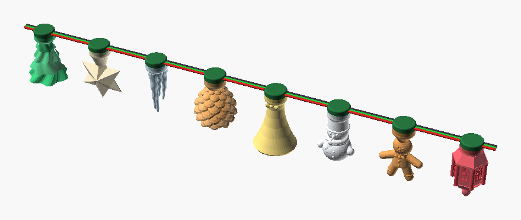
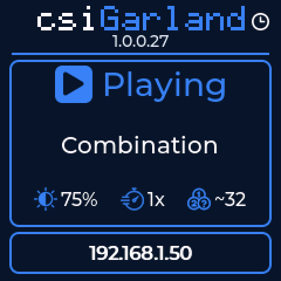
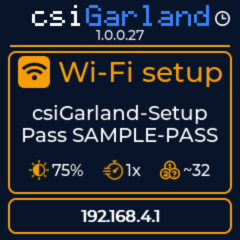
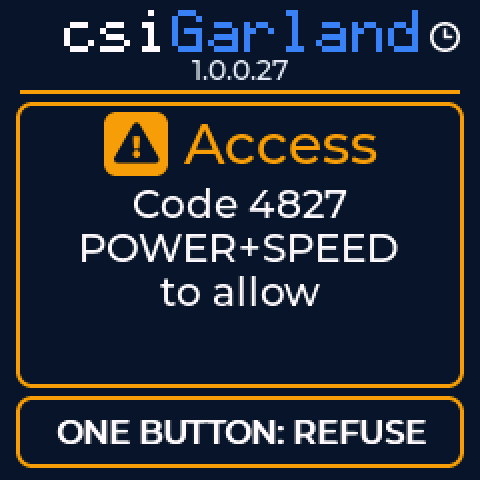
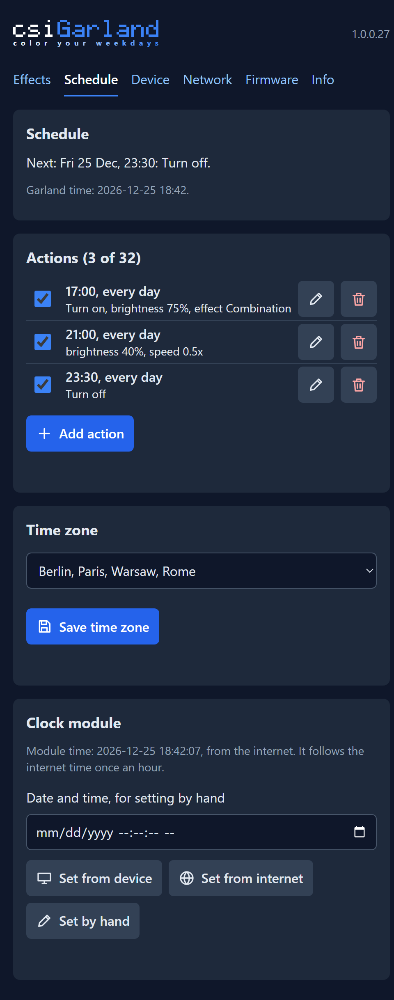
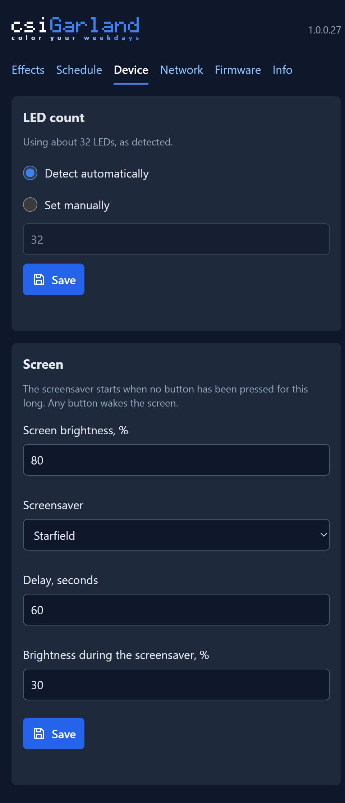
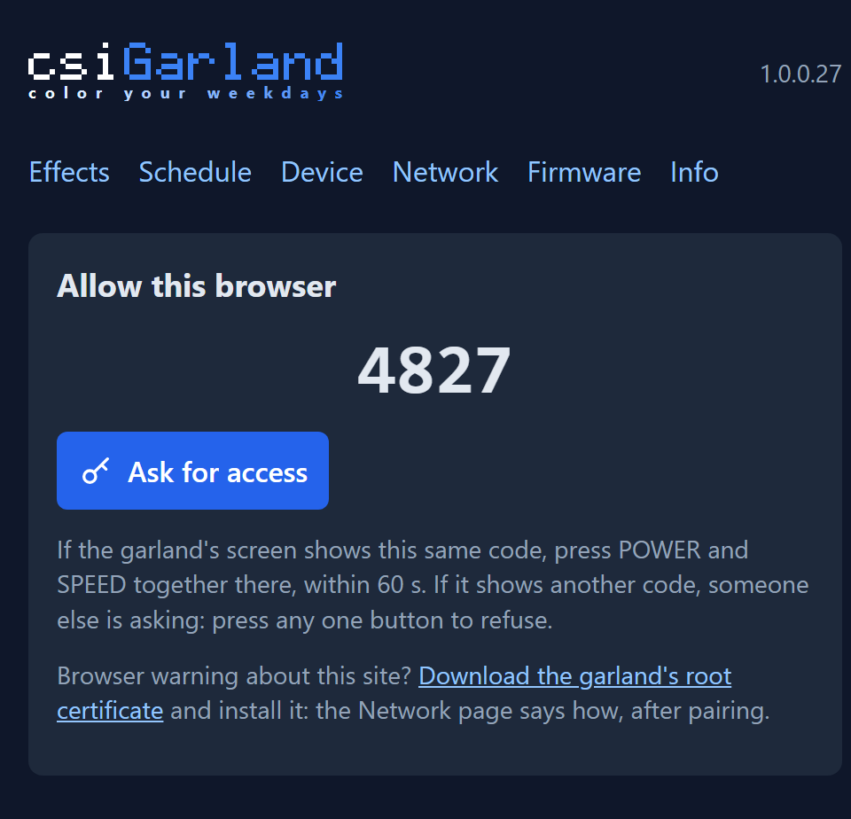

<div align="center">

# csiGarland

*Color your weekdays. Any day can be a holiday.*

**An open-source Christmas garland you build yourself: 32 glowing 3D-printed figurines, 154 effects, three buttons, a small screen and a web portal.**

[](LICENSE)
[](https://github.com/ABespalov/csigarland/actions/workflows/build-and-test.yml)
[](https://github.com/ABespalov/csigarland/releases)

**[garland.csilab.am](https://garland.csilab.am)** · [Downloads](https://garland.csilab.am/downloads.html) · [Roadmap](https://garland.csilab.am/roadmap.html) · [Documents](https://garland.csilab.am/documents.html)



<sub>The eight figurines as designed, a render of the 3D models. Four copies of each make the garland.</sub>

</div>

> **Status: not released yet.** The firmware builds and passes its host tests, and much of it runs on a prototype. What has been seen working on real hardware and what has not is listed in the [roadmap](docs/stubs/ROADMAP.md), and the measurements still to make are in the [to-do list](docs/stubs/TODO.md). No build is published on [Releases](https://github.com/ABespalov/csigarland/releases) yet.

## What It Is

Each figurine is a hollow shell of translucent PETG with one addressable LED inside, so it glows as a whole rather than showing a point of light. A small controller box with a screen runs the garland on its own, with no app, account or internet needed.

* **It stands alone.** Buttons, screen, effects and the schedule all work with no network and no browser.
* **154 effects from 98 algorithms,** in eight groups, from the eight modes of a classic garland controller to fireworks and aurora. They live in a pack of their own, and you can [write your own](docs/guides/effects.md#6-effect-file) as small JSON files and upload up to 32.
* **A web portal over HTTPS,** served by the garland itself: play and pick favourites, set brightness and speed, keep a schedule of up to 32 actions, join your Wi-Fi.
* **No passwords.** A browser asks for access, the browser and the screen show the same code, and you press two buttons on the garland.
* **Safe updates over Wi-Fi.** Every update is signed under your own root key. A new firmware proves itself on its first start, and the board goes back to the previous one if it does not.
* **Careful with power.** Software holds the LEDs to 1400 mA of the 2000 mA supply, and in standby a MOSFET cuts their power rail.

## See It

The pictures come from the firmware's own drawing code and the portal's real pages, with sample data, through [`deploy/new-doc-images.ps1`](deploy/new-doc-images.ps1).

| The screen | | |
|---|---|---|
| <br>Playing | <br>Joining Wi-Fi | <br>A browser asks for access |

| The portal | | |
|---|---|---|
| <br>Schedule | <br>Device | <br>Pairing |

More of them, with what each does, are in the [User Guide](docs/guides/user-guide.md#8-portal-pages).

## What You Need

| Part | Used here | Purpose |
|---|---|---|
| Controller | [ESP32-C6-LCD-1.3](docs/hardware/specification.md) (Waveshare) | 160 MHz RISC-V with Wi-Fi 6 and a 1.3" 240×240 IPS screen |
| LEDs | 32× WS2812B on 9×9×2.5 mm boards | One inside each figurine. The firmware takes chains of up to 256 |
| Power supply | Hi-Link HLK-10M05B, 5 V 2 A | Isolated, from mains |
| Power switch | YZ_CTL_V1 high-side MOSFET module | Cuts the LED rail in standby |
| Buttons | 3× momentary push buttons | POWER, EFFECT and SPEED, each with a click and a long press |
| Figurines and enclosure | 3D-printed, [models included](3d-model/) | Translucent PETG for the figurines, set up for Bambu Lab printers |
| Optional | DS3231 clock module | Keeps the schedule's time through a power cut with no internet |

> **Mains voltage is dangerous, and a printed enclosure is your own responsibility.** Do not buy the XT60H for the mains inlet: it has no approval for mains, though the enclosure is designed around it. Read [Building the Hardware](docs/guides/hardware.md) before you build one.

## Quick Start

On Windows with PowerShell 7.2 or later, [PlatformIO Core](https://docs.platformio.org/en/latest/core/installation/) and Git. **Read [Building a Fork and the First Flash](docs/guides/build-and-flash.md) first:** the first start of the firmware burns a key into the chip's eFuse, which cannot be undone.

To build a published release again and show it is the same to the byte, firmware and utility: [Building a Release Again](docs/guides/rebuild.md).

Fork the repository and clone your fork, then make your own signing keys. It needs PlatformIO's Python, and puts the signing tool's pinned `cryptography` there if it is not yet:

```bash
pwsh -File deploy\new-signing-certificate.ps1
```

Plug the board in by USB and find its port:

```bash
pwsh -File deploy\flash-device.ps1 -ListCandidates
```

Build, flash, and stay on its log, with your port in place of `COM5`:

```bash
pwsh -File deploy\flash-device.ps1 -Port COM5
```

The screen then shows the setup network and its password. Join it, and the portal opens at `http://192.168.4.1`. From there the [User Guide](docs/guides/user-guide.md#2-connecting) takes over, and later updates go over Wi-Fi:

```bash
pwsh -File deploy\ota-update.ps1 -Address csigarland.local
```

**Why there is no ready-made firmware to download for your board:** a board takes updates signed under the root its firmware holds, so a build of your own, under your own keys, is what keeps your garland updatable by you.

## Documents

| Document | What is in it |
|---|---|
| [Building the Hardware](docs/guides/hardware.md) | Schematic, bill of materials, wiring, checks before power |
| [Building a Fork and the First Flash](docs/guides/build-and-flash.md) | Tools, certificates, every script, recovery |
| [Building a Release Again](docs/guides/rebuild.md) | Building a published firmware and utility again from a clean fork, the same to the byte |
| [User Guide](docs/guides/user-guide.md) | Buttons, the screen, portal access, every page, updates, troubleshooting |
| [Effects Guide](docs/guides/effects.md) | The catalog, the file format, every algorithm, tuning |
| [The csiGarland Utility](docs/guides/utility.md) | The program for your computer: control, tuning with a live preview, the log. Windows for now |
| [Public API](docs/stubs/PUBLIC-API.md) | `/api/v1/`, for programs of your own |
| [Hardware Specification](docs/hardware/specification.md) and [Control Unit](docs/hardware/control-unit.md) | Electrical design, pins, power budget, the portal's API |
| [Optical Design](docs/hardware/optical-design.md) and [Diffusers](docs/hardware/diffusers.md) | The figurines and how to slice and print them |
| [Firmware Architecture](docs/architecture.md) | How it works, what happens when something fails, accepted risks |
| [Roadmap](docs/stubs/ROADMAP.md) and [To Do](docs/stubs/TODO.md) | What is planned, including more systems for the utility, and what is left to measure |
| [Changelog](CHANGELOG.md) and [Releases](https://github.com/ABespalov/csigarland/releases) | What changed, and published builds |

## Repository

```
csigarland/
├── 3d-model/          # CAD designs (STEP, STL, Bambu Studio 3MF projects)
├── cmd/, internal/    # The Go + Gio utility, and the firmware's effect engine through cgo
├── deploy/            # PowerShell scripts: build, flash, update, certificates, pictures
├── docs/              # Guides, hardware, roadmap, pictures in docs/images
├── firmware/app/      # The firmware: PlatformIO and ESP-IDF, effects, host tests
├── site/              # The public site, garland.csilab.am, on Cloudflare Pages
└── AGENTS.md          # The repository's rules, for people and coding agents
```

## Contributing

Bug reports, ideas and pull requests are welcome: see [CONTRIBUTING.md](CONTRIBUTING.md). A test build and the host tests need no board and no keys. Please report security problems privately, as [SECURITY.md](SECURITY.md) explains.

## License

`csiGarland` is under the [MIT License](LICENSE). Third-party components keep their own licences, listed in [THIRD_PARTY_NOTICES.md](THIRD_PARTY_NOTICES.md).
