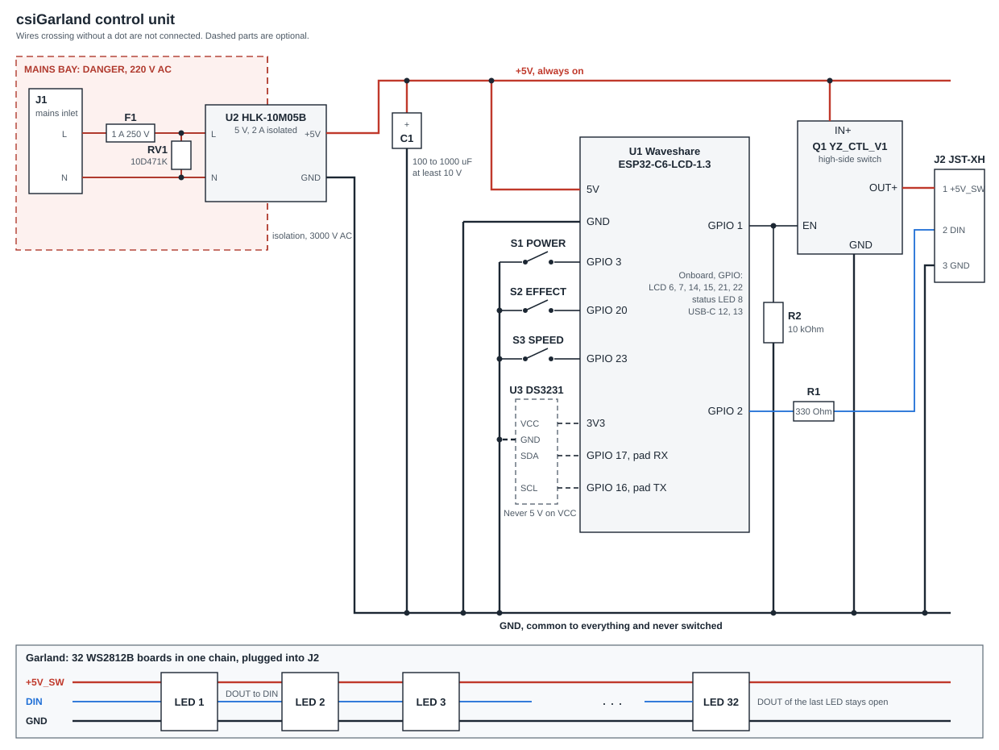

# Building the Hardware

The schematic, every part to buy or print, and the wiring of the control unit and the garland. The design reasons and the enclosure's dimensions are in [Control Unit](../hardware/control-unit.md); the figurines are in [Diffusers](../hardware/diffusers.md) and the [3D model guide](../../3d-model/README.md).

> **This unit holds 220 V AC.** Mains can kill. Build it only if you are qualified to work with mains wiring, never work on it plugged in, and let it stand unplugged for a minute before opening it. Nothing in this project is certified, and nothing here says that an assembled unit is safe.
>
> **Do not buy the XT60H for the mains inlet. It has no approval for mains.** It is a low-voltage battery connector: see [Power Inlet](../hardware/control-unit.md#1-power-inlet-amass-xt60h-f-female-with-sheath-left-wall). The enclosure is designed around it all the same, as that is what the prototype uses.
>
> **Use instead** a mains inlet made for the purpose, such as a panel-mount IEC C14 or the smaller C8, or an external certified 5 V supply, which leaves only low voltage in the enclosure. Either takes a small rework of the enclosure's 3D model: the opening in the left wall and the sleeve behind it, for your part (`xt60_window` and `xt60_pocket` in [`control_enclosure.scad`](../../3d-model/control_enclosure.scad)). The steps below are the same for any inlet.

## 1. Schematic

### Nets

| Net | Connects | Carries |
|---|---|---|
| `L`, `N` | J1, F1 (on `L`), RV1 (across), U2 AC pins | 220 V AC |
| `+5V` | U2 `+5V`, C1 `+`, U1 `5V`, Q1 `IN+` | Always on while plugged in |
| `GND` | U2 `GND`, C1 `-`, U1 `GND`, Q1 `GND`, R2, S1-S3, U3 `GND`, J2 pin 3 | Common, and never switched |
| `+5V_SW` | Q1 `OUT+`, J2 pin 1 | LED power, cut in standby |
| `GATE` | U1 GPIO 1, Q1 `EN`, R2 | High turns the LEDs' power on |
| `DATA` | U1 GPIO 2, R1, J2 pin 2 | LED data, through 330 Ω |
| `BTN_POWER`, `BTN_EFFECT`, `BTN_SPEED` | U1 GPIO 3, 20, 23 to S1, S2, S3 | Pressed pulls to GND. The pull-ups are inside the chip |
| `SCL`, `SDA` (optional) | U1 GPIO 16 (pad `TX`), GPIO 17 (pad `RX`) to U3 | I2C to the clock module |

### Pins of the board

| GPIO | Use | Set by |
|---|---|---|
| 1 | Q1 `EN`, LED power | Your wiring |
| 2 | LED data, through R1 | Your wiring |
| 3 | POWER button | Your wiring |
| 20 | EFFECT button | Your wiring |
| 23 | SPEED button | Your wiring |
| 16, 17 | Optional clock module, pads `TX` and `RX` | Your wiring |
| 12, 13 | USB-C, needed for the first flash and recovery. Leave free | The board |
| 6, 7, 14, 15, 21, 22 | The display | The board |
| 8 | The status LED | The board |

To use other pins, change the `CSIGARLAND_*_GPIO` flags in [`platformio.ini`](../../firmware/app/platformio.ini). No other file names them.

## 2. Bill of Materials

### Control unit

| Ref | Qty | Part | Value or rating | Size | Notes |
|---|---|---|---|---|---|
| U1 | 1 | Waveshare ESP32-C6-LCD-1.3 | ESP32-C6FH4, 4 MB flash, 1.3" ST7789V2 LCD | 26.25 × 30 mm, 8.95 mm with standoffs | Comes with 4 M2 standoffs on its back |
| U2 | 1 | Hi-Link HLK-10M05B | 90-264 V AC in, 5 V 2 A out, isolated 3000 V AC | 47 × 28 × 22 mm | |
| Q1 | 1 | YZ_CTL_V1 high-side MOSFET module | 20 V, 4.3 A, active-high `EN` | 13.2 × 6 × 2 mm | |
| F1 | 1 | Fast-blow fuse with an enclosed holder | 1 A, 250 V AC, 5 × 20 mm | Holder cradle 30 × 11 mm by default | Set `fuse_holder` in the CAD to your holder |
| RV1 | 1 | Varistor 10D471K | 470 V clamping | Ø11.5 × 4.5 mm | |
| C1 | 1 | Electrolytic capacitor, 105 °C | 100 µF 50 V in the prototype. 470-1000 µF, at least 10 V, low ESR gives more reserve | Ø8 × 12 mm fits the saddle | A larger one does not fit it unchanged |
| R1 | 1 | Resistor, 1 %, 0.25 W | 330 Ω | Axial or 0805 | In the data line |
| R2 | 1 | Resistor, 0.25 W | 10 kΩ | Axial or 0805 | From `EN` to `GND`. Keeps the LEDs off while GPIO 1 floats during a reset. **Not optional** |
| S1 | 1 | Tactile switch with a round cap, red | POWER | 12 × 12 × 7.3 mm, cap Ø11.5 mm, 12 mm in all | |
| S2 | 1 | Tactile switch with a round cap, white | EFFECT | As S1 | |
| S3 | 1 | Tactile switch with a round cap, blue or black | SPEED | As S1 | |
| J1 | 1 | Mains inlet made for the purpose: IEC C14 or C8, with its cord | 250 V AC | Per your part | The enclosure needs a small rework for it. **Not the XT60H-F** (24 × 16.4 × 9.2 mm) that the enclosure is designed around: it has no approval for mains |
| J2 | 1 | JST-XH header, 3 pins, B3B-XH-A | 2.50 mm pitch | 9.9 × 5.75 × 7 mm | |
| U3 | 0-1 | DS3231 clock module, such as ZS-042 | Optional. 3.3 V supply | | Keeps time with no network. With a non-rechargeable CR2032, remove the charging resistor |

### Enclosure

| Qty | Part | Notes |
|---|---|---|
| 1 | Printed base and lid | [`3d-model/`](../../3d-model/README.md), `enclosure_base.stl`, `enclosure_lid.stl`. The prototype is PLA; a UL94 V-0 filament such as PC FR is the safer choice around mains |
| 4 | M3 heat-set inserts, M3 × 5.7, OD 4.6 mm | Melted into the lid's posts |
| 4 | M3 × 6 button-head hex screws | From the bottom |
| 4 | M2 × 10 screws | Hold U1 to its posts |
| 4 | Rubber feet, Ø8 mm | |
| 1 set | Hook-up wire, heat-shrink, hot glue | Mains wire rated for at least 300 V, such as 0.5-0.75 mm². 22-24 AWG for the 5 V rail. It carries the owner's limit, 1.4 A by default and at most about 3.9 A, plus the board, so the wire, J2 and the supply must be rated for that limit |

### Garland

| Qty | Part | Notes |
|---|---|---|
| 32 | WS2812B on a 9 × 9 × 2.5 mm breakout board | Boards with their own decoupling capacitor. The firmware's LED count estimate relies on it |
| 32 | Printed base mounts, opaque PETG | |
| 32 | Printed figurine caps, translucent PETG | 8 designs × 4 copies. See [Diffusers](../hardware/diffusers.md) |
| 1 | JST-XH 3-pin plug with crimp contacts | Mates with J2 |
| As needed | 3 flexible stranded wires, 20 to 26 AWG | See [Garland cable](#garland-cable) |

## 3. Wiring the Control Unit

The order follows [Assembly Order](../hardware/control-unit.md#87-assembly-order) and assumes the parts are in their cradles. Flash the board **before** the lid goes on: USB is not reachable afterwards, see [First Flash](build-and-flash.md).

1. **Print the test coupons** `test_jst` and `test_lcd`, and check your parts against them. Do the same for your inlet's reworked opening.
2. **Mains bay.** Wire J1 `L` to F1, then F1 to U2's AC `L` pin. Wire J1 `N` to U2's AC `N` pin. Solder RV1 across U2's AC pins. Cover every joint with heat-shrink. Nothing but the two DC wires leaves this bay.
3. **Through the partition.** Run U2 `+5V` and `GND` through the pass-through at the foot of the partition, the only opening in it.
4. **Rail.** Bring `+5V` to C1's `+` lead, Q1 `IN+` and U1 `5V`. Bring `GND` to C1's stripe side, Q1 `GND` and U1 `GND`. **A reversed electrolytic can burst:** the stripe goes to GND.
5. **LED power.** Wire Q1 `OUT+` to J2 pin 1 and `GND` to J2 pin 3. Solder R2 between Q1 `EN` and Q1 `GND`, right at the module.
6. **Control.** Wire U1 GPIO 1 to Q1 `EN`.
7. **Data.** Wire U1 GPIO 2 through R1 to J2 pin 2. Sleeve R1 with heat-shrink.
8. **Buttons.** One side of each switch to its GPIO, the other to GND. Check the legs with a meter first: a tactile switch has two pairs joined inside.
9. **Clock module, if any.** `VCC` to U1 `3V3`, **never 5 V**, as its pull-ups would reach the chip's pins. `GND` to GND, `SCL` to pad `TX`, `SDA` to pad `RX`.
10. **J2.** Solder its three wires first, feed them through the window from outside, push the header in to its stop, and fix it with hot glue from inside.

Leave the board out of its posts until step 3 of the checks below has passed.

## 4. Wiring the Garland

1. Test each LED board, as a dead one stops every LED after it.
2. Solder the chain on the bench: `+5V` to `+5V`, `GND` to `GND`, and each board's `DOUT` to the next one's `DIN`. Follow the arrows on the boards.
3. Solder the JST plug to the first board: pin 1 `+5V`, pin 2 `DIN`, pin 3 `GND`. Leave the last board's `DOUT` open.
4. Test the whole chain now, on the unit or on a 5 V bench supply limited to 2 A with a data source. A cap cannot be fitted around a fault later.
5. Snap each board into a base mount, lay the wires through the side channel and pot them with hot glue, so that pulling on the garland never reaches the solder pads.
6. Fit the caps last. They come off again without touching the electronics.

### Garland cable

Use flexible stranded wire, 20 to 26 AWG, silicone-insulated if you can get it, as the garland is handled and hung every year. Solid wire breaks at the pads. Three colours make the wiring hard to get wrong: red `+5V`, black `GND`, any other for data.

**Choosing the gauge.** Thicker wire loses less voltage on the way to the last LED, and thinner wire is lighter and easier to solder to a 9 mm board. These figures are calculated, not measured, for the current spread evenly along the chain, counting both `+5V` and `GND`. 1400 mA is the most the firmware allows with the 2000 mA supply at its default margin, and typical effects draw about half of that. A larger supply set on the Device page raises the limit, and the drop with it, up to about 3.9 A: the wire, J2 and the supply must be rated for the limit set.

| Wire | Section | Resistance of one wire | Drop per metre of garland, at 1400 mA | The same, at 700 mA | Longest garland, for 1 V at 1400 mA |
|---|---|---|---|---|---|
| 20 AWG | 0.52 mm² | 0.033 Ω/m | 0.05 V | 0.02 V | 21 m |
| 22 AWG | 0.33 mm² | 0.053 Ω/m | 0.07 V | 0.04 V | 13 m |
| 24 AWG | 0.21 mm² | 0.084 Ω/m | 0.12 V | 0.06 V | 8 m |
| 26 AWG | 0.13 mm² | 0.134 Ω/m | 0.19 V | 0.09 V | 5 m |

The last column is a rule of thumb: keep the drop at the last LED within about 1 V at the limit.

* **Too much drop shows** as the far LEDs turning dim and warm on white. For a longer garland, run a second pair of wires from J2 to the far end, joined to `+5V` and `GND` there. Data stays one line through the chain.
* **Keep neighbouring LEDs within about a metre,** as the data signal is rebuilt at each one and has to get there clean. The same goes from J2 to the first LED.
* **Check your own garland:** measure between `+5V` and `GND` at the last LED, with a white effect at 100 %.

**Fitting the mount.** The channel in the models under `3d-model/` (`cable_slot_w`) is 6.00 × 2.00 mm, with three wires side by side, so each wire can be up to 2.0 mm outside. That is meant for 20 AWG silicone wire, but its insulation varies by maker, so measure yours. Try a wire on one printed mount before buying it all.

**At the plug.** JST-XH crimp contacts commonly take up to 22 AWG. With 20 AWG, check yours, or join a short tail of 22 AWG for the plug.

**Order of the figurines:** from the control unit, tree, star, snowman, pinecone, lantern, bell, icicle, gingerbread, four times over. The order is chosen for that loop: the two clear figurines, the icicle and the snowman, stand four places apart, as do the two warm ones, the pinecone and the gingerbread man, and the two cool ones, the star and the bell, and no two neighbours share a colour. Effects address figurines by type through this order, so assemble the harness in it: four built-in effects depend on it, `Figurine Colors`, `Ring the Bells` and `Star Shine`, by their zones, and `Figurine Parade`, by its algorithm.

## 5. Checks Before and After Power

**Unplugged, with a meter:**

1. `L` to `N` at J1: not a short, and not close to one.
2. `L` or `N` to anything in the DC bay: open.
3. `+5V` to `GND`: not a short, and the capacitor charges up on the meter. Q1 `OUT+` to `GND`: not a short.
4. Mount the board. J2 pin 1 to `GND`: not a short. Polarity of C1 once more.

**Over USB, with the lid off:** [flash the board](build-and-flash.md), and try all three buttons. USB alone powers the board, so keep the mains unplugged, for the board's sake as well as yours: on [Waveshare's schematic](https://files.waveshare.com/wiki/ESP32-C6-LCD-1.3/ESP32C6-1.3.pdf) USB's 5 V and the board's 5 V pad are one net, with no diode between, so with both connected the Hi-Link and the computer feed each other. The prototype has run that way from a computer's USB port with no trouble, which shows it can work, not that it always will.

**With the lid closed and screwed down:** plug in the mains. These should hold:

| Check | Should be |
|---|---|
| Screen | The wordmark within a few seconds, and the setup network or an address |
| Rail in standby, at J2 pin 1 | 0 V. If the LEDs stay lit or glow, check R2 and Q1 |
| POWER | The garland lights at the remembered brightness |
| The garland unplugged | The screen turns amber within about 3 s |
| Full white at 100 % | The garland holds: 32 LEDs draw about 1300 mA by the firmware's model, under its 1400 mA limit, and the supply gives 2000 mA |

## 6. What Is Not Settled

* **LED count estimate:** it has not been run on a MOSFET-gated garland, so the screen may show `?` or a rough figure. Set the count on the Device page if so.

The [roadmap](../stubs/ROADMAP.md) tracks these.
