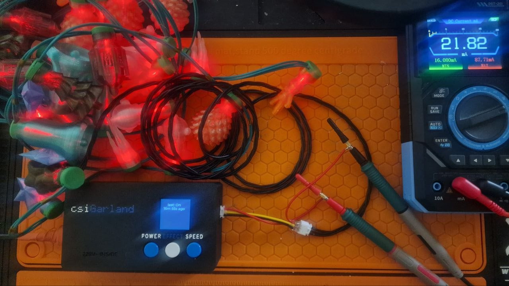

# The Lab Build

A firmware for measuring a garland: the Dev firmware with what the measurements of [Milestone 1](../stubs/ROADMAP.md) need, which a closed unit with no USB cannot otherwise show. It is never published, and goes back to a Release build once the measurements are done.

## 1. What It Adds

| What | Where it shows |
|---|---|
| The log kept from the start, in 6 KB as any build's, and not from the first look | The utility's **Log** page, or `GET /api/v1/log` |
| Why the board started: power on, a restart by the firmware, a watchdog, a panic, and `BROWNOUT`, the supply fallen too low | The first lines of the log: `lab: Lab build: started by ...` |
| Once a minute: time since the start, free heap and its lowest, the chip's temperature and the DS3231's, the air in the box, each with its lowest and highest since the start, the last frame's current by the model and the highest, the rail, the LED count | `lab: up 3600 s, heap ... (low ...), chip 41.20 C (39.10..43.50), box 31.25 C (30.00..33.00), model 1012 mA (top 1012), rail on, 32 LEDs` |
| mbedTLS's memory, counted behind `mbedtls_calloc` from the start and passed on to its pool (1.4.1), or before it to the heap: what it holds now and the most at once, the largest single ask, how many asks and how many failed, and the heap's largest free block now and the smallest found before an ask of 4 KB or more, a record buffer's or a handshake's. With the pool, its peak, its largest free block, the large asks that found the record buffer's slot taken, and the asks past both, spilled to the heap. For sizing them | `lab: tls: live 5120, peak 26624, ask 16749, 812 allocs, 0 failed; pool 11800/16384 peak, 9728 block, slot 0 missed, 0 spilled; heap 23456, 17024 before a 16749`, once a minute, and within a second whenever the peak has grown by 1 KB or an ask failed, so a failed upload's peak is in the log. A good update ends in a restart, which takes the log in RAM with it: the count of the last second before the restart is kept apart and said once after it, as `lab: before the restart, tls: ...` |

Its version ends in `-lab`, as `1.4.1.130-lab`. The rest is the firmware of its checkout, with the same settings, schedule, pairings and uploaded effects, kept both ways. Without the clock module the box's temperature reads `-`.

Its first build, 1.4.0.121-lab, also logged the probe's whole rise at each turn on, which showed that the probe could not count the owner's garland: 1.4.1 dropped the estimate, and the curve with it, as [Architecture](../architecture.md), Garland detection, says.

**What it cannot measure.** The board has no sensor on the 5 V rail, so the rail's voltage and current, standby among them, are for a meter. The log's current is the model's, the figure the limiter goes by, not a measurement.

## 2. Installing It and Going Back

Over the air, as any update, with the owner's signing key on the build machine:

```powershell
pwsh -File deploy\ota-update.ps1 -Address csigarland.local -BuildProfile Lab
```

It goes through the same trial: the script confirms it and prints the trial's log. Once the measurements are done, a Release build in its place:

```powershell
pwsh -File deploy\ota-update.ps1 -Address csigarland.local
```

On Linux and macOS, `bash deploy/ota-update.sh --address csigarland.local --build-profile Lab`, and the same without the profile. `stage-assets` stages a Lab build too, `-BuildProfile Lab`, as `csigarland-<version>.ota` with its version ending in `-lab`, for the portal's or the utility's Firmware page. It links one component of ESP-IDF more than a release, the chip's temperature driver, under the licence `THIRD_PARTY_NOTICES.md` gives all of ESP-IDF, so its staging holds the file to the release builds.

Do not leave it on the garland: its log holds memory from the start, and it keeps ESP-IDF's debug information. Its first build kept 12 KB of log, which left an update's TLS record buffer no block to take: send updates right after a start, with no portal open in a browser, if one does not go through.

## 3. Reading It

Open the utility's **Log** page and leave it open: it reads on as the garland logs, past the 6 KB the garland keeps. **Copy all** puts it all on the clipboard. Each measurement below says which lines to look for.

## 4. Closing Milestone 1

Every point is on the garland's connector, outside the box: the mains side of the box stays closed. A meter on its 10 A range for currents over 400 mA, as for the [current of the assembled garland](../stubs/TODO.md).



**Before.** The Lab build on the garland, the utility paired with its **Log** page open, the meter, and the test effects of solid colours uploaded: black and white at least.

### 4.1 Power gate and standby

1. **At boot.** The garland in standby, the meter on volts between `+5V` and `GND` of the garland's connector. Unplug the control unit from the mains, wait 10 s, plug it in. The rail comes on for a moment at the start, as the firmware sends the chain black frames (a meter may or may not catch it), with no LED lit, and then reads near 0 V until the garland is turned on. The off current itself is measured in step 3. The log begins with `started by power on`.
2. **In standby.** Turn the garland on, then off with POWER. Within a second the connector reads near 0 V.
3. **Standby current.** The meter in series with `+5V` of the connector, on its mA range, then its µA range if it reads under 1 mA, the garland in standby. This is the YZ_CTL_V1's off current.

### 4.2 The Hi-Link under load, closed

1. The box closed, as it will hang. The test black effect: the meter on volts at the connector, the rail on with every LED dark. Then the test white effect at 100 %: the connector again. The difference is what the Hi-Link, the MOSFET module and the wiring inside the box drop at about 1 A.
2. White at 100 % for an hour. Read the connector at 0, 30 and 60 minutes.
3. The log's lines through that hour: `box` and `chip` rise and settle, `model` stays at about 1300 mA, and `up` counts on. `model` and `top` are the current the frames ask for, before the limit scales them and before dithering spreads the levels between frames: `top` above the limit means the limit was used, not passed. The limit holds for each frame as the model reckons it before dithering, and dithering can take a single frame a milliampere or two over it, by the host model, which averages out.
4. Passed when the connector holds within 0.1 V, the box's temperature has levelled off, and the log has one `started by` line only, with no `BROWNOUT`, no watchdog and no panic.

This garland draws at most about 1.05 A on its LEDs and the board its own on top, so this is the most it can ask of the supply, not the Hi-Link's 2 A rating: that would take a dummy load on the rail, which this garland does not need.

### 4.3 TLS memory

For the size of mbedTLS's slot and pool, `kTlsSlotBytes` and `kTlsPoolBytes` in [`tls_pool.h`](../../firmware/app/src/tls_pool.h), as the measured peak, never a guess: the pool's peak under its size, and no slot missed and nothing spilled during an update.

1. After a start, the utility's **Log** page open.
2. The portal in a browser, through every page, and the utility through every page, with both left open.
3. An update from the utility, the staged Lab file itself, once in standby and once lit. It installs, and the garland restarts. The line `lab: before the restart, tls: ...`, early in the new start, holds the upload's peak, the pool's, the slot's misses and the spills, as the count stood in the last second before the restart. A failed upload leaves its own lines, with its `failed` and `spilled`.
4. **Copy all**. The highest `peak`, the pool's peak, the slot's misses and the spills, the `ask`, any `failed`, and the `heap` block at the tightest go to [the to-do list](../stubs/TODO.md), under Memory and timing.

### 4.4 After

**Copy all** from the Log page, and the meter's readings, go to [the to-do list](../stubs/TODO.md), under Power, and the items of Milestone 1 they settle are ticked in [the roadmap](../stubs/ROADMAP.md). Then the Release build goes back on the garland, section 2.

The board's own draw is not part of Milestone 1, and cannot be read on the garland's connector: a wattmeter at the mains gives a rough figure, with the garland in standby and with the LEDs dark.
