# csiGarland User Guide

Using a finished garland: the buttons, the screen, getting into the portal, and every page of it.

## 1. Buttons

Three buttons below the screen. A long press is 0.8 s.

| Button | Click | Long press |
|---|---|---|
| **POWER** (red) | In standby: turns on at the remembered brightness, 50 % at first. When on: steps brightness 10, 25, 50, 75, 100, 10 % | When on: counts down 5 s on the screen, then turns off |
| **EFFECT** (white) | When on: the next favourite effect | When on: the first favourite |
| **SPEED** (blue or black) | When on: steps speed 0.25x, 0.5x, 0.75x, 1x, 1.5x, 2x, 3x, 0.25x | When on: back to 1x |

* **Any button** cancels the countdown, or wakes the screen from a screensaver. That press does nothing else.
* **POWER and SPEED together** answer a browser's request for access, see [Pairing](#4-pairing-a-browser). **Held for 10 s,** they forget every paired browser, for a lost phone. A hold that has just answered a request forgets nothing.
* **While a request for access waits,** a click of any button but that pair refuses the request instead of doing what it would.

The effect, brightness, speed and whether it was playing all survive a power cut. Turning on or off is saved at once, and the rest once it has stayed unchanged for 10 seconds.

## 2. Connecting

1. Plug in the garland. With no home network set, the screen shows the network `csiGarland-Setup` and a password, which is this board's own.
2. Join that network from a phone or computer. A phone opens the portal by itself; otherwise go to `http://192.168.4.1/network`.
3. Choose your home network and enter its password. It must be 2.4 GHz.
4. The screen then shows the garland's address, and the setup network turns off about a minute later.

If the home network goes away, the setup network comes back after 20 s, and the garland keeps trying to reconnect. The password is on the screen whenever that network runs.

## 3. Ways Into the Portal

| From | Address | Security |
|---|---|---|
| The setup network | `http://192.168.4.1` | Plain HTTP and no pairing. Joining took the password on the screen, and phones' login windows refuse our certificate and keep no cookies |
| Your home network | `https://csigarland.local` | HTTPS and a paired browser. Port 80 redirects there |
| The internet, if you set it up | `https://your-domain` | The same. See [section 6](#6-reaching-it-from-the-internet) |

`.local` names work on most systems. If one does not, `https://` and the address on the screen also reach the garland, but with a certificate warning, as a home network's address can change. To go without the warning, reserve the address on your router and enter it on the Network page, as in [section 6](#6-reaching-it-from-the-internet). The name can be changed on the Network page, which restarts the garland.

## 4. Pairing a Browser

There is no password. A browser asks, and you answer at the garland:

1. The browser shows **Allow this browser**. Press **Ask for access**.
2. The browser and the garland's screen show a four-digit code.

   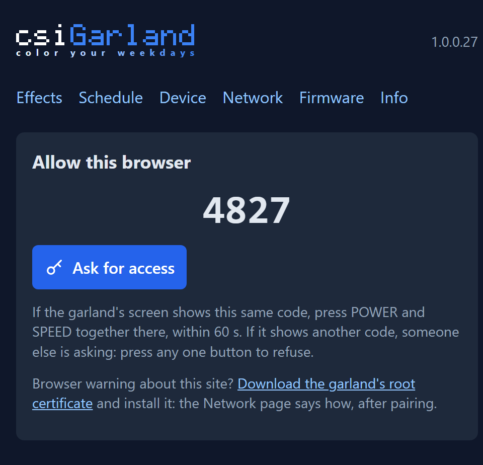 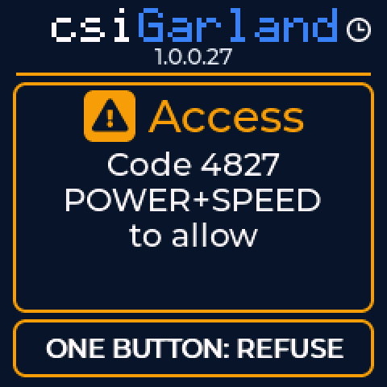

3. **If they match,** press POWER and SPEED together, and let go. **If they differ,** someone else is asking: click any one button, which refuses and holds off new requests for a minute. The page counts that minute down.

A request waits for 60 s, and only one waits at a time. Access lasts 100 days on that browser and is not extended by use, after which you pair again. Up to 8 browsers can have access; a ninth takes the place of the one paired longest ago. The [Info page](#info) lists them and forgets them one by one.

Before you press, look at the address bar: `https://` with no warning, once you have [installed the root](#5-stopping-the-certificate-warning). Someone between you and the garland could otherwise show you the very code on its screen, and your press would give them the access.

Open to anyone with no pairing: the pages themselves, which hold no data until the browser has access, the root certificate, and the request for access.

## 5. Stopping the Certificate Warning

The garland is its own small certificate authority, so a browser warns until its root is installed. Do this once per device.

1. Download `csigarland-root.crt` from the Network page. The pairing page links to it too, as a browser may warn before you have paired.
2. Compare its fingerprint with the SHA-256 on the Network page. That is the hash of the certificate itself, not of the file: on Windows `certutil -dump csigarland-root.crt` shows it as `Cert Hash(sha256)`, elsewhere `openssl x509 -in csigarland-root.crt -noout -fingerprint -sha256`. Compare it with the one on the page, and if you can, with the `root SHA-256` line of the [board's log](build-and-flash.md#what-a-good-first-start-looks-like). The log over USB is the check that nobody stood between you and the garland: the page comes over the same connection as the file. On a closed unit there is no such check: `temp/trial-log.<time>.txt` holds the same line, but it comes over the same network too, so it shows only that the page and the log agree. Install the root while on a network you trust.
3. Install it:

| System | Steps |
|---|---|
| Windows | Open the file, Install Certificate, Current User, Place all certificates in: Trusted Root Certification Authorities |
| macOS | Open the file, add it to the login keychain, open it there, Trust, When using this certificate: Always Trust |
| iPhone, iPad | Open the file, Settings, Profile Downloaded, Install. Then General, About, Certificate Trust Settings: turn it on |
| Android | Settings, Security, Encryption and credentials, Install a certificate, CA certificate |
| Firefox | Keeps its own list: Settings, Privacy and Security, View Certificates, Authorities, Import |

4. **Restart the browser fully,** all its windows. In Chrome or Edge, go to `chrome://restart` or `edge://restart`. A running browser does not notice a new root, and remembers having gone past the warning.

**What you are trusting.** The root's name constraints let it vouch only for `.local` names, `192.168.4.1` and your one domain or fixed address. Even if its key were taken from the board, it could not impersonate your bank to a device that installed it.

**If the warning stays:** click it, and look at who issued the certificate. An antivirus that filters HTTPS, such as ESET, shows its own name there: add the garland's addresses to its exclusions. If it says `csiGarland root`, check that the file you installed is the current one by its certificate's SHA-256 fingerprint, as in step 2. Each domain change makes a new root, and the old one can be removed from your system's list.

## 6. Reaching It From the Internet

1. On your router, forward an outside port to port 443 of the garland, and give the garland a fixed address there. Do not forward port 80: it only redirects.
2. Point a DNS name at your router, such as `garland.example.com`. A fixed outside IP address will do instead of a name.
3. On the Network page, enter that domain or address under **HTTPS certificate** and save. The garland restarts with new certificates.
4. **Install the root again on every device,** as the domain or address is part of it.

One domain or one address, not both. The same field takes the garland's reserved address on the home network, for reaching it by number without a warning. The keys stay the same through this: certificates are made anew on the keys the board has, so there is nothing to regenerate by hand. A new mDNS name needs no new root, as it stays under `.local`.

**Before opening a port,** note what a stranger can reach: the pages themselves and the requests for access, as every other route wants a paired browser. Each stranger's request shows on the screen and can be refused. Nothing limits how often the handshake can be attempted, and the board is a small one. **If the Info page says HTTPS is not working, close the port** until a fix is installed: everything then travels unencrypted.

## 7. The Screen

The colour says what is going on:

| Colour | Means | Screens |
|---|---|---|
| Grey | Nothing is happening | Standby |
| Blue | Running, and all is well | Playing: the effect, brightness, speed, LED count, which reads `!30` if a new length could not be set and 30 are still in use |
| Amber | You have something to do, or must not interfere | No LEDs, setup network, power-off countdown, update under way, access request, making keys |
| Green | An operation finished well | Update installed |

The header shows the firmware version. The wordmark is white and blue on any coloured frame, and on a grey one it and the version go grey too. With a clock module fitted, a small clock glyph sits at the end of the wordmark, and turns white when a scheduled action comes within a day.

The footer shows the portal's address. In the LED count, `N` is set by hand, `~N` is estimated, `0` means none are detected, and `?` means present but not measurable.

| | | |
|---|---|---|
| 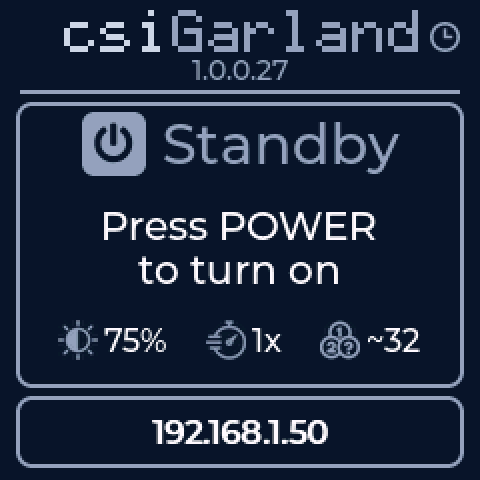<br>Standby | 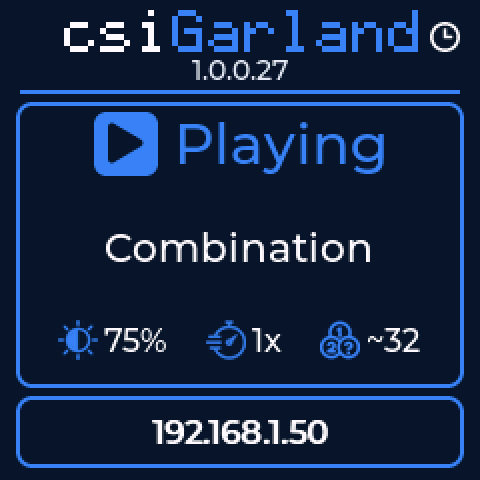<br>Playing | 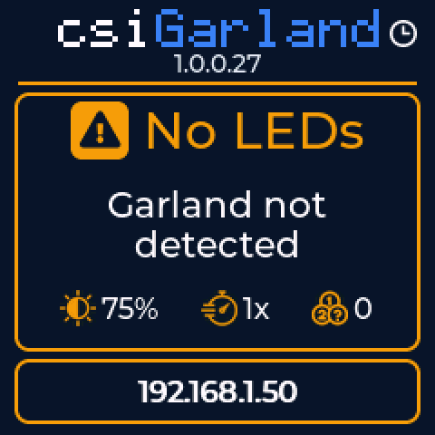<br>No LEDs |
| 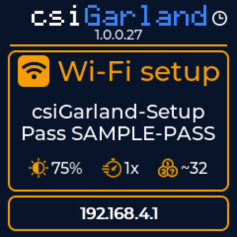<br>Setup network | <br>Access request | 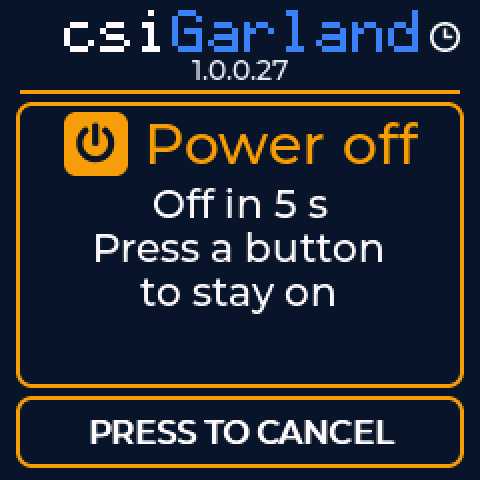<br>Power-off countdown |
| 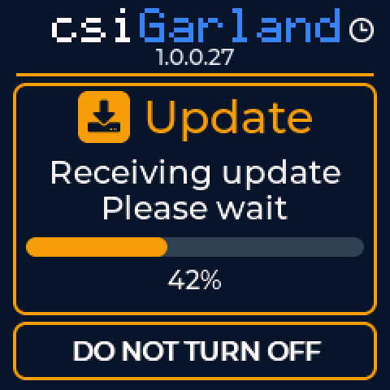<br>Update being received | 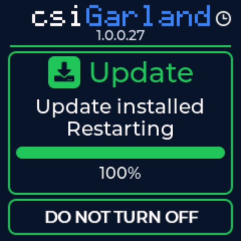<br>Update installed | 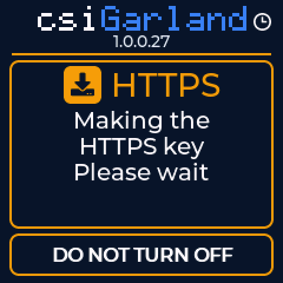<br>Making the HTTPS key |

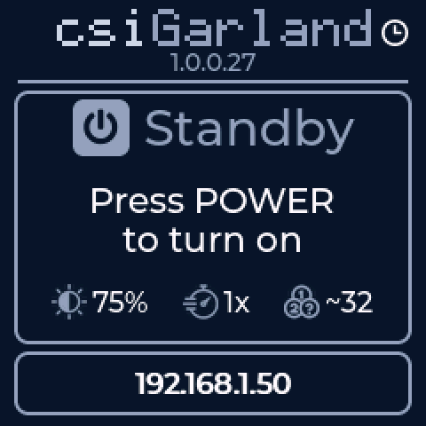<br>Standby with a scheduled action within a day: the clock glyph at the top right is white.

The pictures come from the firmware's own drawing code with sample data. The version, address and password on yours differ.

## 8. Portal Pages

Every page has the same header, with the firmware version on the right. Colours of buttons: blue is the main action of its block, grey is any other, red text loses something. The pictures are the real pages with sample data.

### Effects

`/`

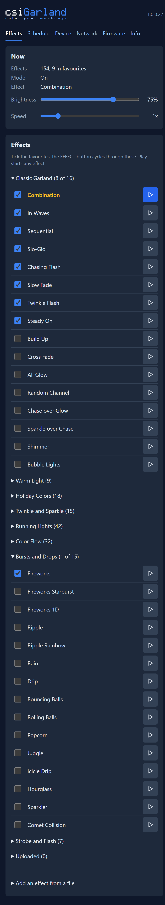

* **Now** shows on or off and the effect, and follows the buttons within a few seconds. Its sliders set the brightness, from 1 to 100 %, and the speed, from 0.25x to 5x in steps of 0.25, and the garland follows as you move them. While the garland is off they do not turn it on: it shows them at the next turn on. From a speed the slider set, the SPEED button goes to its next step up, or to 0.25x from 3x or more. The choice is saved once it has stayed unchanged for 10 seconds.
* **Effects** lists all of them in eight groups, then **Uploaded**, which holds what you added from files, a file replacing a built-in effect among them, and is there even while empty. A group opens by itself if it holds a favourite or what is playing, and Uploaded whenever it holds anything. A title such as `Classic Garland (8 of 16)` says how many of its effects are favourites.
* **The tick** puts an effect in the EFFECT button's cycle. At least one must stay ticked.
* **Play** starts any effect, ticked or not, and turns the garland on. **Active** marks what plays. After a non-favourite, the button goes on with the next favourite.
* **Add an effect from a file** takes a file in [the effect format](effects.md#6-effect-file). **Preview** plays it without saving, until another effect is chosen. **Save** keeps it, up to 32, and the file's name is its id. A file named as a built-in effect replaces it until you press **Restore**; one of your own has **Delete**.

### Schedule

`/schedule`

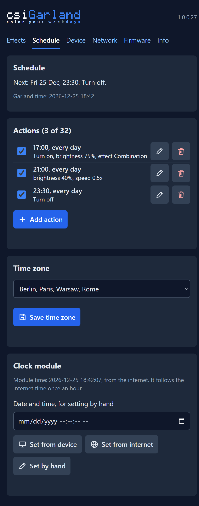

* **Schedule** says what is due next and the garland's time. Actions wait until the clock is set. They go by local time, so in a zone with clock changes, an action in the hour repeated in autumn runs twice, and one in the hour skipped in spring does not run that day.
* **Actions:** up to 32, each with a time, days of the week, and either **Turn off**, or steps: turn on, brightness 1-100 %, speed, start an effect. Nothing can go with off, and starting an effect also turns the garland on.
* **Time zone:** the first browser to open the portal sets it from its own. Change it here if that is wrong.
* **Clock module:** appears if one is fitted. It can be set from the device you are on, from the internet, or by hand. The next answer from the internet overrules a time set here.

The garland comes back from a power cut as it was left. Then, at the first time it knows the time, it carries out only the actions it missed while it had no power, as one result, up to the last 24 hours. Anything you chose counts over any action from before your choice. A choice made while it does not know the time counts over all of them.

### Device

`/device`

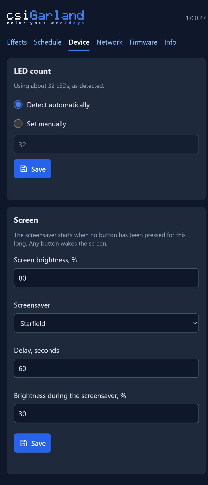

* **LED count:** detected automatically, or set by hand, 1 to 256. An exact count cannot be detected, so if the figure is wrong, set it.
* **Screen:** its brightness, and the screensaver: None, Starfield, Flying Clock, Breathing Dot or Black Screen, its delay of 10-600 s and its brightness. Saved and applied at once.

### Network

`/network`

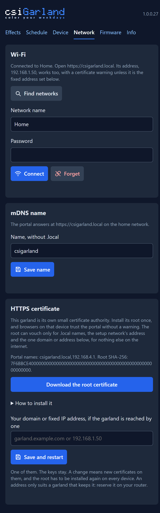

Buttons show a glyph and what they do, side by side. Those on a row of a list, such as an effect's or a scheduled action's, are a glyph alone to keep the row short, and on a computer, hovering over one says what it does. These pages name them by those words.

* **Wi-Fi:** **Find networks**, or type a name, then **Connect**. With the password left empty, the network already saved keeps the one it has. **Forget** removes the network, and the setup network comes back.
* **mDNS name:** lowercase letters, digits and hyphens, without `.local`. Saving a new one restarts the garland, as the portal's certificate holds the name. The root stays, so nothing needs installing again.
* **HTTPS certificate:** the root's SHA-256 and its download, how to install it, and your one domain or fixed address, see [section 6](#6-reaching-it-from-the-internet). Saving it restarts the garland.

### Firmware

`/firmware`

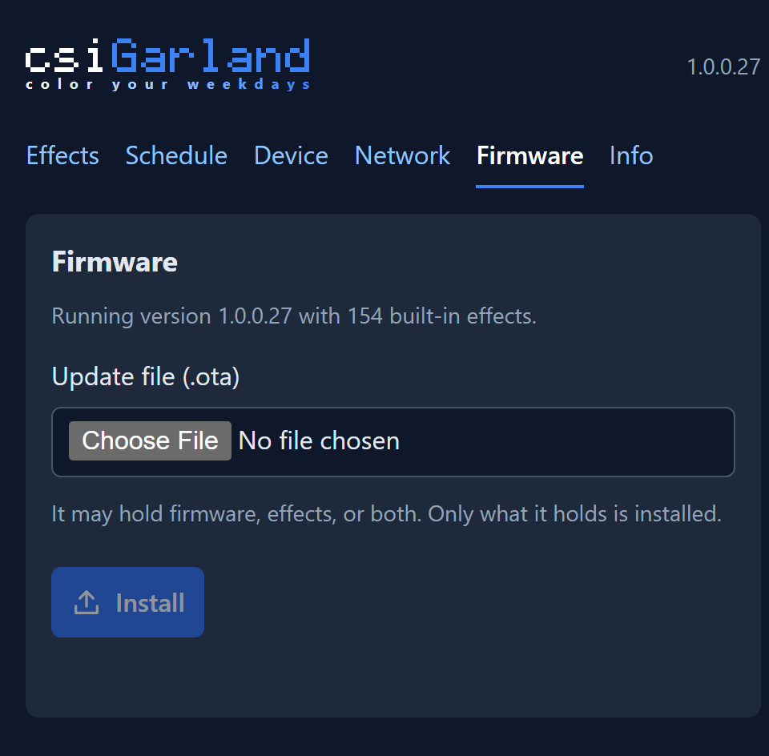

Shows the running version. Choose an `.ota` file, and the page says what it holds before you install it: firmware, effects, or both. Only what it holds is installed. See [Updates](#10-updates).

### Info

`/info`

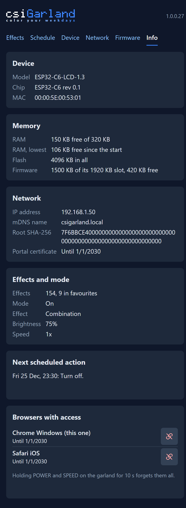

* **Device:** model, chip, MAC.
* **Memory:** free RAM, the lowest it has been since the start, and the firmware's room in flash.
* **Network:** the addresses, the mDNS name, the certificate's names and end date. A line **HTTPS: Not working** means the portal is on plain HTTP; install a new firmware. A line **LED output: Not working** means frames are not reaching the garland, and the firmware keeps trying to start the output again.
* **Effects and mode,** and the **next scheduled action.**
* **Browsers with access,** each with **Forget**. The one you are on says so.

### Pairing

`/pair`

Where a browser with no access lands, see [section 4](#4-pairing-a-browser).

## 9. What the Portal Does Not Have

There is no power switch on a page: that is on the buttons and the schedule, though playing an effect from the page turns the garland on. There is no sleep timer, and no editor of palettes or figurine zones. No current sensor is fitted, so the firmware only estimates current, for its limiter.

## 10. Updates

You need an update file from whoever built your firmware, signed under the same root. See [Building](build-and-flash.md).

**From the portal:** the [Firmware page](#firmware).

**From the build machine:**

```bash
pwsh -File deploy\ota-update.ps1 -Address csigarland.local
```

| Add | Sends |
|---|---|
| Nothing | A new build: firmware and effects |
| `-NoBuild` | The last build, with no new build number |
| `-FirmwareOnly` | Firmware. The effects on the garland stay |
| `-EffectsOnly` | Only the effects, with no build |
| `-File <path>` | That file as it is |
| `-WhatIf` | Nothing: only says what the file holds |
| `-Insecure` | The same, with no check of who answers, and plain HTTP if HTTPS does not answer |

The first time, the script pairs like a browser, so be at the garland to press POWER and SPEED. It keeps its token in `deploy/portal-token.local.txt`, for the same 100 days.

The script checks the garland's certificate against this computer's trusted roots, so [install its root](#5-stopping-the-certificate-warning) first and use its name. Otherwise it stops before sending anything. `-Insecure` is for reaching it by address or when its HTTPS has failed, and is the way out if the check ever stands between you and an update. Anyone on the network between could then read the token and fake the confirmation, though the garland still refuses a file not signed under its root.

**What happens:**

1. The garland refuses anything not signed under its root, before touching flash. The running firmware carries on.
2. The screen shows the progress. The LEDs hold their last frame.
3. It restarts. A new firmware has its **first minute on trial**, and confirms itself if it started a server through which the next update can come, and its buttons and screen.
4. If it restarts for any reason in that minute, a power cut included, the previous firmware comes back. **So do not unplug it during that minute.**

The page and the script report success only when the garland has restarted, runs exactly what was sent, told by the image's hash and the effects' digest rather than the version, and has confirmed it. They say so if it went back.

**On a closed unit, with no USB to read a log,** the script prints the log of the firmware on trial as it starts, and saves it in `temp/trial-log.<time>.txt`. A firmware that cannot start HTTPS stays up on plain HTTP so that the next update can reach it. The script falls back to that with a warning, and the token then travels unencrypted, so do it from your home network.

## 11. When Something Goes Wrong

| What you see | What to do |
|---|---|
| Certificate warning | [Section 5](#5-stopping-the-certificate-warning). After installing, restart the browser fully |
| `Allow this browser` comes back after approving | Check that you let go of the buttons before 10 s. Open the portal by `https://`, not `http://` |
| `Another request is waiting, or one was just refused` | Wait for the countdown. If it keeps happening with nobody asking, click any one button at each request, and close the forwarded port |
| A button seems to do nothing during a request | It refused the request. Ask again after the countdown |
| Portal answers on neither address, screen normal | The board is not on your network. After 20 s without it the setup network comes up |
| Forgot the setup password | It is on the screen whenever that network runs |
| Lost a phone | POWER and SPEED held for 10 s |
| Screen amber, says no LEDs | Check the garland's plug. If the garland works regardless, set the LED count on the Device page: detection only advises |
| A single effect, Warm white, plays | No readable effects pack. Install `effects.ota` |
| `Not installed: ... went back to the previous firmware` | The new firmware failed its first minute. Its log is in `temp/`. Nothing is lost, and another try is safe |
| The schedule does nothing | The clock is not set: see the Schedule page. It needs the internet or a clock module |

Anything needing USB is in [Building](build-and-flash.md#9-when-something-goes-wrong).

**Signed older versions install too,** by design, so anyone with a paired browser can downgrade to any version you signed.
