# The csiGarland Utility

A program for your computer that does what the portal does, and two things it cannot: it tunes an effect with a preview drawn by the firmware's own engine, and it shows the garland's log. It runs on Windows, on Linux, written for Ubuntu with GNOME, and on macOS 12 and later. Android and iOS come after, on the same code.

It talks to the garland over its [public API](../stubs/PUBLIC-API.md), which every release of the firmware has.

The garland does not depend on it, as it does not on the portal: buttons, screen, effects and the schedule work with neither.

## Build It

You need Go and a C++20 compiler on the `PATH`, as the effect engine is the firmware's C++ code: MinGW-w64 on Windows, GCC on Linux, and on macOS the clang of Apple's command line tools, `xcode-select --install`, which bring `codesign` as well. On Linux the window needs the development headers of Wayland, X11 and EGL as well, on Ubuntu as below; [Installing on Linux](build-and-flash.md#installing-on-linux) has the rest of what a first build needs:

```bash
sudo apt install gcc g++ pkg-config libwayland-dev libx11-dev libx11-xcb-dev libxkbcommon-x11-dev libgles2-mesa-dev libegl1-mesa-dev libffi-dev libxcursor-dev libvulkan-dev
```

```bash
pwsh -File deploy\build-utility.ps1
```

On Linux and macOS:

```bash
bash deploy/build-utility.sh
```

The result is one file under `assets/utility`, with nothing to install beside it. No board or keys are needed. On Linux it uses the system's own Wayland, X11 and EGL libraries, which a desktop has. On macOS the file is the program in an application bundle, `csiGarland.app`, zipped: `csigarland-<version>-darwin-arm64.zip`, which a release publishes. The build unzips the bundle beside it, as `.app` for `.zip`, which is what to start there, as [On macOS](#on-macos) says. For an Intel Mac, build on Apple silicon with `GOARCH=amd64` before the command, and the other way round.

Each build has its own number, apart from the firmware's: its base is in `cmd/csigarland/version.go`, and sources the same as the last build's keep its number and its file. `-Force` spends a new one. A build that fails, or is stopped, spends none, and leaves no file. The manifest beside the file names its platform, such as `windows-amd64`; a platform with no release compiler named in `deploy/BuildVersion.psm1` builds, with a warning that no release takes it yet. `-BuildProfile Dev` keeps the symbols and debug information, for a debugger, and marks the version `-dev`.

To build it and start it in one go, which starts nothing if the build failed, rather than the build before it. The script ends there, and the utility goes on by itself:

```bash
pwsh -File deploy\run.ps1
```

or `bash deploy/run.sh` on Linux and macOS.

`-NoRun` builds and stops.

The icon is in `cmd/csigarland`, as `app.ico`, and `rsrc_windows_amd64.syso` puts it in the program; on macOS it is `app.icns`, the same letters on a rounded square, which the build puts in the bundle. `generate_icon.go` there says how to make them again.

## On macOS

The download is `csigarland-<version>-darwin-arm64.zip` for Apple silicon, or `-darwin-amd64.zip` for Intel. Open it, and move the `csiGarland.app` it holds to Applications.

The bundle is signed ad hoc, by no one: the project has no Apple Developer ID, so macOS cannot tell who made it. One built on your Mac opens as it is. One downloaded is held back the first time, as from an unidentified developer:

1. Open it, and close the window macOS shows instead.
2. In System Settings, Privacy & Security, press **Open Anyway** beside its name, and confirm. From then on it opens as any other program.

Or take the quarantine off in Terminal, with the bundle's path:

```bash
xattr -dr com.apple.quarantine /Applications/csiGarland.app
```

Then, once each:

* **Local network.** The first time it looks for a garland or reaches one at its address, macOS asks whether csiGarland may find devices on your local network. Allow it, or it finds none and connects to none on your network. A garland reached over the internet, by its domain, needs no such leave. It can be changed later in System Settings, Privacy & Security, Local Network.
* **The keychain.** The token stays in your login keychain, under `csiGarland/` and the garland's root. A utility of another build is another program to macOS, as nothing signs it lastingly, so after an update it asks once for each garland whether csiGarland may read its token: type your password and press **Always Allow**. **Deny** leaves the garland to pair again.

Built from the sources, it is started with `bash deploy/run.sh`, which opens the bundle, or with `open` and the bundle's path. Its file alone, started from Terminal, works as well, but macOS then asks those questions of Terminal.

## The Linux Utility on Windows

cgo builds only for the system it runs on, so on Windows the Linux utility is built in Docker, in a container of Ubuntu 24.04 that stays, with this checkout mounted in it. It runs `deploy/build-utility.sh` on the same counter, fingerprint and manifests as `build-utility.ps1`, so the two take turns, and its file lands in `assets/utility` beside the Windows one. Its GCC is the release compiler `deploy/BuildVersion.psm1` names for `linux-amd64`, the one of Ubuntu 24.04 itself, so a file built there is the same as one built on Ubuntu.

You need [Docker Desktop](https://www.docker.com/products/docker-desktop/) with its WSL 2 engine, running. The image and the container live in the `docker/` folder of the checkout, which git ignores; make it there as `docker/Dockerfile`:

```dockerfile
# csiGarland: Ubuntu for building the Linux utility on Windows, under Docker Desktop.
# This folder is ignored by git; docs/guides/utility.md, "The Linux Utility on Windows", holds this file
# and the commands, so that it can be made again.
#
# Everything is pinned, as a release says its file builds again to the byte with the compiler named in
# deploy/BuildVersion.psm1: the image by its digest, Ubuntu's packages by the day of their snapshot, and Go
# by its checksum. Go then fetches the toolchain go.mod names itself.

FROM ubuntu:24.04@sha256:fe81560990fae86dc4743202b2cb4d3df98d0bcf949173cecef15ce1127ef852

ARG SNAPSHOT=20261105T000000Z
ARG GO_VERSION=1.26.4
ARG GO_SHA256=1153d3d50e0ac764b447adfe05c2bcf08e889d42a02e0fe0259bd47f6733ad7f

ENV DEBIAN_FRONTEND=noninteractive \
    PATH=/usr/local/go/bin:/root/go/bin:/usr/local/sbin:/usr/local/bin:/usr/sbin:/usr/bin:/sbin:/bin \
    LANG=C.UTF-8

# The packages of "Installing on Linux" in docs/guides/build-and-flash.md that the utility needs: Git, Python
# for the scripts' helper, GCC for the effect engine, and the headers of the window. The snapshot is served
# over HTTPS, so the roots come first from the archive as it is, and then as the snapshot has them.
RUN apt-get update \
 && apt-get install -y --no-install-recommends ca-certificates \
 && apt-get update --snapshot "$SNAPSHOT" \
 && apt-get install -y --no-install-recommends --snapshot "$SNAPSHOT" \
        ca-certificates curl git python3 gcc g++ pkg-config \
        libwayland-dev libx11-dev libx11-xcb-dev libxkbcommon-x11-dev libgles2-mesa-dev libegl1-mesa-dev \
        libffi-dev libxcursor-dev libvulkan-dev \
 && rm -rf /var/lib/apt/lists/*

RUN curl -fsSLo /tmp/go.tar.gz "https://go.dev/dl/go${GO_VERSION}.linux-amd64.tar.gz" \
 && echo "${GO_SHA256}  /tmp/go.tar.gz" | sha256sum -c - \
 && tar -C /usr/local -xzf /tmp/go.tar.gz \
 && rm /tmp/go.tar.gz

# The checkout comes from Windows, owned by another user as git sees it.
RUN git config --system --add safe.directory /src

WORKDIR /src
CMD ["sleep", "infinity"]
```

What it holds, and why:

| Setting | What it is | Why |
|---|---|---|
| `ubuntu:24.04@sha256:…` | The base image, by its digest | The tag alone moves with every point release |
| `SNAPSHOT` | The day of Ubuntu's [package snapshot](https://snapshot.ubuntu.com/) the packages come from | GCC's version, and so the release compiler, stays `gcc (Ubuntu 13.3.0-6ubuntu2~24.04.1) 13.3.0` |
| `GO_VERSION`, `GO_SHA256` | Go from go.dev, checked by its SHA-256 | Any 1.26 does: the build fetches the exact toolchain `go.mod` names |
| `safe.directory /src` | Git's trust of the mounted checkout | Its files belong to Windows' user, and git refuses a repository of another user |

Once, from the repository's root, build the image, then make the container. It mounts the checkout at `/src`, keeps Go's modules and build cache in two volumes of its own, so a container made again starts warm, and starts again with Docker:

```bash
docker build -t csigarland-linux:24.04 docker
```

```bash
docker create --name csigarland-linux --restart unless-stopped -v "${PWD}:/src" -v csigarland-linux-cache:/root/.cache -v csigarland-linux-go:/root/go csigarland-linux:24.04
```

```bash
docker start csigarland-linux
```

Then each build, which spends a number of the shared counter as on Ubuntu:

```bash
docker exec csigarland-linux bash deploy/build-utility.sh
```

`--force`, `--build-number` and `--build-profile` work as in [Build It](#build-it). Nothing else of the bash scripts is needed in the container: a release of the file it made is published from Windows, as `-Platform linux-amd64` in [the build guide](build-and-flash.md). After a change of the Dockerfile, remove the container with `docker rm -f csigarland-linux`, and build and make it again; the volumes stay.

## The Window

As in the csiPass companion. The top bar has the wordmark, in the same pixel letters as the garland's screen and the portal, its tagline, and the pages. The rail under it says whether the garland is answering, its address and firmware, and what it is playing: the effect, or while the playlist plays, `Playlist 3/12 (Fireplace)`. **Refresh** reads the page again, and **Disconnect** leaves this garland for the list, where it stays paired and comes first. The utility still goes back to the last one used when it next starts. The footer is one line for what just happened, or the slogan when nothing did, and the utility's version. The garland pushes its state as it changes, on a connection of the utility's own, so the rail and the Effects page follow its buttons at once; with no stream, as from a garland of 1.0.0, the utility asks every 3 s. While the garland's firmware is on trial, after an update from here or from anywhere else, the footer counts down the seconds until it confirms itself, and says when it has.

Buttons show a glyph and what they do, side by side and on to a new line if the window is narrow. Those that act on one row of a table, such as an effect's or a schedule's, are a glyph alone to keep the row short, and hovering over one says what it does. Whatever loses something, such as deleting or forgetting, asks by a second press within 4 s.

A line too long for the footer is whole in the Journal, beside it, which keeps what the footer has said since the window opened, newest first. Its button turns red while there are errors you have not looked at.

Only one utility runs at a time: starting it again brings the one already open to the front, and ends. On Linux under Wayland the compositor has the last word, and GNOME's leaves the window where it is. Its window is at least 1024 by 768, as csiPass's is, and the system's dialogs for choosing a file open over it. On Linux they are the desktop portal's, or zenity's on a desktop with no portal, and under Wayland they open on their own rather than over the window. On macOS they are the system's panels, as a sheet from the window's title, showing the files of the kind asked for. Beside a hash or a MAC, a small button puts it on the clipboard.

## Connect and Pair

The utility looks for garlands on your network, and lists those that say they are one, with their firmware. It remembers those it has been connected to, and lists them whether they answer or not, with the last one used first and a green tick on those it is paired with. It knows them by their root certificate, so a new address changes nothing. A new address found by the search is kept only once the garland has answered there under its own root: anything can answer a search, and something there without that root is left, with no offer to trust it. Choosing a paired one connects at once, and it is also where the utility goes when it starts. Forgetting one here leaves it paired on the garland until its time runs out. Another garland at an address one used to have takes nothing from the first: each is kept by its root. So one whose root has changed stays listed as not answering until you forget it.

Choose yours, or type its address below the list, as in a browser: an IP address, a domain or a `.local` name, with a port if it has another. The garland's screen shows it. Typing is what is left when the list is empty, as on a network that does not pass mDNS.

For one not paired, the list proves nothing, as anything can say it is a garland, so the next step is the same either way:

1. The utility fetches the garland's root certificate and shows its SHA-256. Compare it with the one on the portal's Info page, and press **It matches: ask for access** if they are the same. From then on it talks only to a garland under that root, and it installs nothing in your system.
2. A code appears, in the utility and on the garland's screen. If they match, press POWER and SPEED together on the garland, as for a browser.

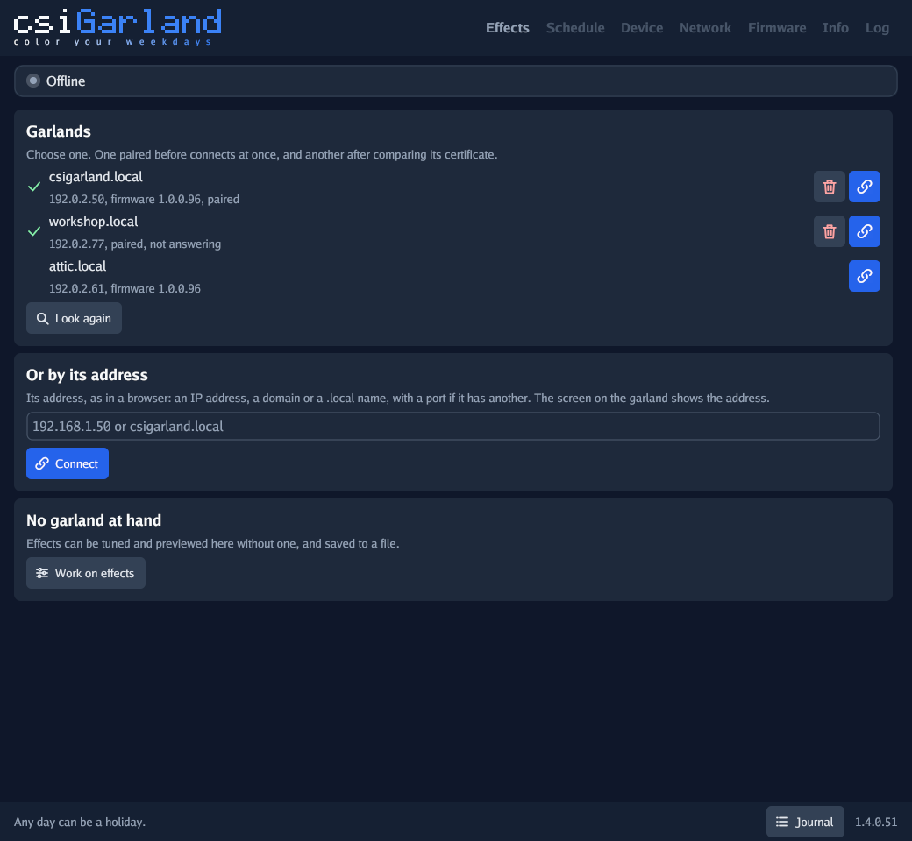

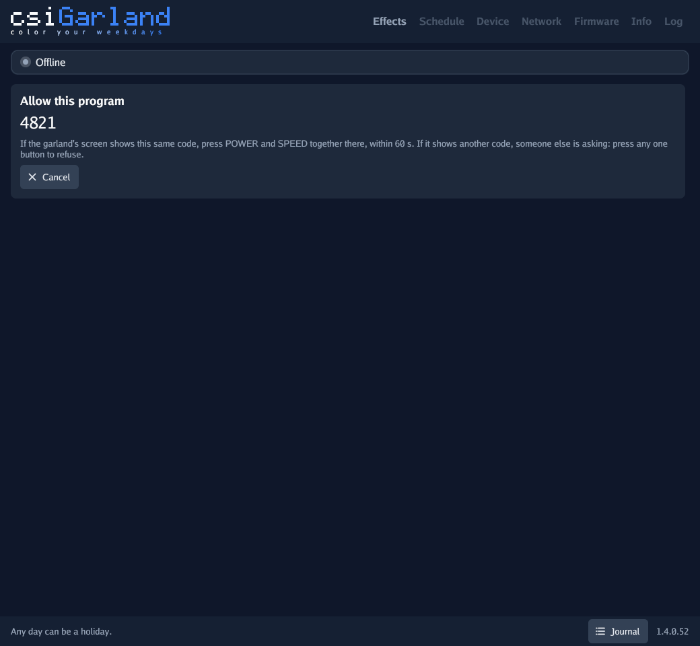

The access token stays in Windows Credential Manager, on Linux in the Secret Service, as GNOME Keyring and KWallet give it, or on macOS in the login keychain, and the addresses and roots in `%AppData%\csiGarland`, `~/.config/csiGarland` on Linux, or `~/Library/Application Support/csiGarland` on macOS. A Linux with no Secret Service keeps no token anywhere less safe: pairing lasts until the utility closes, and it says so. A locked keyring asks for its password when the utility first needs the token. Access lasts 100 days, as a browser's does, and then the utility asks you to pair again. If it says the garland no longer knows it, it was forgotten on the garland, or its time ran out. If it says the certificate is not valid at this computer's time, the garland is yours but a clock is wrong, on this computer or on the garland, which makes a new certificate once it knows the time: pairing again would not help, putting the clock right does.

## With No Garland

**Effects** in the menu, or **Work on effects** on the connect page, needs no garland. The other pages need one, and say so. It lists the built-in effects, which come with the utility, to preview and tune, or a file from this computer, and the result is saved to a file. The same list stands in when a garland paired before does not answer.

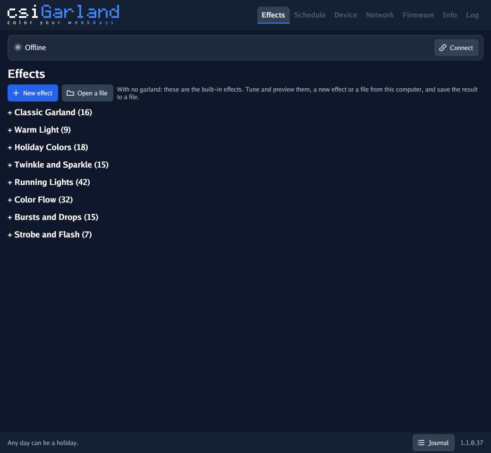

## Pages

**Effects:** on and off, brightness and speed, every effect by group, favourites for the EFFECT button. Beside each effect: preview it here, tune it, and play it on the garland. The **Playlist** card holds the effects the garland plays in turn: **Add the effect playing** puts in what plays now, a bin takes one out, the steppers set how long each plays and the fade between them, **Save playlist** sends the list, and **Play the playlist** or **Stop the playlist** starts or stops it. A garland of 1.0.0 has no playlist, and the card is not shown.

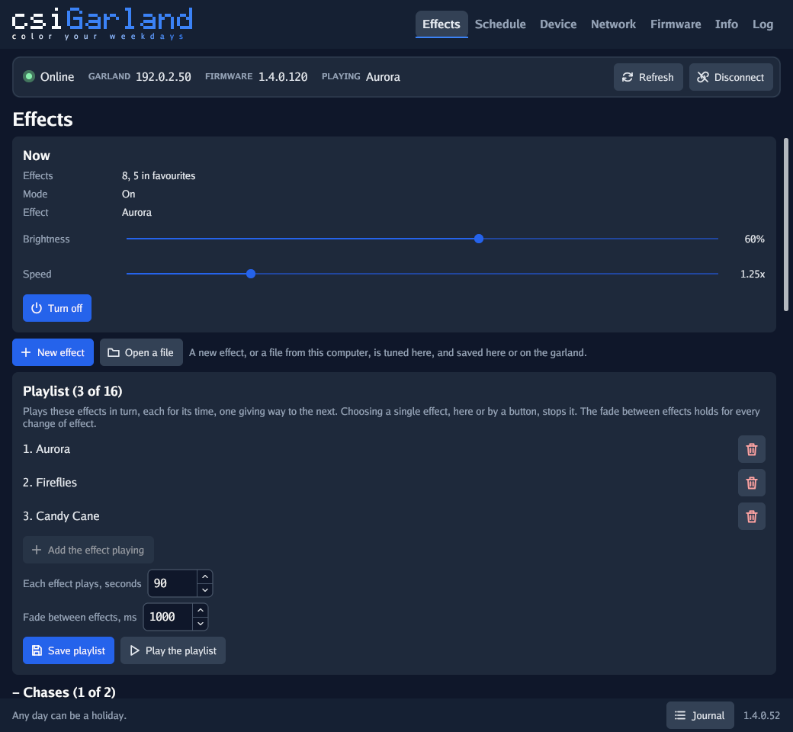

**Schedule:** the next 24 hours, the actions, the time zone, and the clock module if there is one. The next 24 hours start with the garland's time, then a bar, blue where the garland is lit as the actions leave it from now, with a mark at each action due, amber where actions meet, and a line for each; a garland of 1.0.0 cannot say them, and the page shows what is due next in their place. An action's **Turn on** can rise from dark over a minute, and an action can **Start the playlist** in place of an effect. An action's time is typed, or picked by the clock beside it in a window of wheels, as on a phone: the mouse wheel turns one, a drag carries its numbers, and a press on a number brings it to the middle. Its days are a block of segments, any of them on at once, and a step's value stands beside its box once it is ticked: the brightness on arrows, the speed in segments, and the effect in a window of its own, by group. Each zone is shown with its offset from UTC, and its summer one if it has one. The time to set the module to by hand is typed, or picked in the same window of wheels, for the date too, which starts as what is typed, or the module's time, or the garland's, or this computer's; it is in the garland's time zone, and **Set by hand** waits for something in the field. If the list was changed elsewhere while you edited it, your change is not saved, the list is read again, and you can repeat it.

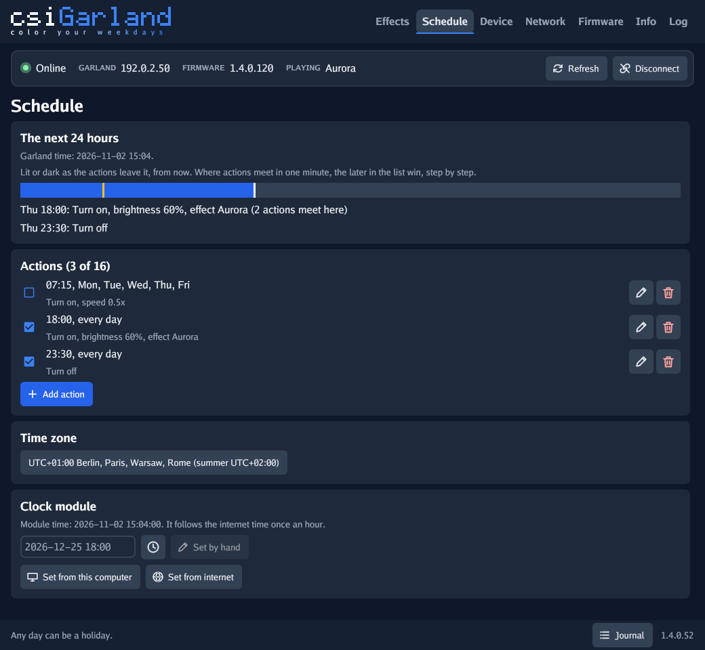

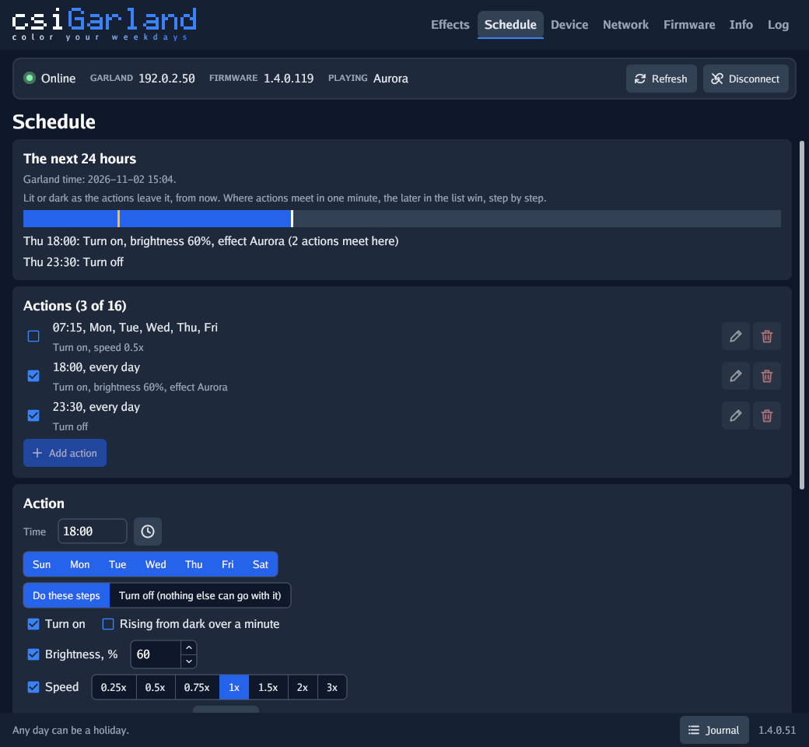

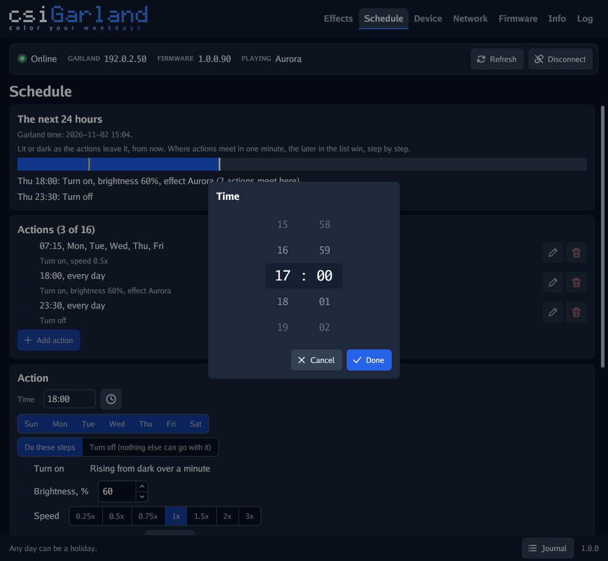

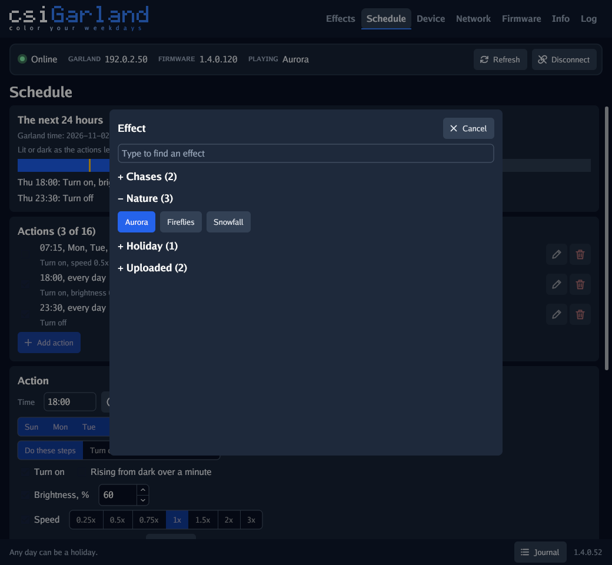

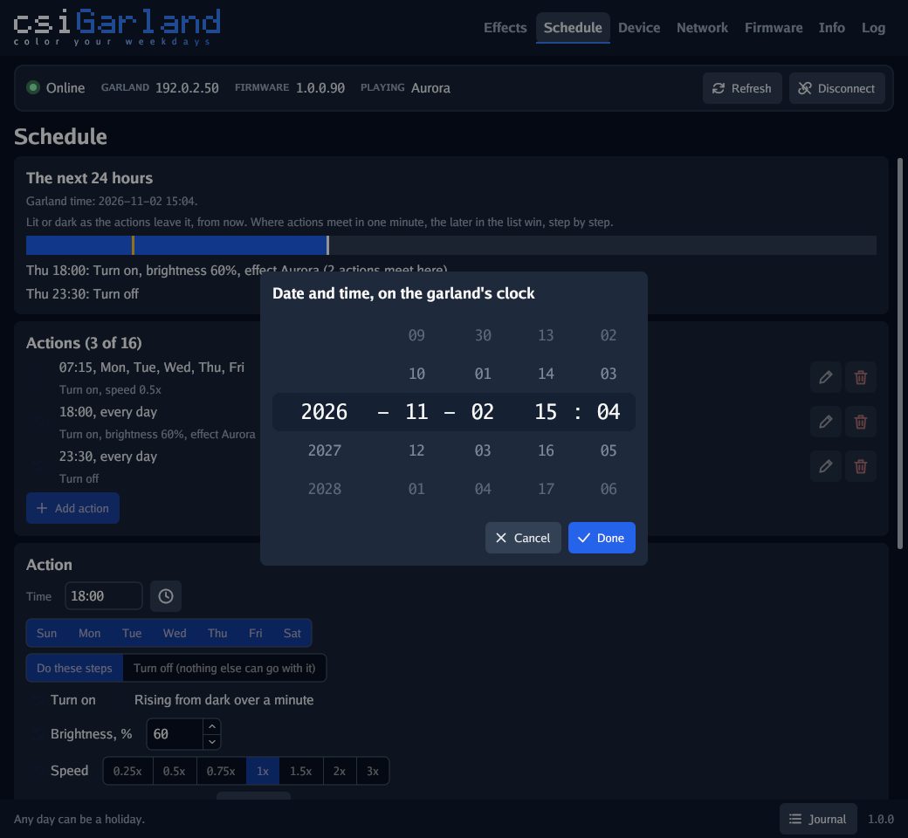

**Device:** the LED count and the screen. **Network:** Wi-Fi, the mDNS name, and the certificate's domain. A password left empty for the network already saved keeps the one it has. A new domain means a new root certificate: browsers need it installed again, and the utility goes back to **Connect**, to compare it and pair again.

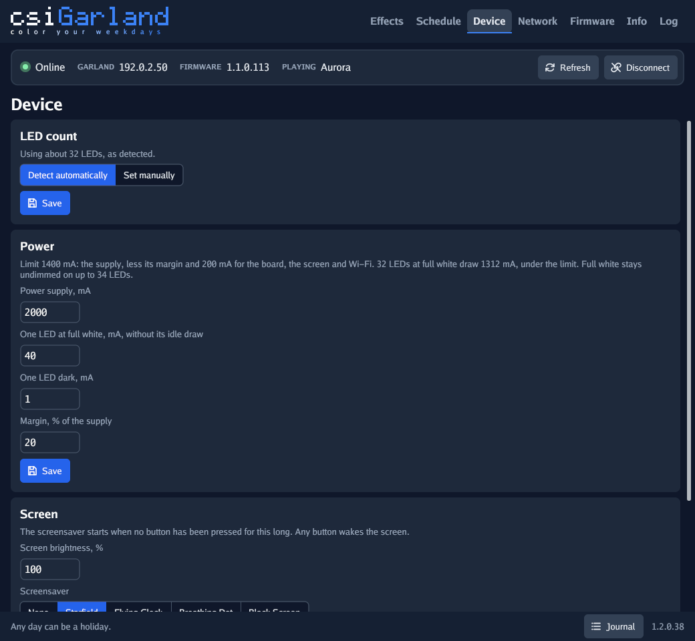

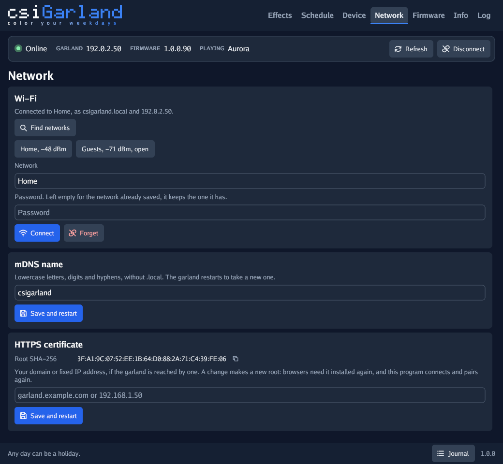

**A newer firmware:** once connected, the utility asks the garland what it runs and the catalog what is released. When the newest release is newer, a window offers it: **Install** downloads it and sends it, as the Firmware page below does, and **Not now** leaves it until the next connection. A Dev build, such as `1.0.0.101-dev`, counts as its number. With no internet, nothing is offered and nothing is said.

**Firmware:** choose an update file from this computer, or **From the catalog**, which takes a file only if it holds firmware of the very version its row names, and an offer installs only while the garland runs older still: the releases the project's site, [garland.csilab.am](https://garland.csilab.am/downloads.html), lists, newest first, with the one running and those newer marked. A file from the catalog is downloaded from GitHub Releases and kept only if its length and SHA-256 are the catalog's; whether it is good is still the garland's to say, by its signature. Then the utility says what it holds, sends it with a bar of how far it has gone, and follows the garland until it has restarted and confirmed itself, or gone back. The bar counts what has left for the network, so all of it gone is not yet taken: the garland then checks and installs it before it answers. While this goes on the other pages wait, as the garland can answer nothing else, and the footer says what the utility waits for: the garland back on the network, counting the seconds, then the new firmware's minute on trial, counting down. The journal keeps each of these once. **Cancel** stops sending. The garland may already have taken the whole file by then, so the utility goes on watching, and says what came of it only once the garland shows it, about 15 s later if it stays as it was. A file downloaded from the catalog after another was chosen meanwhile is left, and nothing is installed from it.

Once a new firmware has confirmed itself, the utility reads, unless the garland went back to the firmware before, in which case it says so, every route of the public API that changes nothing, and says whether each answer reads as it expects: a field of another type, a field the route always gives missing, an item of a list without what each must hold, as an event of the timeline without its time, or a route missing, is an error in the journal, so an empty object passes for no route, and a field it does not know, from a firmware newer than the utility, is said as no fault. A route or field newer than the firmware's release, such as the playlist on a garland of 1.0.0, is not expected of it. **Check the API** does the same at any time. The log is left out, as reading it starts the garland keeping it.

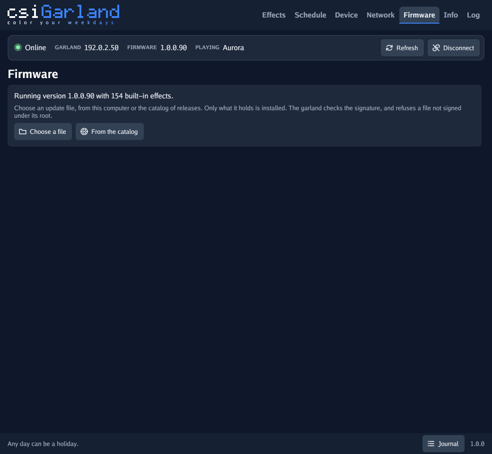

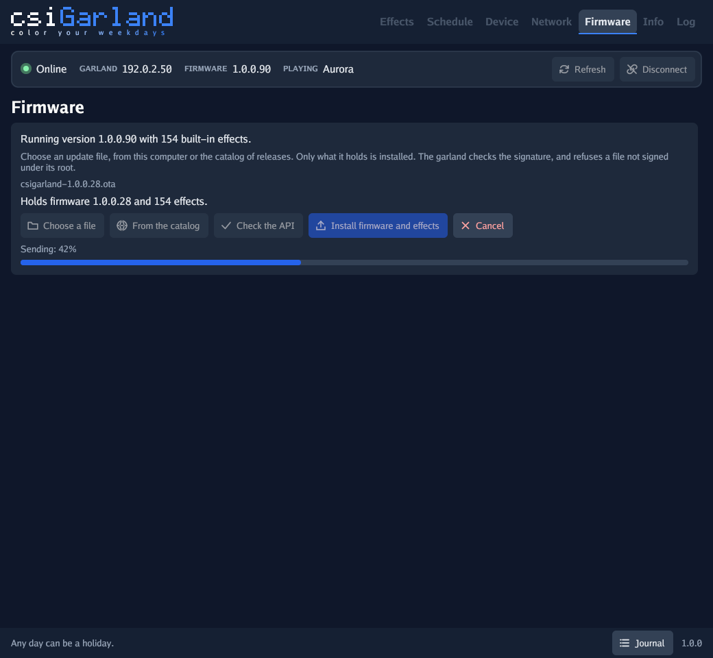

**Info:** the board, its memory and network, and what has access, with **Forget**. **Forget** on the line of this program ends its access here too. **Save a backup** reads the garland's schedule, favourites, playlist, screen and uploaded effects, and keeps them in one file, read as one picture: should the garland change meanwhile, so that the schedule or playlist names an uploaded effect the file would not hold, it reads them all again, up to three times, and makes no file of a picture it cannot get whole. An uploaded effect is known by its file's bytes too, as one replaced under the same id changes nothing else the API says, and one deleted between the list and its file is a change too. A playlist effect the garland itself lacks is kept by its id, and left out on a restore to a garland without it, which is said. A garland of a release with the playlist that answers none makes no backup. The day of the Schedule page keeps a step the garland gave as still to do, drawn from now, until the power the window holds is another than the one the day was worked out with, a step done or a choice, as the garland says it with the day, or, from a build that does not say it, until any newer state came; a change of the power reads the day again, and so does another firmware, whose day 1.0.0 had not. A restore to a garland that lacks every favourite of the backup keeps its own favourites and still puts back the playlist's effects it has. A backup file followed by anything but space, as a bracket too many, is no backup. The file is written beside its place, under a name of that save's own, and then moved into it, so a failure leaves the backup before as it was, and two saves to one file at once each put only their own bytes there; **Restore from a backup**, by a second press, puts a file's back on this garland or another, the uploads first, then the favourites, the playlist, the screen, and last the schedule, which replaces the whole list as it was when the restore began: one saved meanwhile, here or elsewhere, stays, and the restore says so. A restore waits for the commands sent before it, and those sent after wait for it. A backup leaves the playlist out only from a garland of 1.0.0, which has none; any other part it cannot read makes no file. A part the garland refuses, such as an action naming an effect it lacks, is said, and the rest still go on. Pairings, the Wi-Fi password and the HTTPS root are in no backup, as the API gives none of them, and an erased garland needs them set again by hand.

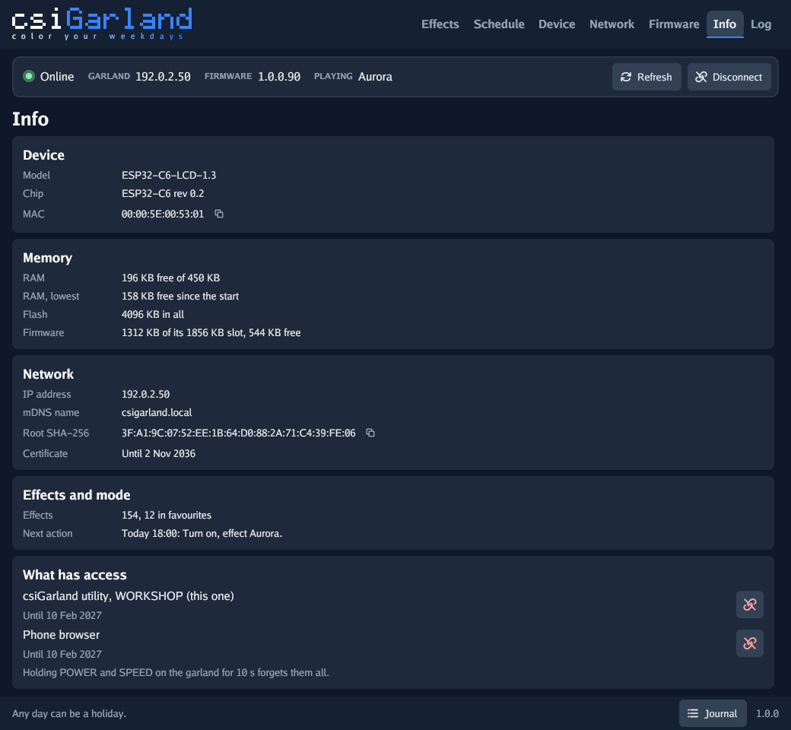

**Log:** what the garland is saying, for a sealed unit with no USB to read it from. The garland starts keeping its log at the first look here, in 6 KB of RAM, so what came before is not there, and it stops at its next restart until you look again. **Copy all** puts it on the clipboard for a bug report.

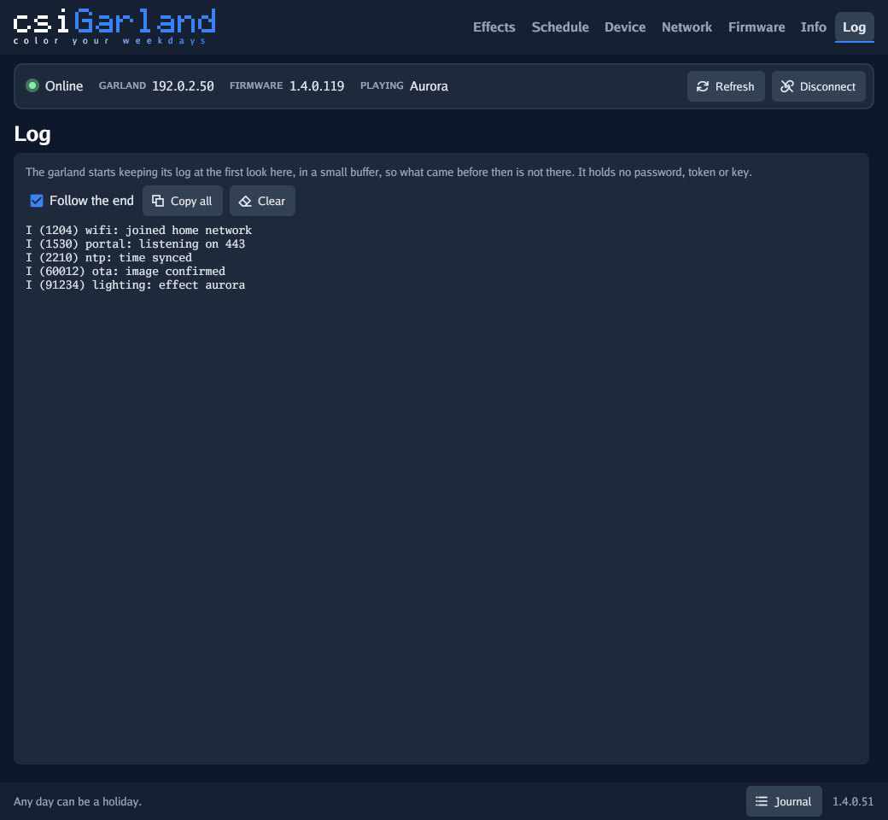

Commands to the garland go one behind another, in the order you gave them, and those still waiting are dropped if you disconnect. Setting the clock module from the internet takes its turn like any other, and only starts the garland asking. The source the garland reports is that of the time it has, so if that came from the internet before, the utility can say that it asked, but not that this time worked.

## Previewing an Effect

The eye beside an effect opens it in a window of its own, drawn here and sent nowhere, on the garland or off it. The LEDs are a chain from the garland's board, numbered from 0 there, as an effect's `start` and `stop` count them, with each number under its LED, going back and forth across the window as a garland is hung: left to right, then right to left, with arrows along the cable. A wider window puts more of them on a line. An LED that is off is a dark circle, and one that is on sends out rays of its colour, as long and as wide as it is bright. Under the LEDs, in this window and in Tune, a speed and a brightness for the preview change nothing on the garland. The speed starts as the garland's and sets how fast the effect's time runs from where it is. The brightness starts at full, as a screen shows a garland turned down low as all but dark where its LEDs in a room are not, and is applied on the garland's own curve, which the screen's own gamma takes back, so that 15% looks about 15% of full.

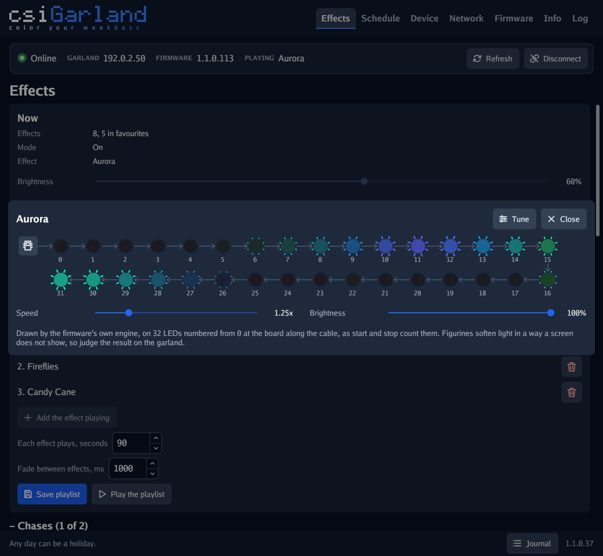

## Tuning an Effect

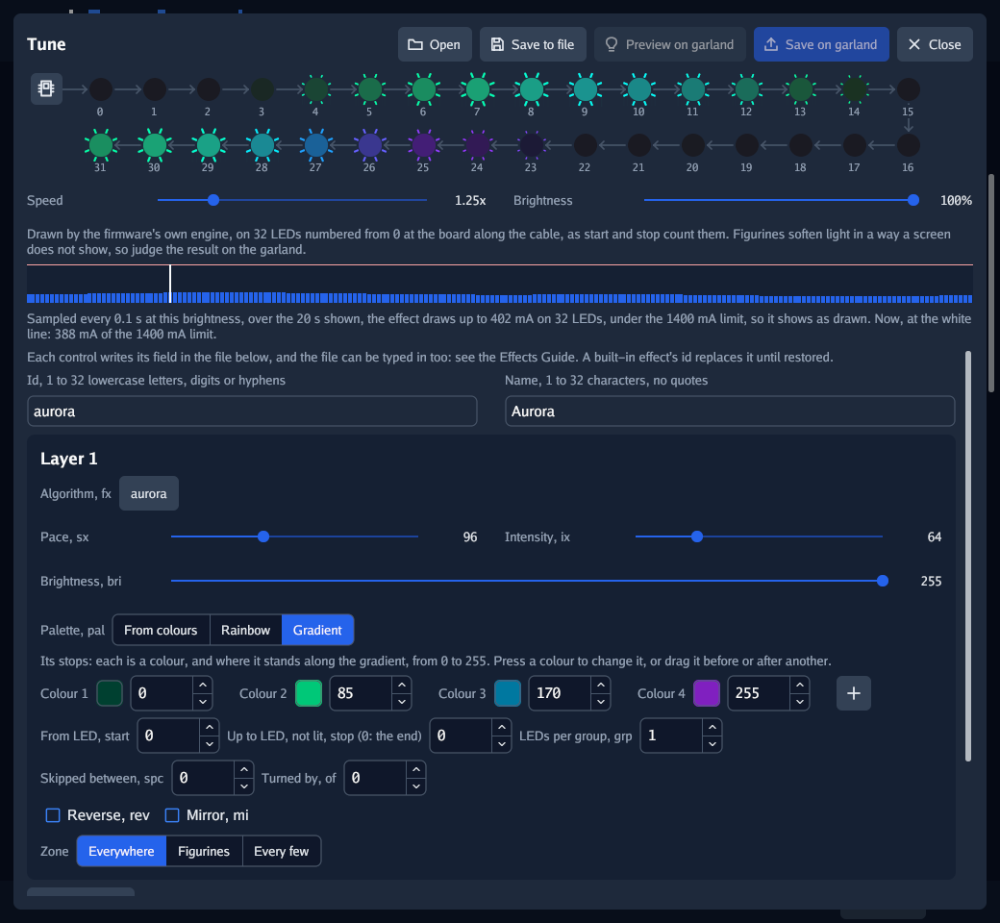

The principle is that there is one engine. The firmware's effect code is built into the utility, so the preview moves as the garland would, and its parser is what says if a file is wrong. It is not frame for frame what the garland shows: the preview is always 32 LEDs, with no current limit applied, and what is random in an effect comes out differently. Under the LEDs, Tune charts what the effect draws over the 20 s of its own time the preview plays in, at the brightness chosen, by the firmware's own model of the current, with the 1400 mA limit across it and the frames past it in amber, and a white line that moves across it with the preview; at the end of the 20 s the chart goes on to the next, all of them worked out in one run of 200 s when the file changes, so each goes on from the one before, and after them it starts again from the first. It says how often and how far the garland would dim those frames, and what the frame on the LEDs, at the line, draws now. The chart samples a frame every 0.1 s, so it says what those frames draw; how far a frame dims is worked out with the idle draw of the LEDs left out, as the firmware does. A screen cannot show what a figurine does to light either, so the preview is for the motion and the colours, and the garland has the last word.

1. **Start from something.** **New effect** on the Effects page starts one of your own: one layer of one colour, under the id `my-effect`. The sliders beside an effect read its file, from your garland if there is one, into a window over the page. Or open a file from this computer, with **Open a file** on the Effects page or **Open** in that window.
2. **Change it.** Every field has a control: the name, and for each layer its algorithm, from the parser's own list, `sx`, `ix` and `bri`, its colours, its palette from its colours, Rainbow or a gradient of stops, each a colour over its place from 0 to 255, where a new one goes after the last, with its colour, at 255, and a last one already there moves halfway back, its range and grouping, reverse and mirror, its zone of every LED, some figurines or every few, and how it blends over the layers below; layers are added, up to four, and removed. A field the algorithm does not read has no control, as the firmware's engine finds by drawing the algorithm with each field changed: rain, say, draws from its palette, so its colours count only while the palette is made of them, and sparkle reads two colours, its sparks and its ground, so it is offered no third. One left in the file is said to change nothing, with a button to take it out. The first layer has no blend, as it is drawn over dark. With more than one, a colour is dragged before or after another, where a mark shows it will go, and the colours are numbered again; a gradient's places stay where they are, in order. A colour pressed opens the picker in a window of its own, of saturation and value, hue and hex, with **Remove** and **Done**; it is lighter than Tune's, so the LEDs above show what the colour does. Each control writes its own field in the file under them and changes no other byte of it, and the file can be typed in as well: the controls follow it as soon as it is JSON in the shape of an effect. The controls and the file scroll as one, under the LEDs. The [format and every algorithm](effects.md) are in the Effects Guide. An error shows above the controls until it is fixed.

   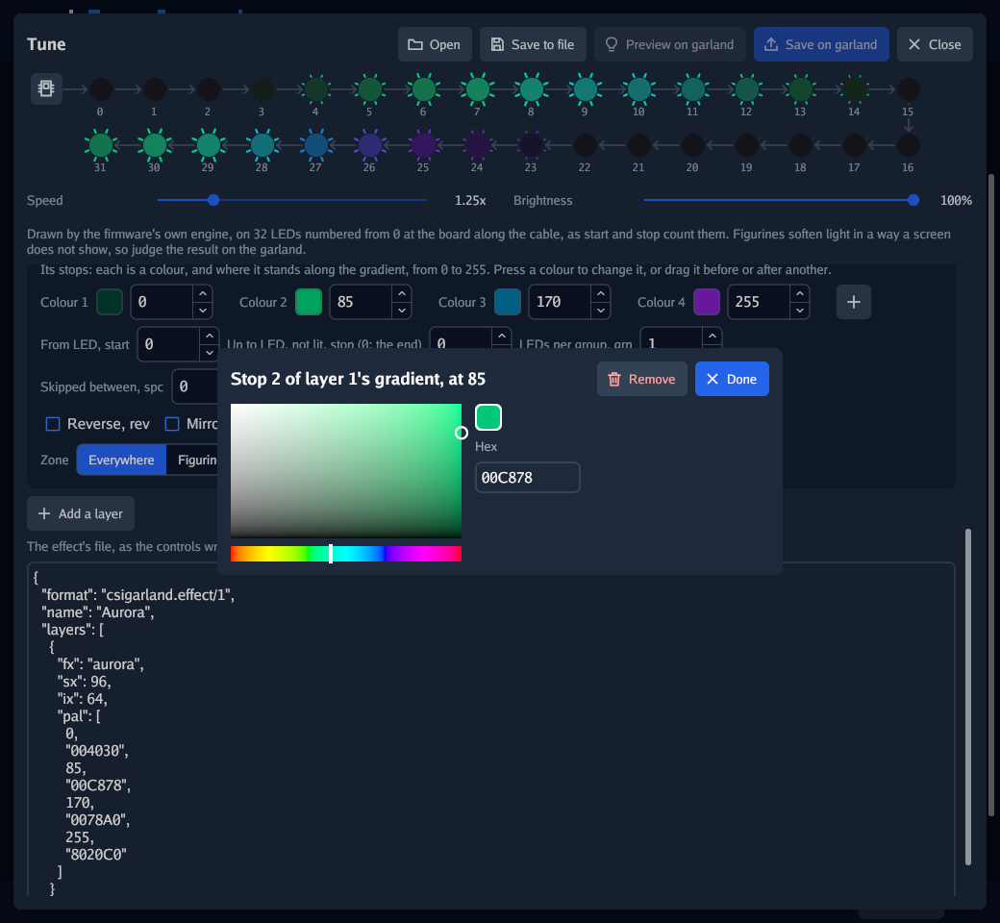
3. **See it on the garland.** **Preview on garland** plays it with nothing saved, until another effect is chosen.
4. **Keep it.** **Save to file** puts it in a file on this computer, right or wrong, as a draft is worth keeping. **Save on garland** saves it there under the id you give, where it appears in the Uploaded group. An id of a built-in effect replaces that effect until you restore it. An uploaded file is at most 4096 bytes.

Closing the window, or opening another file, over what is not saved asks by a second press. An effect asked for from the garland opens only if it is still the last thing you asked for, and no window has opened since, so it cannot replace a draft.

To put an effect in the firmware for everyone, add its file to `firmware/app/effects`, as [the Effects Guide](effects.md#14-the-settings-utility) says.
