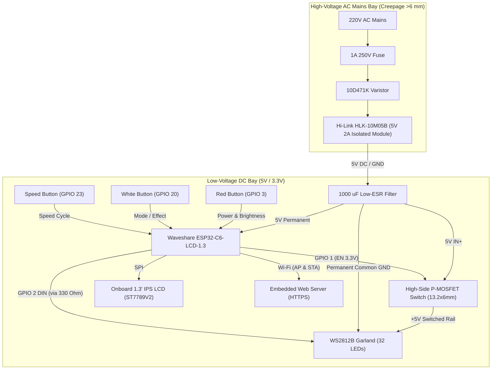
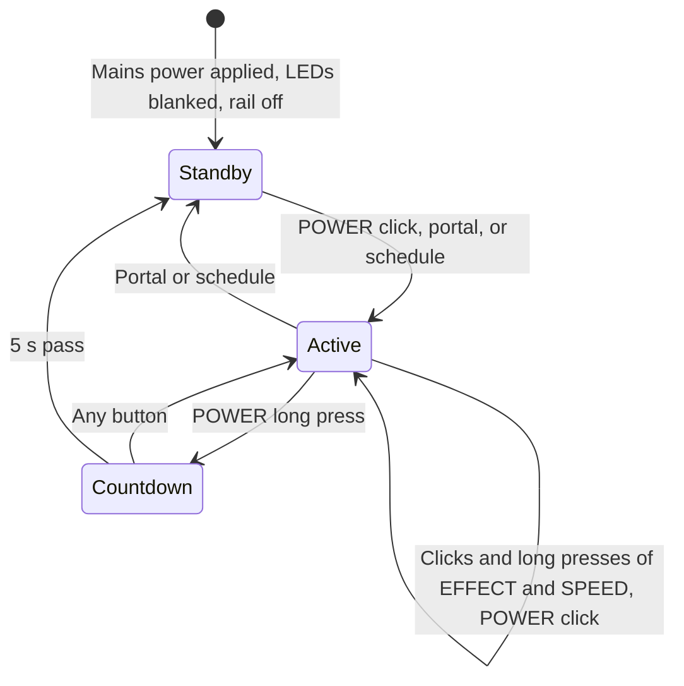
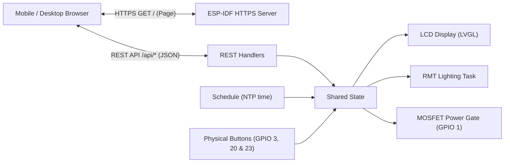

# csiGarland Control Unit Specification

## 1. Executive Summary

The **csiGarland Control Unit** is an autonomous, smart IoT controller engineered for holiday lighting installations. It integrates a compact high-efficiency AC-DC power supply, an ESP32-C6 microcontroller with an onboard 1.3" IPS LCD, zero-standby hardware power-gating via a High-Side MOSFET, a three-button tactile control strip (Power/Brightness, Effect, Speed), and an embedded Wi-Fi web server with mobile-responsive controls. Firmware updates are wireless (OTA); the USB-C port of the board is not brought out of the enclosure.



---

## 2. Bill of Materials (BOM)

The full list, with quantities and the printed and mechanical parts, is in [Building the Hardware](../guides/hardware.md#2-bill-of-materials), with the schematic and the wiring steps.

---

## 3. Three-Button Control Scheme & State Machine

The physical interface uses three dedicated tactile buttons arranged in a horizontal control strip directly below the 1.3" display, each labelled on the panel. A long press is 0.8 s.

| Button | Cap | Label | GPIO | Short click | Long press |
|---|---|---|---|---|---|
| 1 | Red | `POWER` | 3 | Turn on at the remembered brightness (from standby), then step brightness 10 → 25 → 50 → 75 → 100 → 10 % | Start a 5 s countdown to off (when on) |
| 2 | White | `EFFECT` | 20 | Next favourite effect (when on) | First favourite effect (when on) |
| 3 | Blue/Black | `SPEED` | 23 | Next speed 0.25× → 0.5× → 0.75× → 1× → 1.5× → 2× → 3× → 0.25× (when on) | Back to 1× (when on) |

Any button cancels the countdown or wakes the screen from a screensaver, and that press does nothing else.

**POWER and SPEED together** answer a browser's request for access, shown on the screen with its code. While one waits, a click of any one button refuses it instead of doing what it would. Held for 10 s, the pair forgets every paired browser. The presses that make up the pair do nothing else.



During the countdown the garland stays lit and the screen counts the seconds. When it runs out the LEDs are blanked and the MOSFET rail is cut (`GPIO 1 = LOW`). The garland changes state at once: fades on turning on or off are not implemented, and the current limiter applies at every brightness.

The effects themselves, and which of them the EFFECT button cycles through, are described in the [Effects Guide](../guides/effects.md).

---

## 4. Onboard Display (ST7789V2 240×240) User Interface

The integrated 1.3" IPS LCD follows csiPass's design: the pixel wordmark, the build line and a rule, a framed body and a framed footer, in one accent colour per screen.

```
┌─────────────────────────────────┐
│           csiGarland            │  <-- Wordmark
│           1.0.0.102             │  <-- Build
│  ─────────────────────────────  │
│ ╭─────────────────────────────╮ │
│ │        [>]  Playing         │ │  <-- Status icon and word
│ │       Winter Snowfall       │ │  <-- Effect name
│ │                             │ │
│ │ (o) 50%   >> 1.0x    = 32   │ │  <-- Brightness, speed, LED count
│ ╰─────────────────────────────╯ │
│ ╭─────────────────────────────╮ │
│ │         192.168.1.57        │ │  <-- Portal address
│ ╰─────────────────────────────╯ │
└─────────────────────────────────┘
```

1. **Active and standby:** as above, with `Standby` and a hint in place of the effect. The whole screen turns amber when no LEDs are detected. The wordmark is white and blue on any coloured frame, and on a grey frame it and the version go grey, `csi` still the brighter. A clock module shows as a small glyph at the end of the wordmark, white when a scheduled action comes within a day and grey otherwise.
2. **Setup network:** while the access point runs, its name and this board's password replace the effect name.
3. **Countdown and update:** the seconds left before turning off, or the percent of an update being installed, replace the body and the stats.
4. **Screensaver:** None, Starfield, Flying Clock, Breathing Dot or Black Screen, after 10-600 s without a button press (default: Starfield after 60 s). Chosen on the portal.

---

## 5. Embedded Wi-Fi Web Server Architecture

The ESP32-C6 hosts a standalone web server powered by `esp_http_server` and FreeRTOS. The pages poll over HTTPS; there is no WebSocket. How to reach them is in the [User Guide](../guides/user-guide.md#3-ways-into-the-portal).



### 5.1 Network Modes
* **Captive Portal / SoftAP Mode:**
  - Active on first power-up or when the home network is unavailable.
  - SSID: `csiGarland-Setup`, WPA2 with a password each board makes for itself and shows on its screen.
  - IP Address: `192.168.4.1`.
  - Captive DNS redirects any browser request to the landing page to enter home Wi-Fi credentials.
* **Home Wi-Fi (STA) Mode:**
  - Connects to 2.4 GHz Wi-Fi 6 / 802.11 b/g/n.
  - Automatically registers mDNS: **`https://csigarland.local`**.
  - Restores connection automatically if signal drops.

### 5.2 Web Application Features
The web interface is six responsive, touch-friendly pages, described one by one in the [User Guide](../guides/user-guide.md#8-portal-pages):
* **Effects:** what is playing, its brightness and speed on sliders, playing any ready effect, the favourites the EFFECT button cycles through, and uploading effects.
* **Schedule:** up to 32 actions with a time, days of the week and steps (on or off, brightness, speed, effect), the time zone and the clock module.
* **Device:** the LED count, automatic or set by hand, 1-256; the power supply, an LED's draw at full white and dark, and the margin, which give the current limit; and the screen: brightness in normal use and during a screensaver, the screensaver's type and delay.
* **Network:** finding, joining and forgetting the home network, the mDNS name, and the HTTPS certificate.
* **Firmware:** the running version, and installing a signed update file.
* **Info:** the board, memory, addresses, and the browsers that have access.

A browser with no access lands on a seventh, `/pair`.

Not implemented: a power switch on the page, a sleep timer, palette and figurine zone editors, power diagnostics. No current sensor is fitted, so the firmware only estimates current from the frame, for its limiter.

### 5.3 REST API Endpoints

These are the portal's own and may change with it. A program of your own should use the [public API](../stubs/PUBLIC-API.md) under `/api/v1/`, which holds still.

Over HTTPS. All but those marked open want a paired browser, and answer 401 otherwise. On the setup network no pairing is asked for, and a request to another name, or from a page at another address, is refused, those marked open included.

| Method | Endpoint | Description | Payload Example |
|---|---|---|---|
| `GET`, `POST` | `/api/state` | Power, brightness, effect, speed and LED count; set the brightness, 1-100, or the speed, 0.25-5 by 0.25, which turns nothing on | `{"brightness": 40, "speed": 1.5}` |
| `POST` | `/api/leds` | LED count, 0 for automatic | `{"count": 32}` |
| `GET`, `POST` | `/api/leds/power` | The current limit's settings, and the limit, the chain's draw at full white and the LEDs left undimmed they come to | `{"supply_ma": 2000, "led_white_ma": 40, "led_idle_ma": 1, "margin_percent": 20}` |
| `GET` | `/api/effects` | Ready effects, with favourite and active flags | |
| `GET` | `/api/effects/planned` | Effects marked `todo` in the catalog | |
| `POST` | `/api/effect` | Play an effect; also turns the garland on | `{"id": "fireplace"}` |
| `POST` | `/api/favorites` | Add or remove a favourite | `{"id": "fireplace", "favorite": false}` |
| `POST`, `DELETE` | `/api/effects/file?id=` | Save an uploaded effect, sent as the body; delete it | |
| `POST` | `/api/effects/preview` | Play an effect sent as the body, saving nothing | |
| `GET` | `/api/effects/store` | Uploads, their limits, and free memory | |
| `GET`, `POST` | `/api/schedule` | Read or replace the whole list | `{"entries": [{"time": "17:30", "days": 127, "power": "on"}]}` |
| `GET`, `POST` | `/api/time` | Clock state with the clock module's, and the time zone as a POSIX TZ string | `{"zone": "CET-1CEST,M3.5.0,M10.5.0/3"}` |
| `POST` | `/api/time/rtc` | Set the clock module: from NTP, the browser's clock, or by hand in the garland's time zone | `{"source": "manual", "local": "2026-10-31T18:05"}` |
| `GET`, `POST` | `/api/display` | Screensaver and screen brightness | `{"saver": "starfield", "delay": 60, "screen_brightness": 100, "saver_brightness": 30}` |
| `GET`, `POST` | `/api/ota` | Running version, whether on trial and its seconds left (`trial_left`), the effects pack's digest, the image's hash and a boot id; install an update file sent as the body | |
| `GET` | `/api/info` | Board, memory, addresses, certificate, mode and next action | |
| `POST` | `/api/network/name` | The mDNS name; restarts if it changes, with a new portal certificate | `{"name": "my-garland"}` |
| `POST` | `/api/network/certificate` | The owner's one domain or fixed IPv4 address, empty for none; restarts with new certificates | `{"domain": "garland.example.com"}` |
| `GET` | `/csigarland-root.crt` | The root certificate to install. Open | |
| `GET` | `/trial-log` | Over plain HTTP too: `version=... on_trial=... https=... boot=... image=... pack=...`, then the log. Open, only while on trial or with HTTPS failed; 404 otherwise | |
| `POST` | `/api/auth/request` | Ask for access. Open | `{"label": "Windows Chrome"}` |
| `POST` | `/api/auth/wait` | Ask how the request stands. Open; sets the cookie once approved | `{"request": "..."}` |
| `GET`, `POST` | `/api/auth/devices`, `/api/auth/forget` | Paired browsers; forget one | `{"id": 3}` |
| `GET`, `POST` | `/api/wifi` | Network state; join, or forget with an empty `ssid` | `{"ssid": "HomeNetwork", "password": "SecretPassword"}` |
| `GET`, `POST` | `/api/wifi/scan` | POST starts a background search; both report its state and the networks found | |

Bodies are JSON with nothing after the value but whitespace. The program's branch, `/api/v1/`, is in the [public API](../stubs/PUBLIC-API.md).

---

## 6. Complete Electrical Schematic & Pinout

**Optional DS3231 clock module:** `VCC` to the board's 3.3 V, `GND` to GND, `SCL` to pad `TX` (GPIO 16), `SDA` to pad `RX` (GPIO 17). Never 5 V: the module's pull-ups would put it on the ESP32's pins. Common modules (ZS-042) charge their cell through a diode and resistor; with a non-rechargeable CR2032, remove that resistor. Every other header pad is taken, and the remaining free GPIOs only reach the microSD socket.

```
                           +───────────────────────────────────+
                           │      POWER INLET (XT60H-F)        │
                           +──────┬─────────────────────┬──────+
                                  │ Pin 1 (L / +)       │ Pin 2 (N / -)
                                  ▼                     │
                           [ Fuse 1A 250V ]             │
                                  │                     │
                                  ├──[ MOV 10D471K ]────┤
                                  │                     │
                                  ▼                     ▼
                       ┌───────────────────────────────────────────┐
                       │           Hi-Link HLK-10M05B              │
                       │             (5V 2A Isolated)              │
                       └──────────┬─────────────────────┬──────────┘
                                  │ +5V DC              │ GND
                                  │                     │
                                  ├───────────┐         │
                                  │           │         │
                           [ Cap 1000uF 10V ] │         │
                                  │           │         │
                   ┌──────────────┴───────┐   │         │
                   │                      │   │         │
                   ▼                      ▼   │         ▼
         ┌───────────────────┐    ┌───────────┴───────────────┐
         │ ESP32-C6-LCD-1.3  │    │  High-Side MOSFET Module  │
         │                   │    │  (YZ_CTL_V1, 13.2x6mm)    │
         │  5V IN <----------│────┤ IN+ (Pin 2)               │
         │  GND  <-----------│────┤ GND (Pin 2)               │
         │                   │    │                           │
         │  GPIO 1 (EN) ─────│───>│ EN  (Pin 1)               │
         │                   │    │                           │
         │                   │    │ OUT+ (Pin 1) ─────────┐   │
         └─────────┬─────────┘    └───────────────────────┼───┘
                   │                                      │
                   ├────────────────────────┐             │
                   ▼                        ▼             ▼
       ┌───────────────────────┐  ┌───────────────────────────────────┐
       │ Physical Controls     │  │ Garland Output (JST-XH-3A Header) │
       │                       │  │                                   │
       │ Red Button   (GPIO 3) │  │ Pin 1: +5V Switched (OUT+)        │
       │ White Button (GPIO 20)│  │ Pin 2: Garland DIN (GPIO 2, 330Ω) │
       │ Speed Button (GPIO 23)│  │ Pin 3: Common GND (Permanent)     │
       │ (All with PULLUP)     │  │                                   │
       └───────────────────────┘  └───────────────────────────────────┘
```

### Complete Pin Assignment Table

| ESP32-C6 GPIO | Direction | Connection / Target | Hardware Function | Notes |
|---|---|---|---|---|
| **GPIO 2** | Output | Garland DIN via 330 Ω resistor | WS2812B Serial LED Data | Driven by ESP-IDF RMT hardware peripheral |
| **GPIO 3** | Input | Red Tactile Push-Button | Power Toggle & Brightness Step | Internal pull-up enabled, active LOW |
| **GPIO 20** | Input | White Tactile Push-Button | Effect | Internal pull-up enabled, active LOW |
| **GPIO 23** | Input | Speed Tactile Push-Button | Effect Speed Cycle (0.25x–3x) | Internal pull-up enabled, active LOW |
| **GPIO 1** | Output | MOSFET Module `EN` Pin | High-Side Power Switch Gate | Active HIGH (3.3V = ON, 0V = Standby OFF); no pull-up at reset, 10 kΩ pull-down from `EN` to `GND` |
| **GPIO 12 / 13** | Reserved | Type-C `USB_D-` / `USB_D+` | USB Serial/JTAG | Header pads wired to the Type-C port; needed for the first flash and for recovery |
| **GPIO 16** | I2C `SCL` | Header pad `TX` | Optional DS3231 clock module | The ROM boot log still appears here at reset. On SCL it is harmless: with SDA high it can form no start condition |
| **GPIO 17** | I2C `SDA` | Header pad `RX` | Optional DS3231 clock module | Application logs go over USB, so UART0 is free |
| **GPIO 8** | Output | Onboard WS2812 RGB LED | Onboard Status LED Indicator | Built onto Waveshare board |
| **GPIO 6** | Output | Onboard ST7789 SPI MOSI | LCD Display Serial Data | Built onto Waveshare board |
| **GPIO 7** | Output | Onboard ST7789 SPI SCK | LCD Display Clock | Built onto Waveshare board |
| **GPIO 14** | Output | Onboard ST7789 SPI CS | LCD Display Chip Select | Built onto Waveshare board |
| **GPIO 15** | Output | Onboard ST7789 SPI DC | LCD Display Data / Command | Built onto Waveshare board |
| **GPIO 21** | Output | Onboard ST7789 SPI RST | LCD Display Hardware Reset | Built onto Waveshare board |
| **GPIO 22** | Output | Onboard ST7789 SPI BL | LCD Backlight PWM Dimmer | Built onto Waveshare board |

---

## 7. Mechanical Enclosure Layout & Physical Architecture

The enclosure is designed for desktop or shelf placement near the Christmas tree or window. It is a two-part print (base tub + lid/control panel) with two internally isolated chambers. The parametric source is [`3d-model/control_enclosure.scad`](../../3d-model/control_enclosure.scad); exported parts are `enclosure_base.stl` and `enclosure_lid.stl`.

```
┌──────────────────────────────────────────────────────────────────────────────┐
│                    TOP VIEW (LID = CONTROL PANEL), FRONT EDGE DOWN            │
│                                                                              │
│  (o)                                                                   (o)   │
│                                              ┌────────────────────┐          │
│            csiGarland                        │                    │          │
│                                              │   1.3" IPS LCD     │          │
│           220V~ INSIDE                       │   25.0 x 25.0      │          │
│                                              │                    │          │
│                                              └────────────────────┘          │
│                                          POWER     EFFECT     SPEED          │
│                                          ( R )     ( W )      ( B )          │
│  (o)                                                                   (o)   │
└──────────────────────────────────────────────────────────────────────────────┘
   LEFT WALL: XT60H-F inlet, raised "AC 220V~"     RIGHT WALL: JST-XH outlet, raised "LED OUT"

┌──────────────────────────────────────────────────────────────────────────────┐
│                         INTERNAL LAYOUT (BASE TUB)                            │
│                                                                              │
│  [ AC BAY  x 2.5..62 ]                     ║ [ DC BAY  x 64..119.5 ]           │
│   Hi-Link HLK-10M05B bay (back half)       ║  ESP32-C6-LCD-1.3 on 4 M2 posts  │
│   XT60H-F sleeve on the left wall          ║  3 button pedestals (front row)  │
│   Enclosed 5x20 fuse holder cradle         ║  MOSFET module clip cradle       │
│   10D471K MOV cradle                       ║  1000 uF capacitor snap saddle   │
│                                            ║  JST-XH sleeve on the right wall │
│   Solid floor, no openings                 ║  DC wires pass at partition foot │
└────────────────────────────────────────────╨─────────────────────────────────┘
```

### 7.1 Key Dimensions & Mechanical Specifications
* **Outer Dimensions:** 122.0 mm (Length) × 68.0 mm (Depth) × 35.0 mm (Height): base tub 32.0 mm + lid plate 3.0 mm. The length is set by the AC bay, which has to hold the Hi-Link, the XT60H-F with its backstop, the fuse holder and the MOV without crossing the four corner screw posts.
* **Walls:** 2.5 mm walls and floor, 3.0 mm lid plate with a 2.5 mm alignment lip that clears the partition and merges with the four corner posts.
* **Safety Barrier:** Solid 2.0 mm partition from the floor to the lid underside separates the AC bay from the DC bay. The only opening is a 12 × 6 mm DC wire pass-through at the foot of the partition, next to the Hi-Link DC output pins and away from its AC pins.
* **Front Panel (lid):**
  - **Display:** 23.6 × 23.6 mm window at the glass, with a bevel widening it by 1.2 mm per side at the panel face. A 0.8 mm front lip is the forward stop; the LCD glass sits 1.0 mm behind the panel surface (0.2 mm gap to the lip, so the glass is never pressed).
  - **Buttons:** three Ø12.2 mm holes in a row 16 mm from the front edge, pitch 17 mm, below the display, for the factory caps (Ø11.5 mm).
  - **Logo & Labels:** flush 0.4 mm colour inlays printed in the first two lid layers (the lid prints face down): logo `csi` in white + `Garland` in sky blue over the AC bay, set in the csiPass 5×7 pixel face (0.85 mm cells, 50.2 × 6.0 mm), `POWER` and `SPEED` in white and `EFFECT` in sky blue above the buttons. `220V~ INSIDE` is engraved 0.6 mm without colour at the front of the AC bay.
* **Side Labels:** raised 0.6 mm lettering on the walls: `AC 220V~` above the XT60H-F inlet, `LED OUT` above the garland outlet.
* **Thermal Management:** worst-case internal dissipation is below **1.8 W** (Hi-Link ~1.2 W, ESP32 ~0.5 W, MOSFET < 0.05 W). The closed shell (~0.03 m² surface) settles about 10 °C above ambient, so the enclosure has no vents; in particular there are no openings anywhere near the mains wiring.
* **Material:** printed in PLA Basic (black body, white and sky-blue inlays) with the ready Bambu Studio project `3d-model/csigarland_control_enclosure.3mf` (P2S Combo, 0.4 mm nozzle). PLA is not flame-retardant; a UL94 V-0 filament (e.g. Bambu PC FR) is the safer choice for a shell with mains wiring.
* **Fasteners:** four Ø8.4 mm posts with flared roots hang from the lid corners down to 1.0 mm pads on the base floor; 4× M3 heat-set inserts (M3 × 5.7, OD 4.6) are melted into the post tips; 4× M3 × 6 button-head hex screws (head Ø5.4 × 2.0 mm) go in from the bottom and sit flush in Ø6.0 × 2.0 mm counterbores, so the panel has no screw holes; 4× M2 × 10 screws for the ESP32 board; Ø8 mm rubber feet in 1.0 mm recesses. M3 is enough for a 122 × 68 mm shell; M4 would need thicker posts that do not fit the corners.

---

## 8. Component Mounting & Point-to-Point Wiring Architecture

The controller is built by direct point-to-point wiring (no pin headers on the ESP32 board, flying leads soldered to switches and modules). Every component sits in a dedicated, open-top cradle so it can be placed and wired before the lid is closed.

### 8.1 ESP32-C6-LCD-1.3 (screwed to four posts)
1. **Mounting:** the board has four M2 brass standoffs on its back (pitch 22.55 × 25.50 mm, measured; the Waveshare drawing's 26.30 mm is not the hole pitch). Four posts rise from the base floor to the standoff ends (Z = 25.05 mm): Ø7 mm for the top 6 mm under the board, a taper below it, and a Ø10 mm lower body with gussets along Y for stiffness. Each post has a Ø4.4 mm bore from the underside and a solid 7.0 mm top with a Ø2.4 mm hole: an M2 × 10 screw is driven from below through the web into the standoff. The board is fixed without clips, and the screws stay serviceable.
2. **Display Alignment:** the lid carries a pocket for the LCD module and the 0.8 mm front lip with the window. Measured on the first print, the 25.0 mm reference window centre sits 2.15 mm towards the buttons and 0.4 mm towards the power inlet from the board centre (`lcd_active_dy`, `lcd_active_dx`); after the second print its button-side and power-inlet-side edges moved in by 1.4 mm (`lcd_trim_btm`, `lcd_trim_left`). The module pocket (26.65 × 29.82 mm at the lip, centred on the board) fits the module as printed; its walls flare by 0.6 mm per side towards the entrance (`lcd_lead_in`) so the metal side tabs of the module do not catch on them; the offset window still lies inside it, so the front lip stops the glass all round.
3. **Wiring Clearance:** the board hangs 22 mm above the floor, so solder joints on the back and the wires from both header rows (2.54 mm pitch along the long edges) have free space underneath.
4. **USB-C:** not brought out. The USB-C end of the board faces the back wall; firmware updates are wireless (OTA), and the port is reachable by removing the lid if a wired recovery is ever needed.

### 8.2 Tactile Buttons
1. **Pedestals:** each 12 × 12 mm switch sits in a 12.2 × 13.0 × 3.0 mm guide well (the legs are on the front and back sides) on top of a 15 × 16 mm pedestal. It rests on a single 5 mm rib across the middle, so finger force (2.5–4.0 N) goes through the pedestal into the floor while the legs and solder joints stay free.
2. **Height:** the seat is at Z = 22.75 mm, 2 mm lower than the nominal 12.0 mm switch + cap stack would need: on the first print the lid did not close with the real buttons.
3. **Wire Drop-Out:** 6 mm deep leg/solder wells on both sides of the rib are open through the front and back faces of the pedestal, so the flying leads (with heat-shrink) leave without pinching.

### 8.3 Hi-Link HLK-10M05B Power Module
1. **Bay:** 47.5 × 28.5 mm (0.25 mm clearance per side) in the back half of the AC bay, with four L-shaped corner guide pillars 10.0 mm high.
2. **Pin Plenum:** the module rests on four 4 × 4 mm corner shoulders 4.0 mm above the floor, leaving a 4.0 mm air plenum for the soldered AC/DC pins with dual-wall heat-shrink.
3. **Lid Retention:** two 1.6 mm wide, 2.6 mm high ribs on the lid underside end 0.9 mm above the nominal module top. The ribs are narrow on purpose: with an over-height module they crush instead of bowing the lid.
4. **Orientation:** AC pins towards the XT60H-F/fuse side, DC pins towards the partition pass-through.

### 8.4 High-Side MOSFET Module Cradle
The 13.2 × 6.0 mm module lies flat in a 13.8 × 6.6 mm cradle next to the partition on the DC side. Two side latches catch the PCB edges by 0.3 mm; both short ends stay open in the middle for the pin wires (`EN` + `GND` at one end, `IN+` + `OUT+` at the other).

### 8.5 Filter Capacitor, Fuse & MOV
* **Capacitor:** the Ø8 × 12 size capacitor (8.2 × 12.3 mm with sleeve, checked on the first print) snaps horizontally into a saddle whose opening (7.84 mm) is narrower than the capacitor; leads exit at both ends. Observe polarity: the sleeve stripe (−) to GND.
* **Fuse:** an enclosed, insulated 5 × 20 mm fuse holder lies in a cradle along the front of the AC bay (default interior 30 × 11 mm, friction lips at the top; set `fuse_holder` to your part). A drop of hot glue fixes it permanently.
* **MOV:** the 10D471K disc stands on edge in a 5.0 × 12.0 mm slot cradle beside the fuse holder.

### 8.6 Connectors

#### 1. Power Inlet: Amass XT60H-F (female with sheath), left wall
* **Sleeve:** a 16.6 × 9.4 mm open-top slide chamber, 16 mm long. The body drops in from above.
* **Outer Bezel Stop:** a 15.8 × 8.8 mm window in the wall; pulling the cord out loads this wall, not the solder joints.
* **Backstop:** a rib behind the sheath (with a 10 mm wire slot) absorbs the plug insertion force.
* **Hold-down:** a 15.8 mm post on the lid underside ends 0.9 mm above the nominal body and keeps it in the sleeve.
* **Not verified for mains.** The XT60H is a low-voltage DC battery connector, and this use is the prototype's own, not a recommendation. Amass's current [product page](https://www.china-amass.net/xt60h-f-product/) rates the XT60H-F at 80 V DC and another of its [catalogues](https://www.china-amass.com/public/upload/20240723/c1ae9604bbe795ebfd366c9063019e3e.pdf) gives a maximum of 500 V DC; neither says anything about 220 V AC. A label on the cord does not change the rating, nor stop that cord from fitting ordinary XT60 equipment. **Do not buy this connector for a mains inlet: it has no approval for that.** The enclosure is designed around it all the same, as that is what the prototype uses. Use a mains connector made for the purpose, such as IEC C14 or C8, or an external certified 5 V supply, which leaves only low voltage in the enclosure. Either takes a small rework of the enclosure's CAD. Nothing here is a statement that the assembled unit is safe or certified.
* **Check Before Printing:** print the `test_xt60` coupon (a few minutes) and make sure the XT60H-M plug mates through the bezel window; adjust `xt60_window` / `xt60_pocket` to your connectors if needed.

#### 2. Garland Outlet: JST-XH-3A (B3B-XH-A), right wall
* **Pinout:** Pin 1 `+5V_SW` (MOSFET `OUT+`), Pin 2 `DIN` (GPIO 2 via 330 Ω), Pin 3 `GND`.
* **Mounting:** the header sits in a flush 10.2 × 6.0 mm window/sleeve, 7.0 mm deep. Solder the three wires first, feed them through the window from the outside and push the header in until it stops against the backstop rib (the rib has a slot for the pins and wires). A drop of hot glue from inside keeps it from being pulled out; a 16.4 mm lid post above it keeps it in the sleeve.
* **Polarity:** the shrouded header only accepts the plug one way round.
* **Check Before Printing:** print the `test_jst` coupon to verify the fit.

### 8.7 Assembly Order
1. Print `test_xt60`, `test_jst` and `test_lcd` and check the connectors and the LCD module against them.
2. AC bay: place the Hi-Link, drop the XT60H-F into its sleeve, place the fuse holder and the MOV; wire XT60 → fuse → Hi-Link AC input, MOV across the Hi-Link input. Route the Hi-Link DC output through the partition pass-through.
3. DC bay: clip in the MOSFET module, snap in the capacitor, seat the three buttons in their wells, install the JST header from outside.
4. Solder the ESP32 board wiring, then screw the board to the four posts (4× M2 × 10 from below).
5. Close the lid (it drops onto the alignment lip, the corner posts land on the base pads) and fix it from the bottom with 4× M3 × 6 button-head screws into the heat-set inserts (melt the inserts into the lid posts beforehand).
