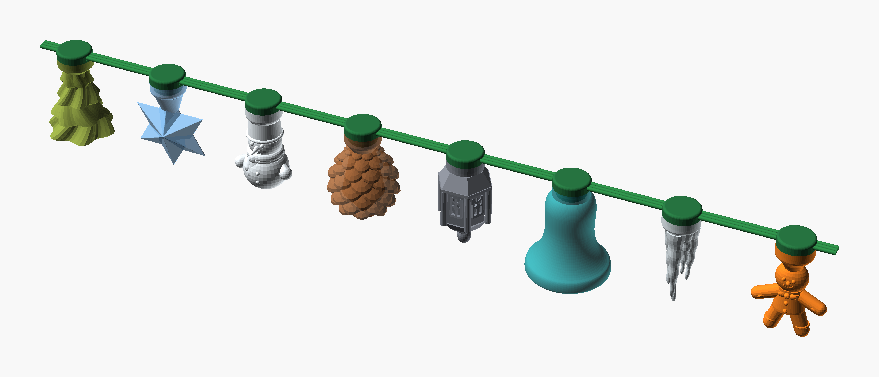
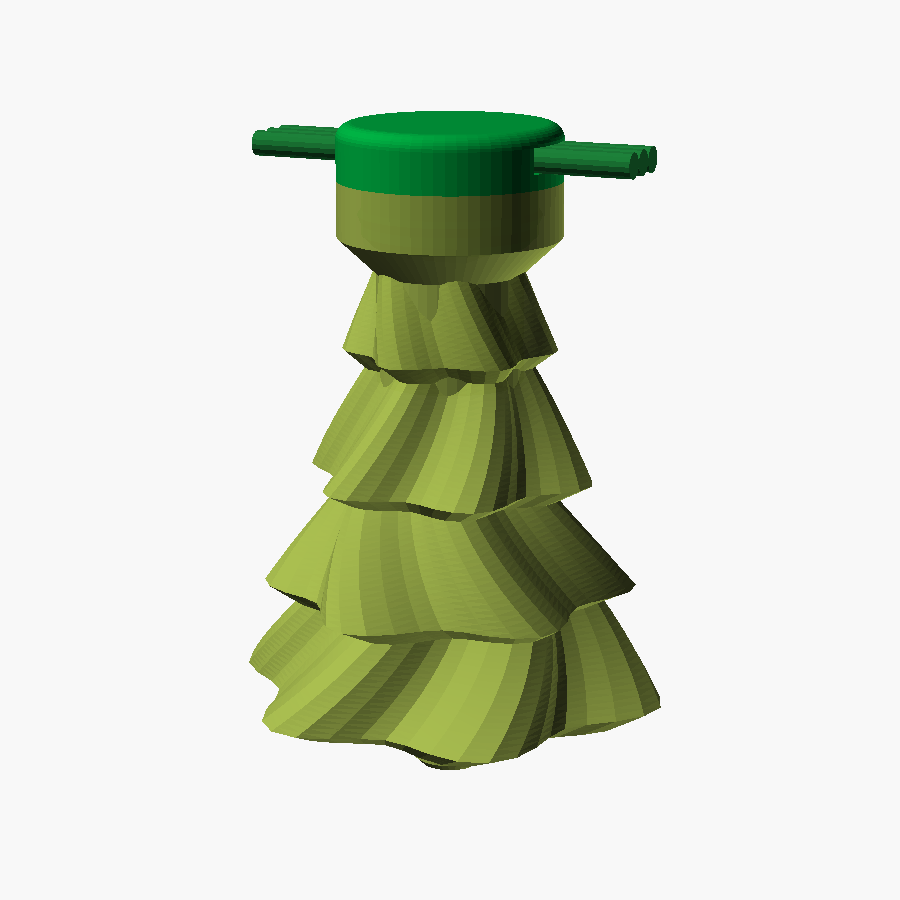
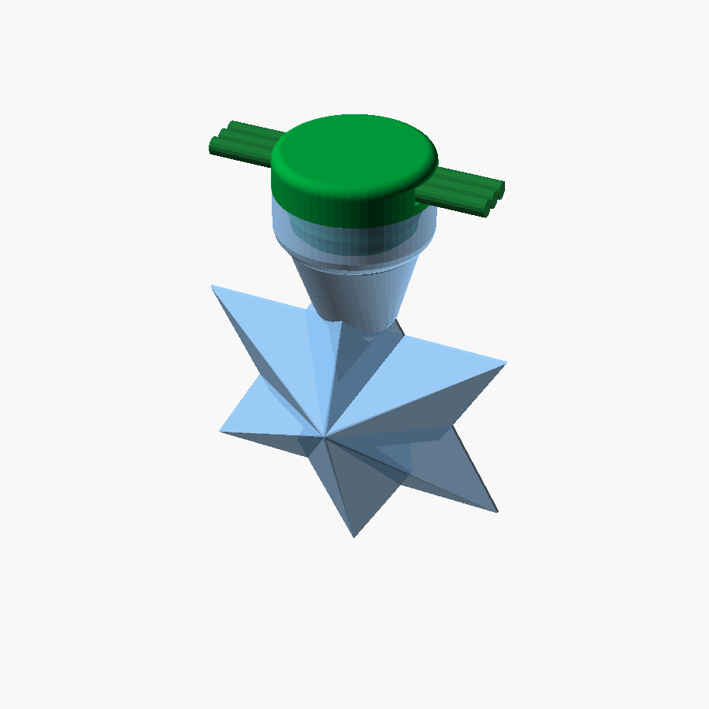
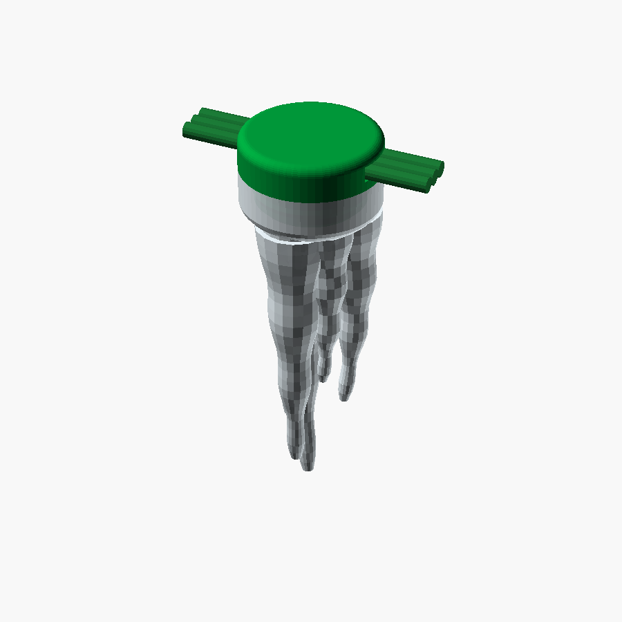
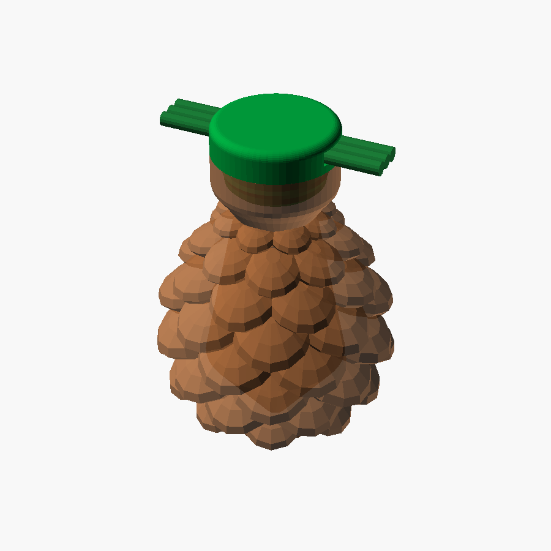
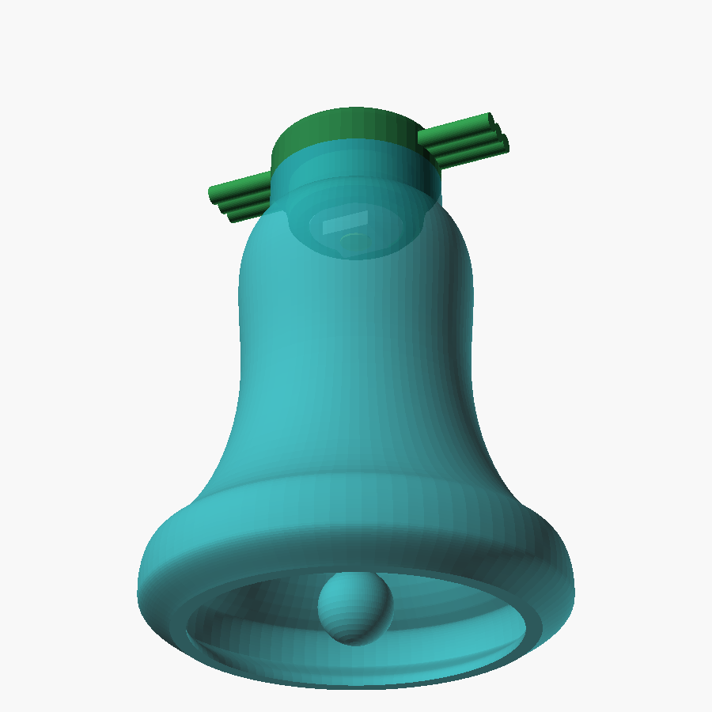
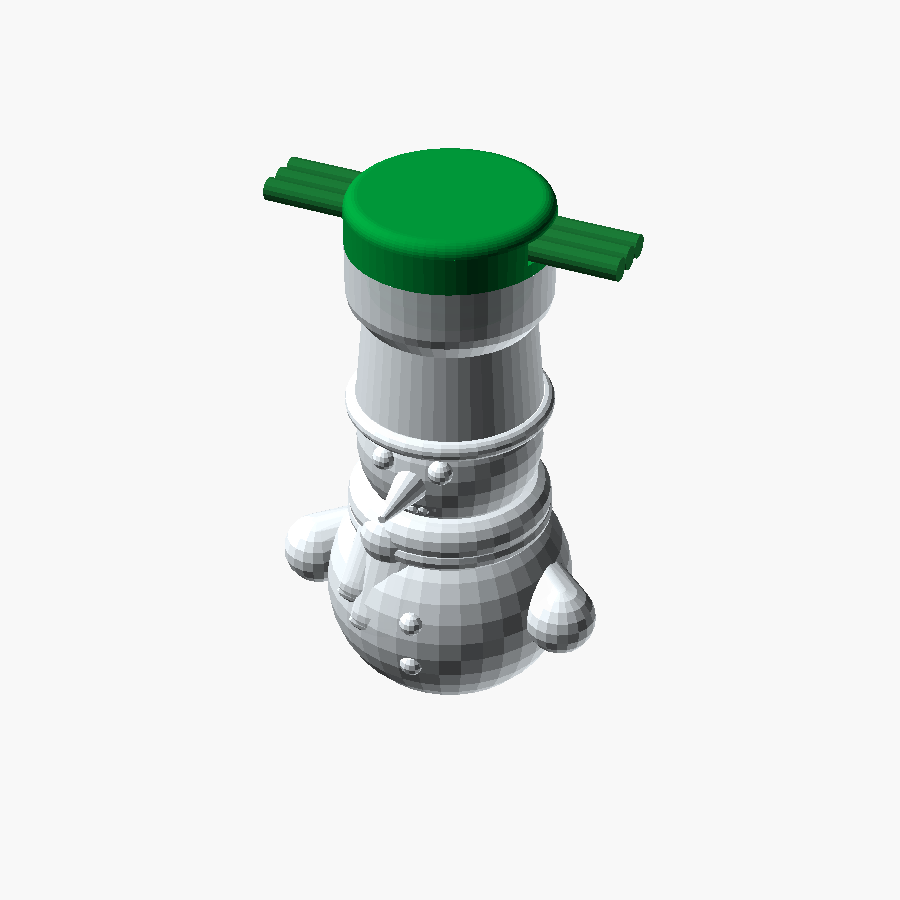
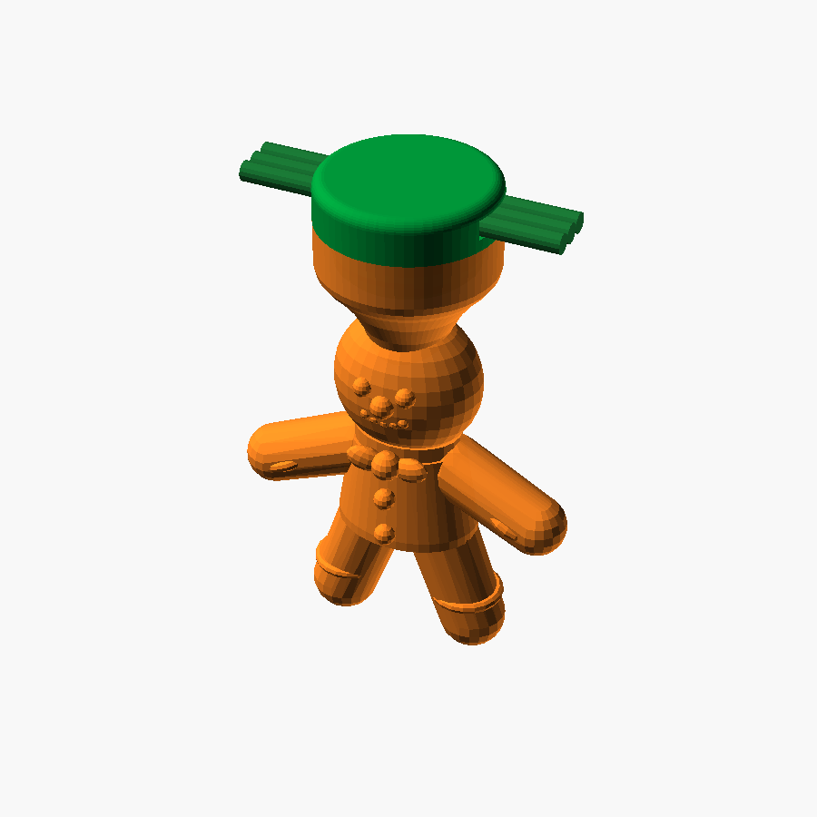
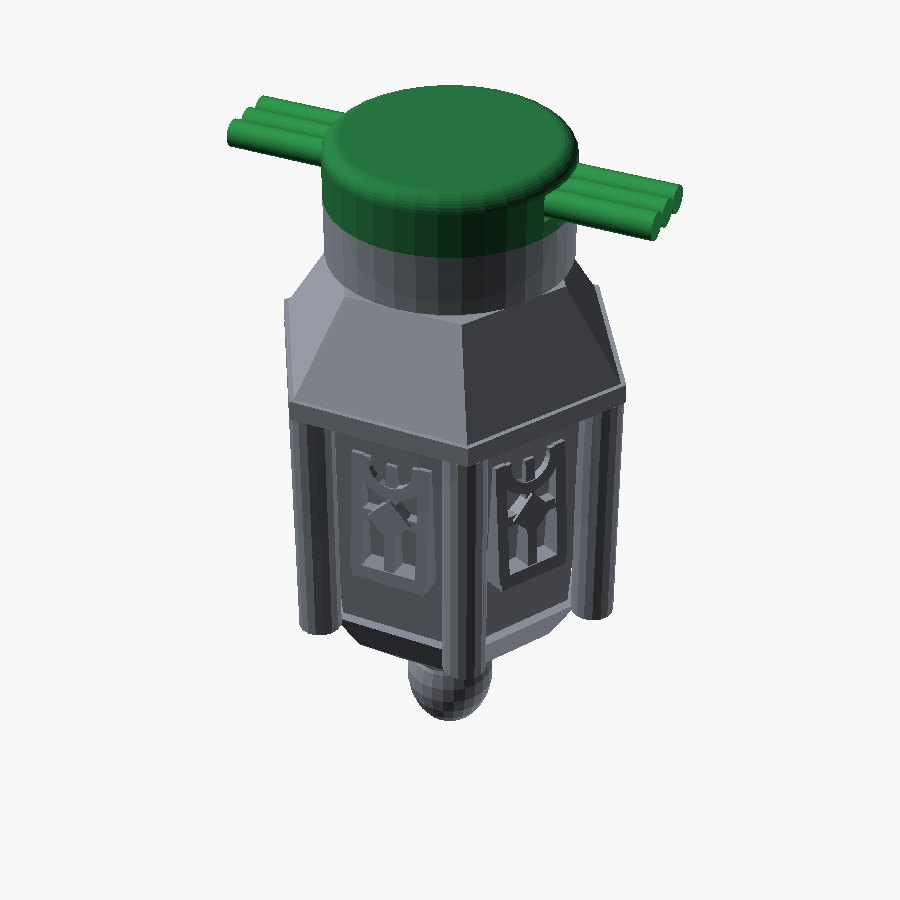

# csiGarland Optical Diffuser Figurine Catalog

This document provides visual previews, geometric descriptions, and Bambu Lab FDM 3D printing specifications for all **8 holiday diffuser figurines** in the `csiGarland` collection.

The full garland runs **32 addressable WS2812B LEDs**, populated by **4 identical copies of each of the 8 unique figurines**.

---

## 1. Garland Hanging Orientation & Power Architecture

* **Physical Mounting:** The garland is designed to hang horizontally overhead along a wall, window frame, or ceiling molding. The universal base mount sits at the **TOP** of each assembly where the 3-wire cable harness runs. All figurines hang downwards into the room in their natural, gravity-aligned posture.
* **Universal Base Mount:** All 8 diffusers share a standardized twist/snap-fit socket ([`base_mount.stl`](../../3d-model/base_mount.stl)) keying over 9.5 mm WS2812B breakout boards with hot-glue potting channels and zero through-holes. The cap socket is $0.30\text{ mm}$ deeper than the base neck, so the cap seats on the base flange and the snap ridge engages even if the socket-ceiling bridge sags. Every cap clears the 5050 chip and capacitor ($1.65\text{ mm}$ proud of the neck top, up to $r = 3.7\text{ mm}$): the hollows of the bell, tree, icicles, snowman, gingerbread man and lantern are at least $r = 4.2\text{ mm}$ wide up to that height, the pinecone's chamber starts at $r = 4.2\text{ mm}$, and the star has an $\varnothing 8.8\text{ mm}$ ($r = 4.4\text{ mm}$) clearance pocket for $2.2\text{ mm}$ above the neck.
* **50 mm Figurine Standard:** All figurines are scaled to the **50 mm height class** (~46–49 mm), providing generous volume for light diffusion and eliminating fragile paper-thin walls.
* **Even Shells, So They Glow Evenly:** A figurine glows evenly when every part of its surface has the same wall between it and the light, and no plastic stands in the light's way inside. The bell, tree, icicles, snowman, gingerbread man and lantern are each the solid of their outline less a hollow, the same outline eroded by **$1.50\text{ mm}$** (about 3 perimeters at 0.42–0.45 mm), built with [`figurine_shell.scad`](../../3d-model/figurine_shell.scad); their outsides are as they were. With 0 % infill a solid part prints as 3 walls round empty space, with top and bottom skins and floating walls inside wherever its section changes, and those shade the walls behind them. A hollow's ceiling, as the cap prints collar down, stays $35^\circ$ from the horizontal or steeper: a flatter one takes tree supports inside the closed hollow, where they can never be taken out, as the snowman, gingerbread man and bell before them did. So the wall is thicker under the few faces that are flat as the cap prints, such as the underside of the tree's lowest tier. Parts too thin to hold a hollow, such as eyes, buttons, the lantern's columns and window reliefs, stay solid. The star is an even **$1.20\text{ mm}$** shell normal to its facets; see [the star](#2-3d-faceted-magen-david) below. The pinecone keeps its overlapping solid scales; see [the pinecone](#4-natural-hanging-pinecone).
* **Reinforced Snap Collar:** Collar outer diameter is **$\varnothing 17.60\text{ mm}$**, guaranteeing **$1.425\text{ mm}$ of solid plastic** over the internal snap groove for a durable, crack-free click.
* **Hardware Power-Gating:** In standby the `YZ_CTL_V1` high-side MOSFET module cuts the +5V power rail, which removes the idle draw of the LEDs, with software current clamping to the limit set on the Device page, 1400 mA by default. The module's own off current has not been measured.

---

## 2. Complete 8-Figurine Garland Panorama

Below is the complete garland panorama showing all 8 unique holiday figurines mounted onto the continuous 3-wire cable harness:

*Figurines on the garland, from the control unit (left) on, the order the firmware's effects count them in:*
1. [Spiral Christmas Tree with Trunk](#1-spiral-christmas-tree-with-trunk), Translucent Olive
2. [3D Faceted Magen David](#2-3d-faceted-magen-david), Translucent Light Blue
3. [Cozy Winter Snowman](#6-cozy-winter-snowman), Clear
4. [Natural Hanging Pinecone](#4-natural-hanging-pinecone), Translucent Brown
5. [Vintage Holiday Lantern](#8-vintage-holiday-lantern), Translucent Gray
6. [Festive Holiday Bell](#5-festive-holiday-bell), Translucent Teal
7. [Natural Icicle Cluster](#3-natural-icicle-cluster), Clear
8. [Gingerbread Man](#7-gingerbread-man), Translucent Orange

The eight repeat four times along the cable, so the order is chosen for the loop: the two clear figurines, the icicle and the snowman, stand four places apart, as do the two warm ones, the pinecone and the gingerbread man, and the two cool ones, the star and the bell, and no two neighbours share a colour. The renders come from the models with `deploy/new-model-renders.ps1`, in the colour each model gives its filament and in this order, read from the firmware.

---

## 3. Individual Figurine Previews & Specifications

### 1. Spiral Christmas Tree with Trunk

* **Design Concept:** 4-tier spiral Christmas tree with a straight triangular outline. The narrow top hangs from the collar and 4 counter-twisting 6-lobed tiers ($\pm 26^\circ$) widen downward, ending in a slim trunk. Each tier steps back in under its rim, so the tiers read separately.
* **Narrow Top:** The $\varnothing 17.6\text{ mm}$ collar tapers below the socket to a $\varnothing 11.6\text{ mm}$ core at $Z = 7.2\text{ mm}$, where the first tier starts. The wall around the light chamber stays over $1.5\text{ mm}$.
* **Trunk Feature:** A plain $\varnothing 6.0\text{ mm}$ trunk with a small end chamfer protrudes $5.6\text{ mm}$ beneath the lowest tier.
* **Even Shell:** The tree is hollow, the tiers, their lobes and twist, the core and the trunk eroded by $1.5\text{ mm}$ (`tree_r`), where it was solid with a narrow light channel up the core. The lowest tier's flat underside is a flat ceiling as the tree prints, so the hollow closes under it at $35^\circ$ and the wall there is thicker.
* **Dimensions:** Height 48.0 mm, maximum branch skirt span 35.5 mm.
* **Recommended Filament:** Bambu PETG Translucent, Translucent Olive.
* **Source & Model:** [`figurine_tree.scad`](../../3d-model/figurine_tree.scad) → [`diffuser_cap_tree.stl`](../../3d-model/diffuser_cap_tree.stl).

---

### 2. 3D Faceted Magen David

* **Design Concept:** Authentic 6-pointed Star of David formed by two intersecting equilateral triangular prisms, creating 12 diamond facets converging at a central apex. Fully vertically symmetrical.
* **Fully Rounded Collar Dome:** The upper rim of the collar cone is smoothly rounded via a 3D spherical dome loft into the lower ray. Completely eliminates the flat horizontal shelf and sharp 90° edge!
* **Even Hollow Shell:** The star, and the neck loft below it, are a sealed shell $1.2\text{ mm}$ thick normal to every facet: the inner cavity is the same pair of faceted triangles with each face moved inward (`tri_cavity`). An $\varnothing 8.8\text{ mm}$ LED clearance pocket with a $45^\circ$ roof sits above the socket and opens, through the light bore ($\varnothing 5.6 \to 3.6\text{ mm}$), into the cavity. All facets lean $54\text{–}73^\circ$ from horizontal, so the cavity has no flat ceilings. The earlier solid rays with an ellipsoid chamber printed floating walls around the chamber floor and roof (and in the voids that 0% infill leaves in solid parts), which showed through the translucent PETG near the centre; the shell removes them (about 3600 mm of floating-wall path per star before, 48 mm now, in Bambu Studio).
* **Smooth Rounded Collar:** Continuous circular fillet ($R = 2.0\text{ mm}$) smoothly transitions collar into star ray.
* **Dimensions:** Height 49.0 mm, ray tip-to-tip span 36.4 mm, thickness 15.0 mm.
* **Recommended Filament:** Bambu PETG Translucent, Translucent Light Blue.
* **Source & Model:** [`figurine_star.scad`](../../3d-model/figurine_star.scad) → [`diffuser_cap_star.stl`](../../3d-model/diffuser_cap_star.stl).

---

### 3. Natural Icicle Cluster

* **Design Concept:** Organic cluster of 5 natural ice stalactites ranging from 23.5 to 48 mm, modeled with sinusoidal freeze-melt wave ripples and organic taper towards rounded needle tips.
* **Continuous Collar Inset & Flutes (thickness fading to zero):** Collar outer cylinder is rounded with a smooth shoulder fillet ($R = 2.0\text{ mm}$). All outer icicle streams continue downward directly onto the collar cylinder to $Z = 0.4\text{ mm}$, smoothly fading their radial thickness to exactly 0 (conformal to the cylinder). Zero overhang steps, zero flat shelves!
* **Hollow Icicles:** A cone over the socket opens into all five icicles, each a tube $1.5\text{ mm}$ inside its outline down to where it is too thin to hold one, ending in a cone at its tip, so the light reaches into every icicle; they were solid. The streams on the collar stay solid.
* **Dimensions:** Height 48.0 mm, base collar diameter 17.6 mm.
* **Recommended Filament:** Bambu PETG Translucent, Clear.
* **Source & Model:** [`figurine_icicle.scad`](../../3d-model/figurine_icicle.scad) → [`diffuser_cap_icicle.stl`](../../3d-model/diffuser_cap_icicle.stl).

---

### 4. Natural Hanging Pinecone

* **Design Concept:** Hanging pinecone inverted relative to collar: narrow stem attaches to collar, expanding across 8 checkerboard scale tiers to a closed rosette crown at the bottom.
* **Rosette Umbo Apex:** Closed rosette crown with 3 converging scale tiers (8 scales @ $42^\circ$, 6 petals @ $60^\circ$, 4 petals @ $75^\circ$) meeting at a central umbo button. Zero bare hemispheres!
* **Solid Scales:** The scales are solid and overlap, so most of the surface has several scale walls behind it, and in Bambu Studio the cone prints with many floating walls inside. Hollowing the core alone makes that worse, and the scales cannot be hollowed without flat ceilings inside them, so the pinecone stays as it is: an even glow would take a new shape of scales.
* **Dimensions:** Height 45.7 mm, maximum diameter 35.3 mm.
* **Recommended Filament:** Bambu PETG Translucent, Translucent Brown.
* **Source & Model:** [`figurine_pinecone.scad`](../../3d-model/figurine_pinecone.scad) → [`diffuser_cap_pinecone.stl`](../../3d-model/diffuser_cap_pinecone.stl).

---

### 5. Festive Holiday Bell

* **Design Concept:** Classic church bell. Below the collar a rounded crown shoulder widens to a nearly straight waist ($\varnothing 23.4\text{ mm}$), which flares to a thick rolled lip, the sound bow ($\varnothing 40.0\text{ mm}$), whose top meets the mouth at $36^\circ$. The outline is a chain of Bezier segments (`bell_segments`), and no surface, inside or out, is flatter than $35^\circ$ from the horizontal: Bambu Studio slices it with no support at all.
* **Even Shell:** The interior is cut $1.5\text{ mm}$ inside the outline everywhere (`bell_wall`). The light chamber opens straight out of the socket bore, so the socket has no ceiling, widens along the crown at $35^\circ$ and fills the crown and the waist, closing under a $45^\circ$ conical roof; a $1.6\text{ mm}$ conical plate parallel to it is the ceiling of the open mouth.
* **Clapper:** A short tapered rod ($\varnothing 4.4 \to 3.2\text{ mm}$) hangs from the apex of the mouth ceiling and ends in a $\varnothing 7.0\text{ mm}$ ball that peeks $1\text{ mm}$ out of the mouth. A $45^\circ$ cone carries the ball, so it prints without support.
* **Dimensions:** Height 49.0 mm with the clapper (lip 48.0 mm), rim diameter 40.0 mm.
* **Recommended Filament:** Bambu PETG Translucent, Translucent Teal.
* **Source & Model:** [`figurine_bell.scad`](../../3d-model/figurine_bell.scad) → [`diffuser_cap_bell.stl`](../../3d-model/diffuser_cap_bell.stl).

---

### 6. Cozy Winter Snowman

* **Design Concept:** Cozy winter snowman hanging right-side up from winter beanie hat.
* **Sculpted Holiday Scarf:** Double-wrap neck scarf with knot and 2 draped fabric ribbon tails with fringe cascading down the chest ($Z = 24.5\text{..}34.5\text{ mm}$).
* **Facial Features:** 3D coal eyes, forward-pointing carrot nose ($\varnothing 3.2\text{ mm}$ tapering to $\varnothing 0.7\text{ mm}$, length $5.8\text{ mm}$), cheerful upturned smile arc, snowball hands, coal buttons.
* **Even Shell:** Hat, head, scarf, knot, body, arms and the round at the bottom are hollow, each eroded by $1.5\text{ mm}$ (`snowman_hollow`), where the walls were $1.8\text{–}2.6\text{ mm}$ and the scarf and arms solid. The tops of the head and the body close at $35^\circ$, as their round tops took a tree of supports inside the old snowman. The eyes, nose, smile, buttons and scarf tails stay solid.
* **Dimensions:** Height 47.6 mm, hand span 30.3 mm, lower snowball diameter 22.4 mm.
* **Recommended Filament:** Bambu PETG Translucent, Clear.
* **Source & Model:** [`figurine_snowman.scad`](../../3d-model/figurine_snowman.scad) → [`diffuser_cap_snowman.stl`](../../3d-model/diffuser_cap_snowman.stl).

---

### 7. Gingerbread Man

* **Design Concept:** Plump holiday gingerbread cookie figure hanging from baker's toque hat.
* **Narrowed Stepless Collar Cone:** The collar cone tapers gracefully to $r = 3.5\text{ mm}$ at $Z = 14.0\text{ mm}$, smoothly entering completely inside the head sphere. Eliminates the flat horizontal ledge under the chin!
* **Even Shell:** Collar, head, neck and torso are hollow, each eroded by $1.5\text{ mm}$ (`cookie_hollow`), and the arms and legs are tubes with a $35^\circ$ ridge on top (`cookie_limb`), the legs' running up into the torso; the walls were $2\text{–}3\text{ mm}$ with narrow channels. Under the torso's flat underside the hollow closes at $35^\circ$. The eyes, nose, smile, bow tie, buttons and icing cuffs stay solid.
* **Protruding Icing Nose:** Sculpted round gumdrop nose ($\varnothing 2.4\text{ mm}$) positioned between gumdrop eyes and upturned sugar smile arc.
* **Cookie Details:** 3D bow tie at neck, belly buttons, welcoming open-hug arms with wavy icing cuffs, and legs with ankle cuffs.
* **Dimensions:** Height 47.9 mm, arm span 34.3 mm.
* **Recommended Filament:** Bambu PETG Translucent, Translucent Orange.
* **Source & Model:** [`figurine_gingerbread.scad`](../../3d-model/figurine_gingerbread.scad) → [`diffuser_cap_gingerbread.stl`](../../3d-model/diffuser_cap_gingerbread.stl).

---

### 8. Vintage Holiday Lantern

* **Design Concept:** Hexagonal carriage lantern with pagoda canopy and bottom acorn drop finial.
* **Upright Window Bas-Reliefs:** Inverted $180^\circ$ so that when hanging, Gothic arched headers are at the **TOP** (under canopy eaves) and flat window sills are at the **BOTTOM**. Features central vertical mullion, horizontal transom, and 4-pointed diamond star.
* **Stepless Canopy:** Tapered collar chamfer eliminates crescent steps on the 6 flat faces. The canopy starts at $\varnothing 17.6\text{ mm}$ (flat-to-flat $15.24\text{ mm}$, matching the chamfer top) and flares at $\sim 33^\circ$ from vertical, so it prints without a flat overhang ring.
* **Even Shell:** Canopy, eaves, window cage, base tray and finial are hollow, each eroded by $1.5\text{ mm}$ across its slope (`lantern_hollow`), where the walls were $2\text{–}3\text{ mm}$ and the tray and finial solid. Under the flat eaves the hollow closes at $35^\circ$. The corner columns and window reliefs stay solid.
* **Dimensions:** Height 47.5 mm, cornice width 27.2 mm.
* **Recommended Filament:** Bambu PETG Translucent, Translucent Gray.
* **Source & Model:** [`figurine_lantern.scad`](../../3d-model/figurine_lantern.scad) → [`diffuser_cap_lantern.stl`](../../3d-model/diffuser_cap_lantern.stl).

---

## 4. FDM Slicing & Manufacturing Reference Table

All models are sliced using Bambu Studio with the following verified profile parameters:

| Figurine | STL File | Height | Max OD | Layers (0.2 mm) | Wall loops | Sparse infill | Recommended Color |
|---|---|---|---|---|---|---|---|
| **Spiral Pine Tree** | [`diffuser_cap_tree.stl`](../../3d-model/diffuser_cap_tree.stl) | 48.0 mm | 35.5 mm | 240 | 3 (1.50 mm shell) | 0% | Translucent Olive |
| **3D Magen David** | [`diffuser_cap_star.stl`](../../3d-model/diffuser_cap_star.stl) | 49.0 mm | 36.4 mm | 245 | 3 (1.20 mm shell, normal to the facets) | 0% | Translucent Light Blue |
| **Icicle Cluster** | [`diffuser_cap_icicle.stl`](../../3d-model/diffuser_cap_icicle.stl) | 48.0 mm | 17.6 mm | 240 | 3 (1.50 mm shell) | 0% | Clear |
| **Hanging Pinecone** | [`diffuser_cap_pinecone.stl`](../../3d-model/diffuser_cap_pinecone.stl) | 45.7 mm | 35.3 mm | 228 | 3–4 (1.50 mm) | 0% | Translucent Brown |
| **Holiday Bell** | [`diffuser_cap_bell.stl`](../../3d-model/diffuser_cap_bell.stl) | 49.0 mm | 40.0 mm | 245 | 3 (1.50 mm shell) | 0% | Translucent Teal |
| **Cozy Snowman** | [`diffuser_cap_snowman.stl`](../../3d-model/diffuser_cap_snowman.stl) | 47.6 mm | 30.3 mm | 238 | 3 (1.50 mm shell) | 0% | Clear |
| **Gingerbread Man** | [`diffuser_cap_gingerbread.stl`](../../3d-model/diffuser_cap_gingerbread.stl) | 47.9 mm | 34.3 mm | 239 | 3 (1.50 mm shell) | 0% | Translucent Orange |
| **Vintage Lantern** | [`diffuser_cap_lantern.stl`](../../3d-model/diffuser_cap_lantern.stl) | 47.5 mm | 27.2 mm | 238 | 3 (1.50 mm shell) | 0% | Translucent Gray |
| **Base Mount** | [`base_mount.stl`](../../3d-model/base_mount.stl) | 9.4 mm | 17.6 mm | 47 | 4+ (Solid) | 100% | Opaque Dark Forest Green |
