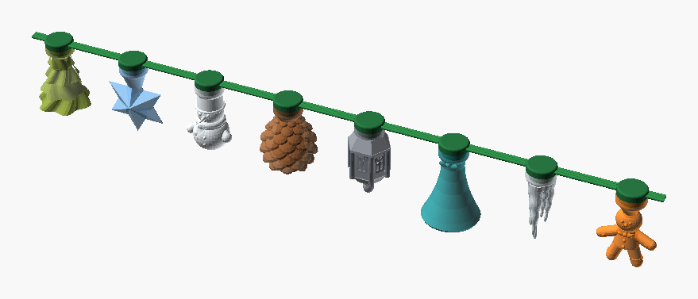
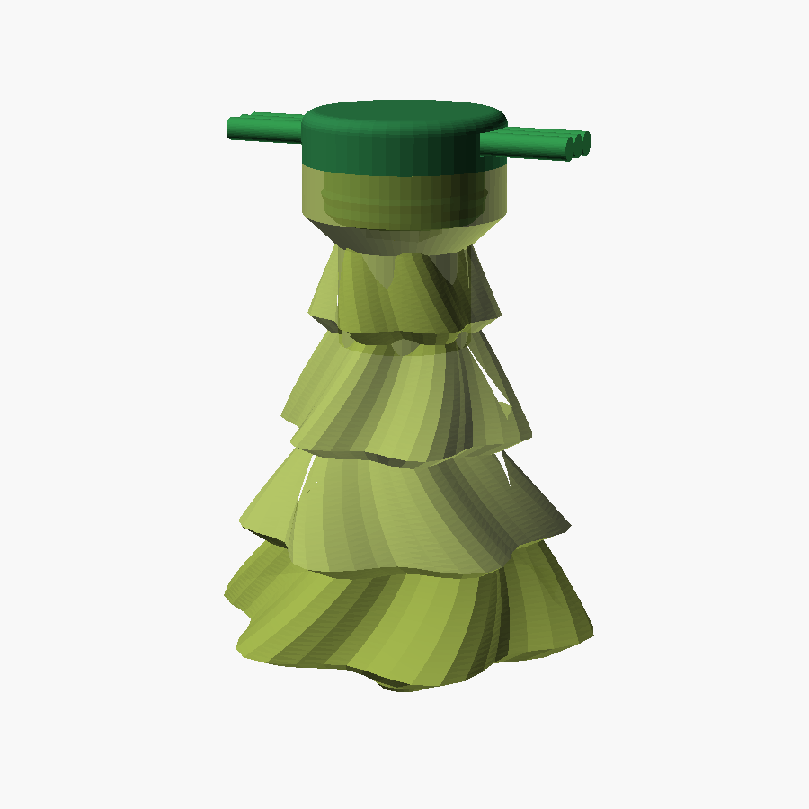
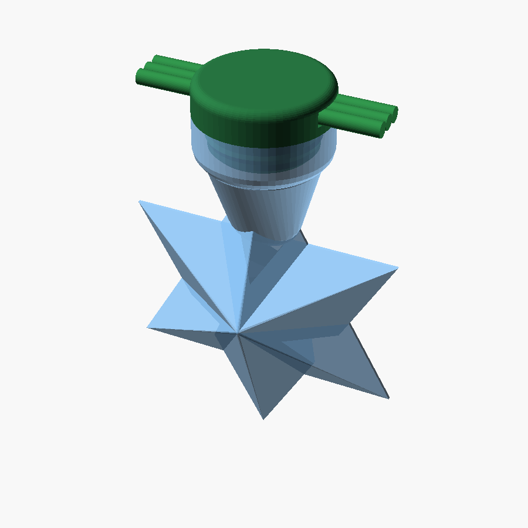
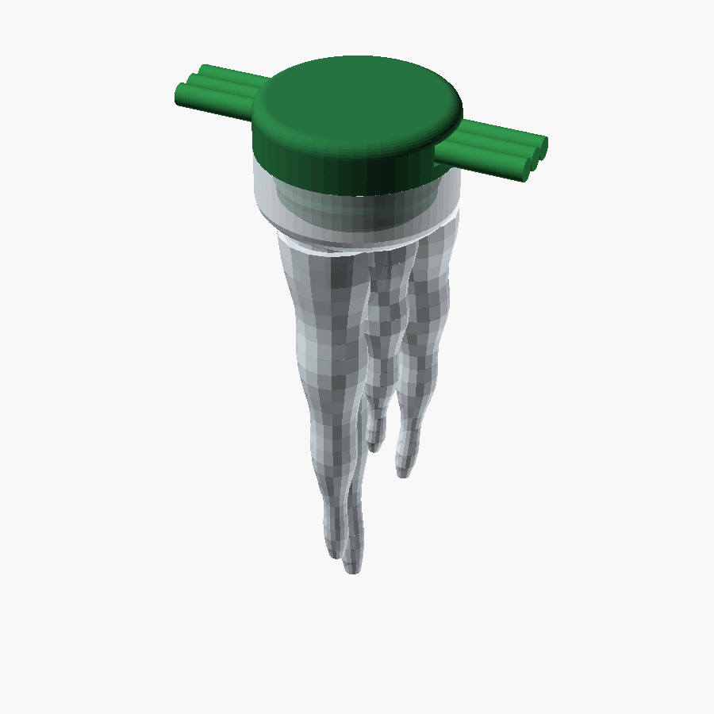
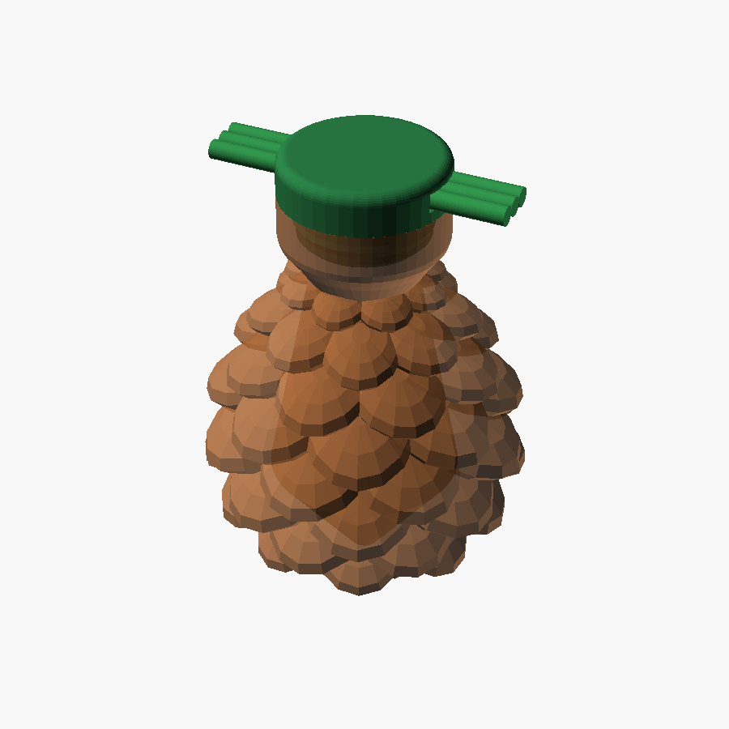
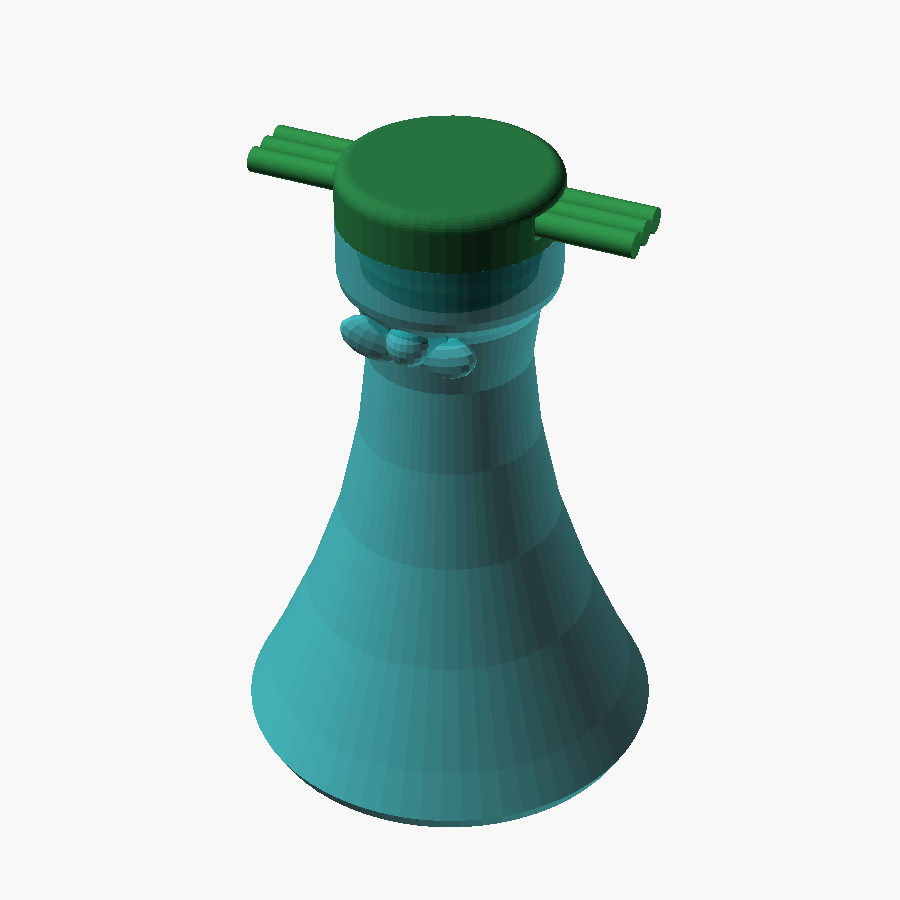
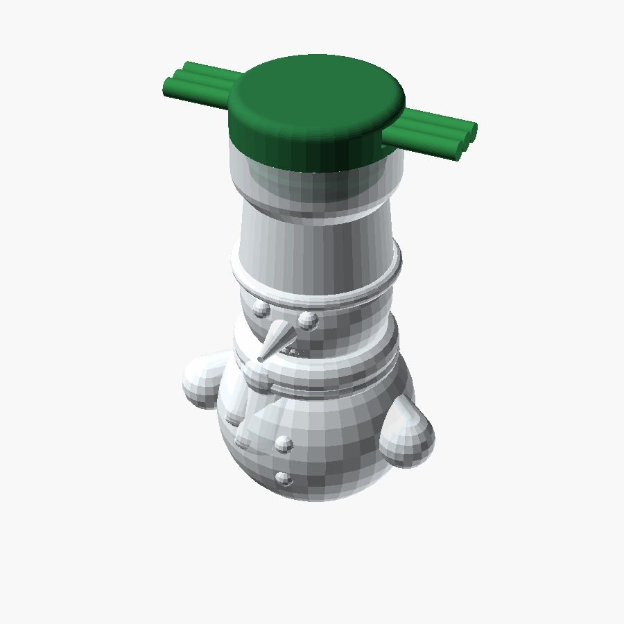
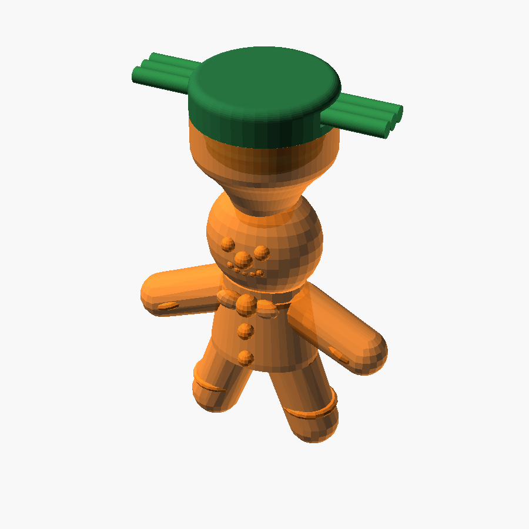
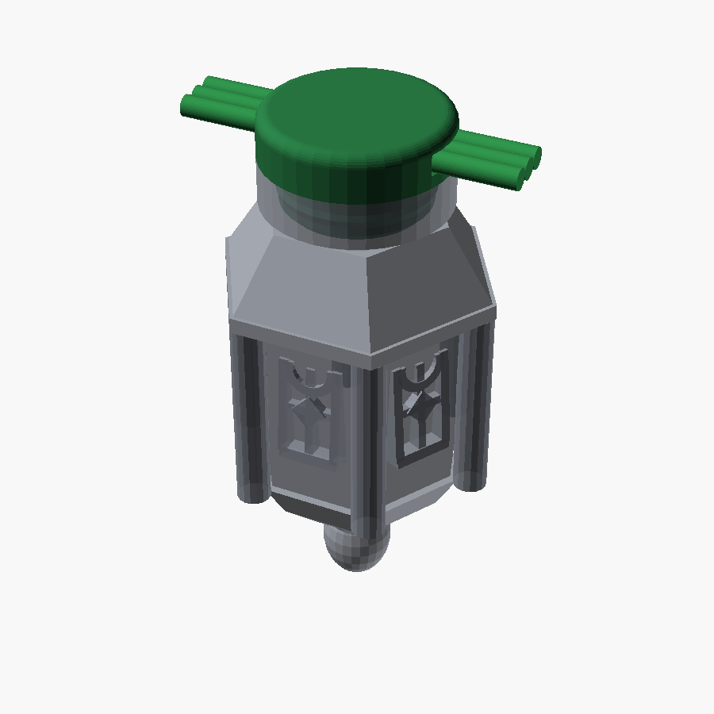

# csiGarland Optical Diffuser Figurine Catalog

This document provides visual previews, geometric descriptions, and Bambu Lab FDM 3D printing specifications for all **8 holiday diffuser figurines** in the `csiGarland` collection.

The full garland runs **32 addressable WS2812B LEDs**, populated by **4 identical copies of each of the 8 unique figurines**.

---

## 1. Garland Hanging Orientation & Power Architecture

* **Physical Mounting:** The garland is designed to hang horizontally overhead along a wall, window frame, or ceiling molding. The universal base mount sits at the **TOP** of each assembly where the 3-wire cable harness runs. All figurines hang downwards into the room in their natural, gravity-aligned posture.
* **Universal Base Mount:** All 8 diffusers share a standardized twist/snap-fit socket ([`base_mount.stl`](../../3d-model/base_mount.stl)) keying over 9.5 mm WS2812B breakout boards with hot-glue potting channels and zero through-holes. The cap socket is $0.30\text{ mm}$ deeper than the base neck, so the cap seats on the base flange and the snap ridge engages even if the socket-ceiling bridge sags. Every cap clears the 5050 chip and capacitor ($1.65\text{ mm}$ proud of the neck top, up to $r = 3.7\text{ mm}$), either through its wide lower chamber ($r_1 = 4.2\text{–}5.5\text{ mm}$) or, in the narrow-neck star and gingerbread caps, an $\varnothing 8.8\text{ mm}$ ($r = 4.4\text{ mm}$) clearance pocket for $2.2\text{ mm}$ above the neck.
* **50 mm Figurine Standard:** All figurines are scaled to the **50 mm height class** (~46–49 mm), providing generous volume for light diffusion and eliminating fragile paper-thin walls.
* **Robust Wall Thickness:** All diffuser caps but the star have a minimum wall thickness of **$\ge 1.40\text{ mm}$** (strictly **3 to 4 solid perimeter loops** on a 0.40 mm nozzle with 0.42–0.44 mm line widths). The star is an even **$1.20\text{ mm}$** shell normal to its facets, about 3 perimeters in plan, as a thicker one printed floating walls that showed through the PETG; see [the star](#2-3d-faceted-magen-david) below.
* **Reinforced Snap Collar:** Collar outer diameter is **$\varnothing 17.60\text{ mm}$**, guaranteeing **$1.425\text{ mm}$ of solid plastic** over the internal snap groove for a durable, crack-free click.
* **Hardware Power-Gating:** In standby the `YZ_CTL_V1` high-side MOSFET module cuts the +5V power rail, which removes the idle draw of the LEDs, with software current clamping to 1400 mA. The module's own off current has not been measured.

---

## 2. Complete 8-Figurine Garland Panorama

Below is the complete garland panorama showing all 8 unique holiday figurines mounted onto the continuous 3-wire cable harness:

*Figurines on the garland, from the control unit (left) on, the order the firmware's effects count them in:*
1. [Spiral Christmas Tree with Trunk](#1-spiral-christmas-tree-with-trunk), Translucent Olive
2. [3D Faceted Magen David](#2-3d-faceted-magen-david), Translucent Light Blue
3. [Cozy Winter Snowman](#6-cozy-winter-snowman), Clear
4. [Natural Hanging Pinecone](#4-natural-hanging-pinecone), Translucent Brown
5. [Vintage Holiday Lantern](#8-vintage-holiday-lantern), Translucent Gray
6. [Festive Holiday Bell](#5-festive-holiday-bell), Translucent Teal
7. [Natural Icicle Cluster](#3-natural-icicle-cluster), Clear
8. [Gingerbread Man](#7-gingerbread-man), Translucent Orange

The eight repeat four times along the cable, so the order is chosen for the loop: the two clear figurines, the icicle and the snowman, stand four places apart, as do the two warm ones, the pinecone and the gingerbread man, and the two cool ones, the star and the bell, and no two neighbours share a colour. The renders come from the models with `deploy/new-model-renders.ps1`, in the colour each model gives its filament and in this order, read from the firmware.

---

## 3. Individual Figurine Previews & Specifications

### 1. Spiral Christmas Tree with Trunk

* **Design Concept:** 4-tier spiral Christmas tree with a straight triangular outline. The narrow top hangs from the collar and 4 counter-twisting 6-lobed tiers ($\pm 26^\circ$) widen downward, ending in a slim trunk. Each tier steps back in under its rim, so the tiers read separately.
* **Narrow Top:** The $\varnothing 17.6\text{ mm}$ collar tapers below the socket to a $\varnothing 11.6\text{ mm}$ core at $Z = 7.2\text{ mm}$, where the first tier starts. The wall around the light chamber stays over $1.5\text{ mm}$.
* **Trunk Feature:** A plain $\varnothing 6.0\text{ mm}$ trunk with a small end chamfer protrudes $5.6\text{ mm}$ beneath the lowest tier.
* **Dimensions:** Height 48.0 mm, maximum branch skirt span 35.5 mm.
* **Recommended Filament:** Bambu PETG Translucent, Translucent Olive.
* **Source & Model:** [`figurine_tree.scad`](../../3d-model/figurine_tree.scad) → [`diffuser_cap_tree.stl`](../../3d-model/diffuser_cap_tree.stl).

---

### 2. 3D Faceted Magen David

* **Design Concept:** Authentic 6-pointed Star of David formed by two intersecting equilateral triangular prisms, creating 12 diamond facets converging at a central apex. Fully vertically symmetrical.
* **Fully Rounded Collar Dome:** The upper rim of the collar cone is smoothly rounded via a 3D spherical dome loft into the lower ray. Completely eliminates the flat horizontal shelf and sharp 90° edge!
* **Even Hollow Shell:** The star, and the neck loft below it, are a sealed shell $1.2\text{ mm}$ thick normal to every facet: the inner cavity is the same pair of faceted triangles with each face moved inward (`tri_cavity`). An $\varnothing 8.8\text{ mm}$ LED clearance pocket with a $45^\circ$ roof sits above the socket and opens, through the light bore ($\varnothing 5.6 \to 3.6\text{ mm}$), into the cavity. All facets lean $54\text{–}73^\circ$ from horizontal, so the cavity has no flat ceilings. The earlier solid rays with an ellipsoid chamber printed floating walls around the chamber floor and roof (and in the voids that 0% infill leaves in solid parts), which showed through the translucent PETG near the centre; the shell removes them (about 3600 mm of floating-wall path per star before, 48 mm now, in Bambu Studio).
* **Smooth Rounded Collar:** Continuous circular fillet ($R = 2.0\text{ mm}$) smoothly transitions collar into star ray.
* **Dimensions:** Height 49.0 mm, ray tip-to-tip span 36.4 mm, thickness 15.0 mm.
* **Recommended Filament:** Bambu PETG Translucent, Translucent Light Blue.
* **Source & Model:** [`figurine_star.scad`](../../3d-model/figurine_star.scad) → [`diffuser_cap_star.stl`](../../3d-model/diffuser_cap_star.stl).

---

### 3. Natural Icicle Cluster

* **Design Concept:** Organic cluster of 5 natural ice stalactites ranging from 23.5 to 48 mm, modeled with sinusoidal freeze-melt wave ripples and organic taper towards rounded needle tips.
* **Continuous Collar Inset & Flutes (thickness fading to zero):** Collar outer cylinder is rounded with a smooth shoulder fillet ($R = 2.0\text{ mm}$). All outer icicle streams continue downward directly onto the collar cylinder to $Z = 0.4\text{ mm}$, smoothly fading their radial thickness to exactly 0 (conformal to the cylinder). Zero overhang steps, zero flat shelves!
* **Optical Spreader:** The inner domed ceiling serves as an optical light distributor, guiding LED flux into all five stalactite light guides.
* **Dimensions:** Height 48.0 mm, base collar diameter 17.6 mm.
* **Recommended Filament:** Bambu PETG Translucent, Clear.
* **Source & Model:** [`figurine_icicle.scad`](../../3d-model/figurine_icicle.scad) → [`diffuser_cap_icicle.stl`](../../3d-model/diffuser_cap_icicle.stl).

---

### 4. Natural Hanging Pinecone

* **Design Concept:** Hanging pinecone inverted relative to collar: narrow stem attaches to collar, expanding across 8 checkerboard scale tiers to a closed rosette crown at the bottom.
* **Rosette Umbo Apex:** Closed rosette crown with 3 converging scale tiers (8 scales @ $42^\circ$, 6 petals @ $60^\circ$, 4 petals @ $75^\circ$) meeting at a central umbo button. Zero bare hemispheres!
* **Dimensions:** Height 45.7 mm, maximum diameter 35.3 mm.
* **Recommended Filament:** Bambu PETG Translucent, Translucent Brown.
* **Source & Model:** [`figurine_pinecone.scad`](../../3d-model/figurine_pinecone.scad) → [`diffuser_cap_pinecone.stl`](../../3d-model/diffuser_cap_pinecone.stl).

---

### 5. Festive Holiday Bell

* **Design Concept:** Flared holiday trumpet bell with festive ribbon bows on both front and back sides ($Z = 7.4\text{ mm}$).
* **Solid Clapper Anchor:** Internal light chamber terminates at $Z = 15.0\text{ mm}$, leaving a **$9.0\text{ mm}$ thick solid plastic ceiling** before the bell mouth floor ($Z = 24.0\text{ mm}$). Rigid $\varnothing 3.4\text{ mm}$ rod deeply anchors the $\varnothing 7.6\text{ mm}$ clapper ball (1 single manifold body, zero island slicing!).
* **Dimensions:** Height 48.0 mm, bell rim diameter 34.8 mm.
* **Recommended Filament:** Bambu PETG Translucent, Translucent Teal.
* **Source & Model:** [`figurine_bell.scad`](../../3d-model/figurine_bell.scad) → [`diffuser_cap_bell.stl`](../../3d-model/diffuser_cap_bell.stl).

---

### 6. Cozy Winter Snowman

* **Design Concept:** Cozy winter snowman hanging right-side up from winter beanie hat.
* **Sculpted Holiday Scarf:** Double-wrap neck scarf with knot and 2 draped fabric ribbon tails with fringe cascading down the chest ($Z = 24.5\text{..}34.5\text{ mm}$).
* **Facial Features:** 3D coal eyes, forward-pointing carrot nose ($\varnothing 3.2\text{ mm}$ tapering to $\varnothing 0.7\text{ mm}$, length $5.8\text{ mm}$), cheerful upturned smile arc, snowball hands, coal buttons.
* **Dimensions:** Height 47.6 mm, hand span 30.3 mm, lower snowball diameter 22.4 mm.
* **Recommended Filament:** Bambu PETG Translucent, Clear.
* **Source & Model:** [`figurine_snowman.scad`](../../3d-model/figurine_snowman.scad) → [`diffuser_cap_snowman.stl`](../../3d-model/diffuser_cap_snowman.stl).

---

### 7. Gingerbread Man

* **Design Concept:** Plump holiday gingerbread cookie figure hanging from baker's toque hat.
* **Narrowed Stepless Collar Cone:** The collar cone tapers gracefully to $r = 3.5\text{ mm}$ at $Z = 14.0\text{ mm}$, smoothly entering completely inside the head sphere. Eliminates the flat horizontal ledge under the chin! An $\varnothing 8.8\text{ mm}$ LED clearance pocket with a $45^\circ$ roof sits directly above the socket.
* **Zero Through-Hole Solid Neck:** Reinforced with an outer solid neck connector cylinder ($r = 5.5\text{ mm}$), while restricting the internal light connecting tunnel through the neck to $\varnothing 3.8\text{ mm}$ ($r = 1.9\text{ mm}$). Leaves $\ge 2.6\text{ mm}$ of solid plastic in front and back everywhere; zero cutouts, zero through-holes!
* **Protruding Icing Nose:** Sculpted round gumdrop nose ($\varnothing 2.4\text{ mm}$) positioned between gumdrop eyes and upturned sugar smile arc.
* **Cookie Details:** 3D bow tie at neck, belly buttons, welcoming open-hug arms with wavy icing cuffs, and legs with ankle cuffs. Continuous internal light channel.
* **Dimensions:** Height 47.9 mm, arm span 34.3 mm.
* **Recommended Filament:** Bambu PETG Translucent, Translucent Orange.
* **Source & Model:** [`figurine_gingerbread.scad`](../../3d-model/figurine_gingerbread.scad) → [`diffuser_cap_gingerbread.stl`](../../3d-model/diffuser_cap_gingerbread.stl).

---

### 8. Vintage Holiday Lantern

* **Design Concept:** Hexagonal carriage lantern with pagoda canopy and bottom acorn drop finial.
* **Upright Window Bas-Reliefs:** Inverted $180^\circ$ so that when hanging, Gothic arched headers are at the **TOP** (under canopy eaves) and flat window sills are at the **BOTTOM**. Features central vertical mullion, horizontal transom, and 4-pointed diamond star.
* **Stepless Canopy:** Tapered collar chamfer eliminates crescent steps on the 6 flat faces. The canopy starts at $\varnothing 17.6\text{ mm}$ (flat-to-flat $15.24\text{ mm}$, matching the chamfer top) and flares at $\sim 33^\circ$ from vertical, so it prints without a flat overhang ring.
* **Dimensions:** Height 47.5 mm, cornice width 27.2 mm.
* **Recommended Filament:** Bambu PETG Translucent, Translucent Gray.
* **Source & Model:** [`figurine_lantern.scad`](../../3d-model/figurine_lantern.scad) → [`diffuser_cap_lantern.stl`](../../3d-model/diffuser_cap_lantern.stl).

---

## 4. FDM Slicing & Manufacturing Reference Table

All models are sliced using Bambu Studio with the following verified profile parameters:

| Figurine | STL File | Height | Max OD | Layers (0.2 mm) | Wall loops | Sparse infill | Recommended Color |
|---|---|---|---|---|---|---|---|
| **Spiral Pine Tree** | [`diffuser_cap_tree.stl`](../../3d-model/diffuser_cap_tree.stl) | 48.0 mm | 35.5 mm | 240 | 3–4 (1.50 mm) | 0% | Translucent Olive |
| **3D Magen David** | [`diffuser_cap_star.stl`](../../3d-model/diffuser_cap_star.stl) | 49.0 mm | 36.4 mm | 245 | 3 (1.20 mm shell, normal to the facets) | 0% | Translucent Light Blue |
| **Icicle Cluster** | [`diffuser_cap_icicle.stl`](../../3d-model/diffuser_cap_icicle.stl) | 48.0 mm | 17.6 mm | 240 | 3–4 (1.40 mm) | 0% | Clear |
| **Hanging Pinecone** | [`diffuser_cap_pinecone.stl`](../../3d-model/diffuser_cap_pinecone.stl) | 45.7 mm | 35.3 mm | 228 | 3–4 (1.50 mm) | 0% | Translucent Brown |
| **Holiday Bell** | [`diffuser_cap_bell.stl`](../../3d-model/diffuser_cap_bell.stl) | 48.0 mm | 34.8 mm | 240 | 3–4 (1.40 mm) | 0% | Translucent Teal |
| **Cozy Snowman** | [`diffuser_cap_snowman.stl`](../../3d-model/diffuser_cap_snowman.stl) | 47.6 mm | 30.3 mm | 238 | 3–4 (1.40 mm) | 0% | Clear |
| **Gingerbread Man** | [`diffuser_cap_gingerbread.stl`](../../3d-model/diffuser_cap_gingerbread.stl) | 47.9 mm | 34.3 mm | 239 | 3–4 (1.40 mm) | 0% | Translucent Orange |
| **Vintage Lantern** | [`diffuser_cap_lantern.stl`](../../3d-model/diffuser_cap_lantern.stl) | 47.5 mm | 27.2 mm | 238 | 3–4 (1.40 mm) | 0% | Translucent Gray |
| **Base Mount** | [`base_mount.stl`](../../3d-model/base_mount.stl) | 9.4 mm | 17.6 mm | 47 | 4+ (Solid) | 100% | Opaque Dark Forest Green |
