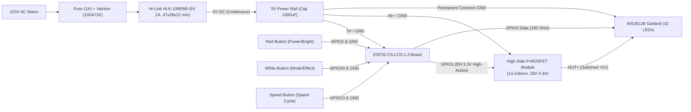

# csiGarland Hardware Specification

## 1. System Overview

csiGarland is an autonomous holiday garland system featuring:
- **Controller:** Waveshare ESP32-C6-LCD-1.3 (ESP32-C6FH4 RISC-V @ 160 MHz, PCB 26.25 × 30.0 mm, 8.95 mm thick including the 4× M2 standoffs).
- **Display:** Onboard 1.3" IPS LCD (ST7789V2, 240×240 pixels, 4-wire SPI).
- **Power Supply:** Hi-Link HLK-10M05B (5V 2A, 10W isolated AC-DC module, dimensions 47 × 28 × 22 mm).
- **Power Switch:** Ultra-miniature High-Side P-MOSFET module (13.2 × 6.0 × 2.0 mm, 20V 4.3A 31W, 2 ms response) gating the +5V LED rail, to remove the idle draw of the LEDs in standby.
- **Light Source:** 32x addressable WS2812B LEDs (8 unique holiday figurines × 4 copies each) on miniature 9×9×2.5 mm breakout boards.
- **Diffusers:** Hollow 50 mm holiday figurines 3D-printed in translucent PETG with standardized snap-fit collars (OD 17.6 mm).
- **Input:** Three tactile push-buttons (Red on GPIO 3: power on / brightness cycle / long press off with a countdown; White on GPIO 20: effect cycle / double click to the first / long press starts or stops the playlist; Speed on GPIO 23: effect speed cycle / long press to 1x) + onboard 1.3" display UI + Wi-Fi Web Server. Firmware updates are wireless (OTA); USB is not brought out of the enclosure.
- **Detailed Control Unit Design:** See [`control-unit.md`](control-unit.md). To build one: [Building the Hardware](../guides/hardware.md).



---

## 2. Power Budget Analysis

### 2.1 Available Power
* **Hi-Link 5V 2A:** Rated output power is **10 W** continuous (2000 mA @ 5V).

### 2.2 System Consumption Breakdown
Estimates from the datasheets, but for one LED: a WS2812B of the owner's garland, measured on its own on the garland's plug, draws 0.51 mA dark and 36.6 mA at full white, 12.3, 11.5 and 12.2 mA above dark for red, green and blue. The firmware's default allows 40 mA above 1 mA dark, for a batch's spread. The rest has not been measured on an assembled garland yet: see the [roadmap](../stubs/ROADMAP.md).

| Subsystem | Typical Current | Peak Current | Power (5V) |
|---|---|---|---|
| **ESP32 + Display** | 120–180 mA | ~250 mA (Wi-Fi active) | ~0.9 W |
| **32x WS2812B (Holiday Effects)** | 480–700 mA | ~960 mA | ~3.5 W |
| **32x WS2812B (Standby via MOSFET)** | The module's off current, not yet measured | | ~0 W |
| **32x WS2812B (100% White)**| — | ~1170 mA as measured on one LED, 1312 mA by the firmware's default model | ~6.6 W |

### 2.3 Operating Margins & Software Current Limiting
* In typical holiday dynamic modes (Fireplace, Twinkle, Aurora, Snowfall, Candy Cane), 32 LEDs consume around **600–700 mA**.
* Together with the ESP32 and display (~200 mA), total system draw is **~850 mA** (only **42%** of the Hi-Link capacity).
* **Firmware Safety Clamp:** The firmware incorporates a strict software current limiter, which scales the final frame down before it is sent. Its limit is worked out from the Device page's settings: what the supply gives beyond 250 mA kept for the ESP32 and display, its peak, less a margin of 5-20 % of that, so **1400 mA** with the Hi-Link's 2000 mA and the default 20 %. It covers the LEDs alone, by its model, and the ESP32 and display come on top: at their ~250 mA peak that is ~1650 mA, which leaves ~350 mA (about 17%) of the Hi-Link's 2000 mA. At the smallest margin, 5 %, the limit is 1662 mA and ~88 mA is left at the board's peak: as the margin is taken after the board, it is always 5 % of what the LEDs may have, never eaten by the board. Until the current is measured on an assembled garland, this margin is a calculation.

---

## 3. Hardware Power-Gating Architecture (High-Side MOSFET Module)

### 3.1 Module Specifications & Form Factor
The system utilizes an ultra-compact High-Side MOSFET power switch module:
* **Dimensions:** 13.2 mm (L) × 6.0 mm (W) × 2.0 mm (H) with 1.0 mm FR4 PCB.
* **Pin Pitch:** Standard 2.54 mm (0.1") pitch, suitable for wire soldering or header mounting.
* **Electrical Ratings:**
  - Maximum Controlled Voltage: **20 V** (operates at 5 V).
  - Maximum Continuous Current: **4.3 A** (operates at max 1.4 A, providing a >300% safety margin).
  - Maximum Power: **31 W** (operates at max 7.0 W).
  - Switching Response Time: **2 ms**.
  - Standby Quiescent Draw: expected to be very low, which removes the 25–30 mA quiescent drain of idle WS2812B chips. The real off current has not been measured.

### 3.2 Pinout & Signal Connections
```
     Input / Control Side                Power Output Side
        ┌───────────────┐               ┌───────────────┐
 [EN] ──┤ 1 (Top)       │   U1 (P-FET)  │       (Top) 1 ├── [OUT+] (Switched +5V to Garland)
[GND] ──┤ 2 (Bottom)    │   Q2 (Driver) │    (Bottom) 2 ├── [IN+]  (Continuous +5V from Hi-Link)
        └───────────────┘               └───────────────┘
          Pitch 2.54mm                    Pitch 2.54mm
```

* **`EN/PWM` (Pin 1 Input):** High-active trigger input ($0.7\text{–}6.0\text{ V}$). Driven directly by ESP32-C6 **GPIO 1** (3.3V logic). A 10 kΩ pull-down from `EN` to `GND` keeps the rail off while GPIO 1 floats during reset and boot.
  - Logic HIGH ($3.3\text{ V}$): Internal driver pulls P-MOSFET gate to GND $\rightarrow$ switch turns ON ($V_{OUT+} = V_{IN+} = 5\text{ V}$).
  - Logic LOW ($0\text{ V}$): P-MOSFET gate pulled up to $V_{IN+}$ $\rightarrow$ switch turns completely OFF ($V_{OUT+} = 0\text{ V}$).
* **`GND` (Pin 2 Input):** Reference ground for the gate driver circuit. Connected to system common ground.
* **`IN+` (Pin 2 Power):** Connects directly to the +5V output of the Hi-Link HLK-10M05B power supply.
* **`OUT+` (Pin 1 Power):** Connects to the +5V power conductor of the 32-LED garland cable.

### 3.3 Critical Architectural Benefits: High-Side vs. Low-Side Switching
1. **Permanent Common Ground Preservation:**
   Because switching occurs on the positive rail (`IN+` to `OUT+`), **Garland Ground and ESP32 Ground are bonded permanently**.
   In low-side (GND) switching, cutting ground while +5V remains connected causes parasitic current to backfeed from +5V through the WS2812B internal ESD protection diodes into the MCU GPIO data pin. This causes "ghost glowing", pin damage, and unstable resets.
   **High-side switching eliminates this failure mode entirely.**
2. **Safe Power Sequencing in Firmware:**
   To guarantee zero voltage transients and zero backfeeding:
   - **Power ON Sequence:**
     1. Set GPIO 2 (`DIN`) to `LOW` (0V).
     2. Assert GPIO 1 (`MOSFET_EN`) to `HIGH` (3.3V).
     3. Delay 10 ms (permits bulk capacitor charge-up and LED controller stabilization).
     4. Enable RMT hardware peripheral and commence dynamic lighting data transmission.
   - **Power OFF Sequence:**
     1. Transmit `RGB(0, 0, 0)` blackout frame.
     2. De-assert / float GPIO 2 (`DIN`) to `LOW` (0V).
     3. Assert GPIO 1 (`MOSFET_EN`) to `LOW` (0V).
     4. WS2812B power rail drops to about 0 V, leaving only the module's off current, which has not been measured.

---

## 4. Electrical Schematics and Wiring

### 4.1 AC Mains Safety
* **Fuse:** 1A 250V fast-acting fuse on the AC Phase line before the Hi-Link module.
* **Varistor (MOV):** 10D471K connected across AC Phase and Neutral to absorb voltage spikes.
* **Isolation:** The high-voltage AC section must be completely separated inside the enclosure with appropriate creepage distances (>6 mm).

### 4.2 Low Voltage 5V Rail & Pin Mapping
* **Bulk Capacitor:** 470–1000 µF (10V–16V) low-ESR electrolytic capacitor across 5V and GND at the entrance to the LED garland.
* **Garland Data Line (GPIO 2):** 330–470 Ω series resistor placed on GPIO 2 close to the first LED to dampen transmission line reflections.
* **Red Button (GPIO 3):** Momentary tactile push button connected between GPIO 3 and GND with internal pull-up (`INPUT_PULLUP`). Controls Power ON/OFF and brightness step.
* **White Button (GPIO 20):** Momentary tactile push button connected between GPIO 20 and GND with internal pull-up (`INPUT_PULLUP`). Controls effect cycling.
* **Speed Button (GPIO 23):** Momentary tactile push button connected between GPIO 23 and GND with internal pull-up (`INPUT_PULLUP`). Cycles the effect speed 0.25×–3×.
* **Common Ground:** ESP32 board GND, Hi-Link GND, MOSFET module GND, and Garland GND are permanently bonded.

| Interface / Signal | ESP32-C6 GPIO | Hardware Function |
|---|---|---|
| **ST7789 MOSI** | GPIO 6 | Onboard SPI Display Data |
| **ST7789 SCK** | GPIO 7 | Onboard SPI Display Clock |
| **ST7789 CS** | GPIO 14 | Onboard SPI Display Chip Select |
| **ST7789 DC** | GPIO 15 | Onboard Display Data/Command |
| **ST7789 RST** | GPIO 21 | Onboard Display Reset |
| **ST7789 BL** | GPIO 22 | Onboard Display Backlight |
| **Onboard RGB** | GPIO 8 | WS2812 status indicator on board |
| **Garland DIN** | GPIO 2 | 32x WS2812B Chain Output (via 330 Ω) |
| **Red Button** | GPIO 3 | Power Toggle & Brightness Step (internal pull-up) |
| **White Button** | GPIO 20 | Effect cycle (internal pull-up) |
| **Speed Button** | GPIO 23 | Effect Speed Cycle: 0.25x, 0.5x, 0.75x, 1x, 1.5x, 2x, 3x (internal pull-up) |
| **Garland Power Gate** | GPIO 1 | High-Side MOSFET EN control (High-Active) |

### 4.3 Control Enclosure Dimensions Envelope
The controller enclosure (122.0 × 68.0 × 35.0 mm, base tub + lid control panel) integrates:
* **Hi-Link HLK-10M05B module:** 47.0 mm (L) × 28.0 mm (W) × 22.0 mm (H) in a 47.5 × 28.5 mm bay on 4.0 mm corner shoulders, retained by the lid ribs.
* **ESP32-C6-LCD-1.3 board:** PCB 26.25 × 30.0 mm, 8.95 mm thick, screwed to four floor posts through its M2 standoffs; 23.6 × 23.6 mm bevelled display window with the glass 1.0 mm behind the panel.
* **High-Side MOSFET Module:** 13.2 mm (L) × 6.0 mm (W) × 2.0 mm (H) in a latch cradle next to the partition.
* **Three Tactile Buttons:** 3x 12 × 12 mm switches on solid pedestals with factory snap-on round caps (head Ø11.5 mm, total height 12.0 mm) on single-rib pedestals with free leg/solder wells — Red (`POWER`), White (`EFFECT`), Blue/Black (`SPEED`).
* **AC Bay:** enclosed 5×20 mm 1 A fuse holder, 10D471K MOV, XT60H-F inlet, Hi-Link; separated from the DC bay by a solid 2.0 mm partition.
* **Connectors & Cable Access:** detachable 220 V AC inlet (Amass XT60H-F with rear sheath in the prototype, which the enclosure is designed around; [do not buy it for this, as it has no approval for mains](control-unit.md#1-power-inlet-amass-xt60h-f-female-with-sheath-left-wall)) and detachable 3-pin garland output header (JST-XH-3A: +5V_SW, DIN, GND). The shell has no vents or service holes; firmware updates are performed wirelessly via OTA.
* **Labels:** all connectors and buttons are labelled on the enclosure: two-colour flush inlays on the panel (logo `csi` white + `Garland` sky blue, `POWER`/`SPEED` white, `EFFECT` sky blue), engraved `220V~ INSIDE`, raised `AC 220V~` / `LED OUT` on the side walls.
* **Fasteners:** M3 heat-set inserts in four lid corner posts, 4× M3 × 6 button-head screws from the bottom (no screw holes in the panel).
* Full mechanical description: [`control-unit.md`](control-unit.md), sections 7–8.
